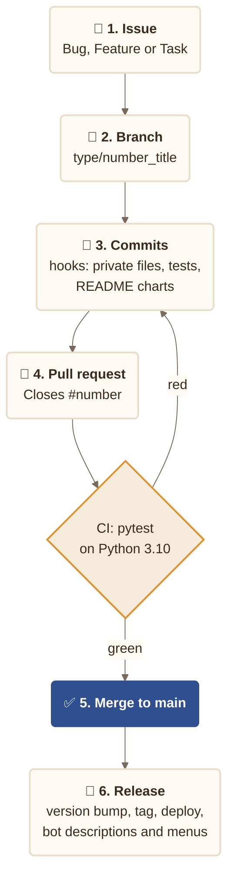

# Contributing

How to run Caccometro on your machine, test it and send a change. The code, the comments, the issues and the pull requests are in English; the bot speaks Italian and English.

## Run the bot locally

You need Python 3.10 or newer (production uses 3.10: the dependencies must stay compatible with it).

### 1. Virtual environment and dependencies

| System            | Create the environment  | Activate it                 |
| :---------------- | :---------------------- | :-------------------------- |
| **Linux / macOS** | `python3 -m venv .venv` | `source .venv/bin/activate` |
| **Windows**       | `python -m venv .venv`  | `.\.venv\Scripts\activate`  |

```bash
pip install -r requirements-dev.txt   # the bot dependencies plus pytest
git config core.hooksPath .githooks   # once per clone: see Git hooks
```

### 2. A test bot

Create your own bot on @BotFather and disable its Group Privacy, as in [docs/deployment.md](docs/deployment.md#telegram-setup). The menus and descriptions are optional for a test bot.

### 3. The `.env` file

Copy `.env.example` to `.env` and fill in your values. `.env` is excluded from Git: never commit it.

```env
BOT_USERNAME = '@username_bot'
BOT_TOKEN = '123456:ABC-DEF1234ghIkl-zyx57W2v1u123ew11'
WEBHOOK_SECRET = 'a_long_random_string'   # production only: letters, digits, _ and -
HOSTING_USERNAME = 'your_hosting_username' # scripts/set_webhook.py and tools/ only
ALERT_CHAT_ID = '123456789'                # tools/ only: your Telegram user ID, for the alerts
RUN_MODE = 'POLLING'                       # 'POLLING' locally, 'WEBHOOK' in production
```

### 4. Start

```bash
python -m caccometro
```

In polling mode the bot asks Telegram for the updates itself: no public server is needed. Stop it with `CTRL+C`. The databases are created in `db/` (one per chat) and the log in `caccometro.log`, always in the project folder, whatever folder the bot starts from.

## Tests

```bash
python -m pytest -q
```

The tests (in `tests/`) do not call Telegram: they use temporary databases and fake objects, and write the log to a temporary folder. They cover commands, message counting, schema migration, records, statistics, trophies, charts, webhook, retries and translations. `tests/test_docs.py` also checks that the documentation matches the code: every command in the README table and in the menu table of [docs/deployment.md](docs/deployment.md), every module in [docs/architecture.md](docs/architecture.md), every variable in `.env.example`, every service script in [docs/operations.md](docs/operations.md), every file named exists, and that [docs/replies.md](docs/replies.md), [docs/functions.md](docs/functions.md) and [docs/use_cases.md](docs/use_cases.md) are up to date.

On GitHub the same tests run on every pull request and every push to `main`, on Python 3.10: the `pytest` check must pass before a merge.

## Workflow of a change



1. **Issue.** Every change starts from an issue: use the **Bug**, **Feature** or **Task** template (title and description in English). Report vulnerabilities privately, see [SECURITY.md](SECURITY.md). The labels say which area is touched (`commands`, `charts`, `database`, `hosting`, `deploy`, `dependencies`, `documentation`); the issue type says whether it is a bug, a feature or a task.
2. **Branch.** One branch per issue, with the prefix of its type, `bugfix/`, `feature/` or `task/`, then `<number>_<title_with_underscores>` (e.g. `task/49_update_the_documentation`).
3. **Commits.** One logical change per commit, message in English. The documentation is updated in the same change as the code.
4. **Pull request.** Fill in the template; `main` accepts changes only through pull requests, with the `pytest` check green.
5. **Release.** Releases group several merged changes: see [docs/operations.md](docs/operations.md#releases).

## Conventions

- Comments and docstrings in English. The first paragraph of the docstring of a public function or class is its line in [docs/functions.md](docs/functions.md): make it say what the function does. The bot messages are written in Italian inside `tr("...")`, with the English translation in `caccometro/i18n.py` ([docs/architecture.md](docs/architecture.md#translations)), under the comment of its command: that comment is the section of the sentence in [docs/replies.md](docs/replies.md), the page of every reply.
- Docstrings follow the Google style, checked by `tests/test_docstrings.py`: a summary line ending with a period, then `Args:`, `Returns:`, `Yields:`, `Raises:` and `Attributes:` where they apply. Handlers use the fixed `update` and `context` phrases; nested functions, dunders, properties and Flask views without parameters need only the summary. Comments say only why. The JavaScript of `assets/webapp/index.html` uses JSDoc (`@param`, `@returns`). Functions used by one module only start with `_`.
- The `.py` files have CRLF line endings in the working tree on every system (`.gitattributes`).
- No secrets in the repository: tokens live in `.env` (not tracked) or in environment variables.
- The documentation: [README.md](README.md) for the people who use the bot, `docs/` and this file for the people who work on it. Keep the README commands table and the menus in `docs/deployment.md` in step with `menus.MENU`. The infographics in `docs/images/` are drawn by `tools/draw_infographics.py`: change the flow there and run it again. The other diagrams are Mermaid with one style, in `tools/mermaid_style.py`: start a new one with its `FRONTMATTER`, an `accTitle` and an `accDescr`, and use only its `classDef` lines (a test checks all three; the reasons are in [docs/research/diagrams.md](docs/research/diagrams.md)).

## Git hooks

The hooks in `.githooks/` run once enabled with `git config core.hooksPath .githooks`:

- `pre-commit` refuses the private files (`.env`, `logs/`, `backups/`, the logs) and runs the tests. Then it redraws what follows the code: the README charts (`tools/sample_charts.py`), the infographics (`tools/draw_infographics.py`) and the generated pages of the replies (`tools/write_replies.py`), the functions (`tools/write_functions.py`) and the use cases (`tools/write_use_cases.py`). When one of them changed (new chart style, translations, version, new sentences, new or changed functions), it stops the commit: look at `assets/screenshots/`, `docs/images/`, `docs/replies.md`, `docs/functions.md` and `docs/use_cases.md` and stage them.
- `commit-msg` refuses co-author and "Generated with" lines.

Extra personal rules can go in `.git/hooks/local-pre-commit` and `.git/hooks/local-commit-msg`, which the versioned hooks call when they exist.
