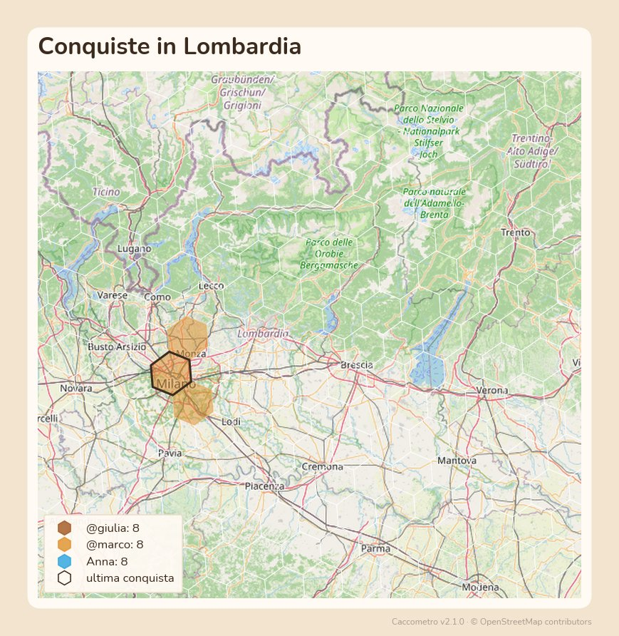
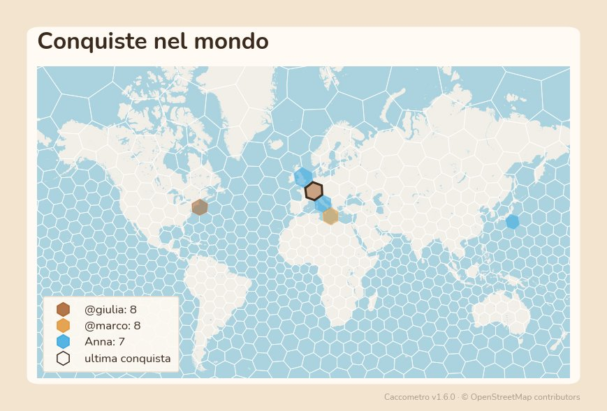

# 💩 Caccometro Bot Telegram

[English](README.md) · **Italiano**

  
  

Caccometro è un bot Telegram open source che conta le 💩 di ogni persona in un gruppo (o in una chat privata) e sfida gli amici a chi ne fa di più: classifiche mensili e annuali, statistiche con grafici, record personali e di gruppo, trofei, giorni di "costipazione" e un gioco di conquista sulla mappa. Parla italiano e inglese.

- [Come si usa](#-come-si-usa)
- [Comandi](#-comandi)
- [Grafici](#-grafici)
- [Record e trofei](#-record-e-trofei)
- [Gioco di conquista](#-gioco-di-conquista)
- [Vecchio storico e supergruppi](#-vecchio-storico-e-supergruppi)
- [Privacy](#-privacy)
- [Documentazione](#-documentazione)

---

## 💬 Come si usa

1. Aggiungi il bot al gruppo e manda `/start`.
2. Quando hai fatto il tuo dovere manda un messaggio con 💩 o 🚽 (anche come sticker): il bot risponde con una frase divertente (cambia con l'ora e con il numero della 💩 del giorno), il conto di oggi e ricorda di mandare la posizione.
3. Entro 15 minuti dalla 💩 manda una posizione (📎 → Posizione) per conquistare la sua zona: vedi [Gioco di conquista](#-gioco-di-conquista).
4. Usa i comandi qui sotto per classifiche, statistiche e record.
5. Il bot parla italiano; per l'inglese un admin manda `/lingua en` (in privato chiunque).

---

## 📚 Comandi

| Comando                                        | Descrizione |
| :--------------------------------------------- | :---------- |
| `/start`                                       | Prepara il database della chat e mostra la versione del bot. |
| `/classifica_mese [MM-YYYY]`                   | Classifica del mese (quello corrente se la data manca; anche `marzo 2026`), con un grafico dell'andamento giorno per giorno. Per il mese in corso, accanto a ogni conto, la previsione a fine mese. |
| `/classifica_anno [YYYY]`                      | Classifica dell'anno (quello corrente se manca; anche `26`), con un grafico e, per l'anno in corso, la previsione a fine anno. |
| `/statistiche_mese [MM-YYYY]`                  | Media, mediana e varianza delle 💩 al giorno di ogni persona nel mese, con un grafico delle distribuzioni. |
| `/statistiche_anno [YYYY]`                     | Le stesse statistiche sull'anno. |
| `/record [io \| @username]`                    | Senza argomenti i **record del gruppo** (chi detiene ciascun record e chi è in testa adesso). Con `io` i tuoi record, con `@username` (o rispondendo a un messaggio) quelli di un'altra persona, ciascuno con il suo **stato attuale**. |
| `/trofei [io \| @username]`                    | Senza argomenti la **bacheca dei trofei** del gruppo; con `io` i tuoi trofei, con `@username` (o rispondendo a un messaggio) quelli di un'altra persona, con quanti giorni mancano al prossimo trofeo di serie. |
| `/conquiste [io \| @username]`                 | Senza argomenti le **zone tenute** da ogni persona, prima il re della collina 👑; con `io`, `@username` (o rispondendo a un messaggio) le zone tenute e visitate da una persona. |
| `/conto_giorno [@username] [DD-MM-YYYY]`       | 💩 di una persona in un giorno (oggi se la data manca; anche `ieri`). |
| `/ultima_cacca [@username]`                    | Giorni passati dall'ultima 💩. |
| `/aggiungi_cacca [@username] DD-MM-YYYY`       | Aggiunge 1 💩 in un giorno passato o di oggi (anche `oggi`, `ieri`). Sul conto di un altro: solo admin. |
| `/togli_cacca [@username] DD-MM-YYYY`          | Toglie 1 💩 (fino a 0) in un giorno passato o di oggi (anche `oggi`, `ieri`). Sul conto di un altro: solo admin. |
| `/collega_storico [auto \| username storico]`  | Solo admin: collega il vecchio storico registrato per username alle persone (vedi sotto). Senza argomenti mostra cosa resta da collegare. |
| `/lingua [it \| en]`                           | Senza argomenti mostra la lingua della chat; con `it` o `en` la cambia (nei gruppi solo admin). Vale per le risposte, i grafici, l'annuncio di mezzanotte e il menu dei comandi della chat. |

Ogni comando ha anche un nome inglese (`/leaderboard_month`, `/add_poop`, ...), valido in ogni chat qualunque sia la sua lingua: vedi il menu inglese in [docs/deployment.md](docs/deployment.md#command-menus).

Nei comandi con `[@username]` la persona si può indicare anche **rispondendo a un suo messaggio** (utile per chi non ha uno username). Un `@username` funziona solo per chi ha già scritto almeno un messaggio nel gruppo. Nei gruppi con i topic, rispondere al messaggio che ha creato il topic non conta come rispondere a una persona.

**Date e mesi** si possono scrivere in vari modi: `-`, `/` e `.` sono equivalenti, gli zeri iniziali sono facoltativi e l'anno può avere due cifre (`26` = 2026, anche per `/classifica_anno` e `/statistiche_anno`). Quindi `5/3/26`, `05.03.2026` e `5-3-2026` indicano lo stesso giorno (prima il giorno, poi il mese), e `3/26`, `03.2026` e `03-2026` lo stesso mese. Si possono usare anche `oggi` e `ieri` (o `today` e `yesterday`), un giorno senza anno (`5/3`, vale l'anno corrente) e il nome del mese in italiano o in inglese (`marzo 2026`, `march 26`, `marzo` per l'anno corrente), in qualunque lingua sia la chat. Le risposte mostrano sempre `DD-MM-YYYY` e `MM-YYYY`. Sono valide solo date reali tra il 1970 e oggi (mesi e anni fino al 2100).

Le date seguono l'ora italiana (`Europe/Rome`). Una 💩 vale nel giorno in cui il messaggio è stato **inviato**, anche se il bot lo elabora più tardi.

---

## 📈 Grafici

Le classifiche e le statistiche arrivano con un grafico. Questi sono disegnati dal codice del bot con dati di esempio e vengono ridisegnati a ogni modifica del codice (`tools/sample_charts.py`).

| Classifica del mese, con la previsione | Statistiche del mese |
| :---: | :---: |
|  |  |

Gli stessi grafici in una chat inglese: [classifica](assets/screenshots/leaderboard_month_en.png), [statistiche](assets/screenshots/stats_month_en.png).

---

## 🏅 Record e trofei

- **Giorno / serie / pause:** il giorno con più 💩, la serie più lunga di giorni consecutivi con almeno una 💩, la serie con più 💩 in totale e la pausa più lunga tra due giorni con 💩. A parità, sono elencati tutti i periodi.
- **Mese migliore:** solo mesi completi (il mese in corso non conta ancora).
- **Mese peggiore:** solo mesi completi, escludendo il primo mese con dati (potresti aver iniziato a metà) e quelli dopo l'ultimo mese con dati (potresti aver lasciato il gruppo); i mesi in mezzo senza nessuna 💩 valgono 0. Servono quindi almeno due mesi di dati.
- **Record del gruppo:** per ogni metrica il valore migliore tra tutte le persone (anche quelle che hanno lasciato il gruppo) e chi lo detiene; a parità, tutti. Il blocco "Adesso" considera solo chi ha fatto una 💩 negli ultimi 90 giorni.
- **Stato attuale:** una serie è "in corso" se l'ultima 💩 è di oggi o di ieri; la pausa attuale sono i giorni dall'ultima 💩. Il 🔥 compare quando si raggiunge un record (dal 2 in su) o si supera il record di pausa.
- **Previsione:** per il mese o l'anno in corso, il totale finora più, per ogni giorno che manca, la media di 💩 al giorno degli ultimi 30 giorni.
- **Trofei:** 🔥 uno ogni 15 giorni consecutivi con almeno una 💩 (15, 30, 45, ...; una serie di 47 giorni vale 3 trofei), annunciato nella risposta alla prima 💩 del giorno che li completa; 🏅 **💩 del mese** e 👑 **💩 dell'anno** a chi ne ha fatte di più in un mese o in un anno completo (a parità, a tutti). I trofei sono calcolati dai conteggi, quindi `/aggiungi_cacca` e `/togli_cacca` li aggiornano.
- **Annuncio di mezzanotte:** il primo giorno di ogni mese, a mezzanotte, il bot scrive in ogni chat la 💩 del mese appena finito; il 1° gennaio anche la 💩 dell'anno, con gli auguri di buon anno.

---

## 🚩 Gioco di conquista

- Il mondo è diviso in zone esagonali di circa 36 km² (celle [H3](https://h3geo.org/) a risoluzione 6, larghe circa 7 km).
- Ogni 💩 mandata come messaggio o sticker (non `/aggiungi_cacca`) apre una **finestra di 15 minuti**: la prima posizione mandata dentro conquista la zona in cui cade. Una conquista per ogni 💩. Una posizione senza finestra aperta non conquista niente.
- 🚩 zona nuova, ⚔️ zona rubata a un'altra persona, 🏠 zona propria difesa. Una zona è di chi l'ha conquistata per ultimo.
- 👑 Il **re della collina** tiene più zone di tutti; a parità il re attuale tiene la corona.
- Ogni chat ha la sua mappa, mai azzerata; togliere una 💩 con `/togli_cacca` non toglie una conquista.
- Ogni conquista arriva con una **mappa** delle zone intorno; `/conquiste` aggiunge la Lombardia, l'Italia e il mondo intero. Lì un esagono grande vale per le zone che contiene e prende il colore di chi ne tiene di più (a parità, di chi ha conquistato per ultimo). Se la mappa non si riesce a disegnare, la risposta arriva solo come testo.

| Conquista | `/conquiste`: Lombardia |
| :---: | :---: |
|  |  |
| **`/conquiste`: Italia** | **`/conquiste`: mondo** |
|  |  |

---

## 🔄 Vecchio storico e supergruppi

I conteggi sono legati all'**ID utente di Telegram**, non allo username: chi cambia username mantiene i suoi dati, e chi non ha uno username è contato col suo nome.

- I database delle prime versioni (conteggi per username) vengono **migrati automaticamente** al primo avvio. Prima si fa una copia; i vecchi dati restano in una tabella d'archivio finché non vengono collegati.
- Gli **admin** del gruppo collegano il vecchio storico alle persone con `/collega_storico`:
  1. `/collega_storico` mostra lo storico ancora da collegare;
  2. quando tutti hanno scritto almeno un messaggio, `/collega_storico auto` collega gli username identici;
  3. per gli altri, rispondi a un messaggio della persona con `/collega_storico <username storico>`.
- I vecchi record senza username non si possono collegare.
- Quando un gruppo diventa **supergruppo**, Telegram gli dà un nuovo ID di chat: il bot sposta da solo lo storico nella nuova chat, e lo unisce se il supergruppo ha già dei conteggi.

---

## 🔒 Privacy

Il bot legge i messaggi del gruppo per trovare le 💩: per questo la sua **Group Privacy** è disattivata. Il testo dei messaggi non viene mai salvato né scritto nel log. Il bot salva, per ogni chat, ID utente Telegram, username e nome di chi scrive, e le 💩 per giorno. Per il gioco di conquista salva l'ora dell'ultima 💩 (finché la sua finestra non è usata) e, per ogni conquista, l'ora, la zona e latitudine e longitudine della posizione; il log non registra mai le coordinate. Il log registra le modifiche fatte a mano: per ogni `/aggiungi_cacca` e `/togli_cacca` chi l'ha mandato, la persona, il giorno e il conteggio prima e dopo; per `/collega_storico` il vecchio username, la persona e i giorni spostati.

---

## 📖 Documentazione

La documentazione tecnica è solo in inglese:

| Documento | Per |
| :-------- | :-- |
| [CONTRIBUTING.md](CONTRIBUTING.md) | Far partire il bot in locale, test, convenzioni e flusso di una modifica |
| [docs/architecture.md](docs/architecture.md) | Moduli, percorso di un messaggio, database, traduzioni |
| [docs/deployment.md](docs/deployment.md) | Configurazione di Telegram (menu, descrizioni), produzione su un hosting WSGI, webhook, annuncio di mezzanotte |
| [docs/operations.md](docs/operations.md) | Deploy, backup e ripristino, log, release |
| [SECURITY.md](SECURITY.md) | Segnalare una vulnerabilità |

## Licenza

Caccometro è rilasciato con licenza [MIT](LICENSE).

Le mappe usano tile e dati di [OpenStreetMap](https://www.openstreetmap.org/copyright), © OpenStreetMap contributors, disponibili con licenza Open Database License.
