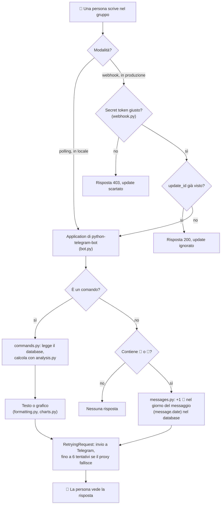
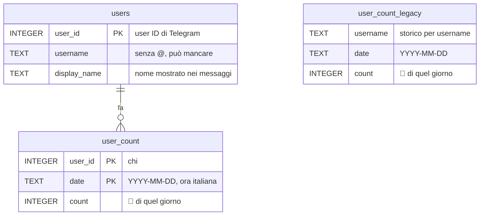
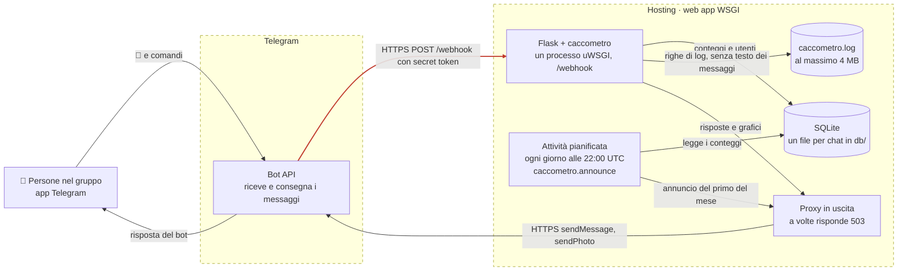
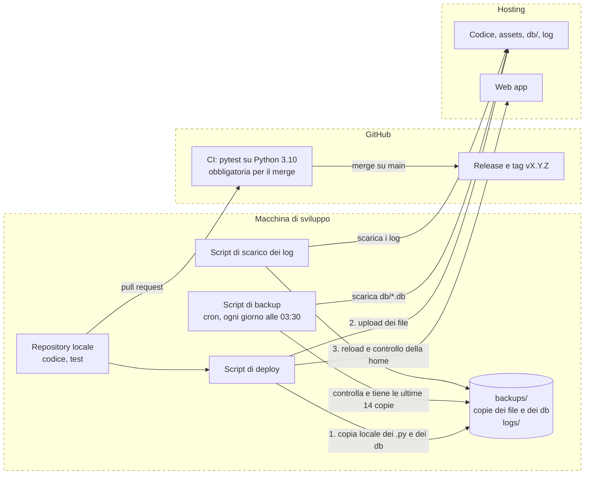

# 💩 Caccometro Bot Telegram

<p align="center">
  
  
</p>

Caccometro è un bot Telegram open source che conta le 💩 di ogni persona in un gruppo (o in chat privata) e sfida gli amici a chi ne fa di più: classifiche mensili e annuali, statistiche con grafici, record personali e di gruppo, giorni di "costipazione".

- [Come si usa](#-come-si-usa)
- [Comandi](#-comandi)
- [Come si calcolano i record](#-come-si-calcolano-i-record)
- [Identità degli utenti e dati storici](#-identità-degli-utenti-e-dati-storici)
- [Sviluppo in locale](#️-sviluppo-in-locale)
- [Test](#-test)
- [Architettura](#️-architettura)
- [Produzione (webhook)](#-produzione-webhook)
- [Operazioni](#️-operazioni)
- [Contribuire](#-contribuire)

---

## 💬 Come si usa

1. Aggiungi il bot al gruppo e manda `/start`.
2. Quando hai fatto il tuo dovere manda un messaggio con 💩 o 🚽 (anche come sticker): il bot risponde con il conto di oggi.
3. Usa i comandi qui sotto per classifiche, statistiche e record.

Il bot legge i messaggi del gruppo per trovare le 💩: per questo su @BotFather la **Group Privacy** deve essere disattivata. Il testo dei messaggi non viene mai salvato né scritto nel log. Nel log finiscono invece le modifiche fatte a mano: per ogni `/aggiungi` e `/togli` chi l'ha mandato, la persona, il giorno e il conteggio prima e dopo; per `/collega` il vecchio username, la persona e i giorni spostati.

---

## 📚 Comandi

| Comando                                | Descrizione |
| :------------------------------------- | :---------- |
| `/start`                               | Prepara il database della chat e mostra la versione del bot. |
| `/classifica_mese [MM-YYYY]`           | Classifica del mese (corrente se la data manca; anche `marzo 2026`), con grafico dell'andamento giorno per giorno. Per il mese in corso, accanto a ogni conto, la previsione a fine mese. |
| `/classifica_anno [YYYY]`              | Classifica dell'anno (corrente se manca; anche `26`), con grafico e, per l'anno in corso, la previsione a fine anno. |
| `/statistiche_mese [MM-YYYY]`          | Media, mediana e varianza delle 💩 al giorno di ogni persona nel mese, con grafico delle distribuzioni. |
| `/statistiche_anno [YYYY]`             | Le stesse statistiche sull'anno. |
| `/record [io \| @username]`            | Senza argomenti i **record del gruppo** (chi detiene ciascun record e chi è in testa adesso). Con `io` i tuoi record, con `@username` (o rispondendo a un messaggio) quelli di un'altra persona, ciascuno con lo **stato attuale**. |
| `/trofei [io \| @username]`            | Senza argomenti la **bacheca dei trofei** del gruppo; con `io` i tuoi trofei, con `@username` (o rispondendo a un messaggio) quelli di un'altra persona, con quanti giorni mancano al prossimo trofeo di serie. |
| `/conto_giorno [@username] [DD-MM-YYYY]` | 💩 di una persona in un giorno (oggi se la data manca; anche `ieri`). |
| `/costipazione [@username]`            | Giorni passati dall'ultima 💩. |
| `/aggiungi [@username] DD-MM-YYYY`     | Aggiunge 1 💩 in un giorno passato o di oggi (anche `oggi`, `ieri`). Sul conto di un altro: solo admin. |
| `/togli [@username] DD-MM-YYYY`        | Toglie 1 💩 (fino a 0) in un giorno passato o di oggi (anche `oggi`, `ieri`). Sul conto di un altro: solo admin. |
| `/collega [auto \| username storico]`  | Solo admin: collega lo storico registrato per username alle persone (vedi sotto). Senza argomenti mostra cosa resta da collegare. |

Nei comandi con `[@username]` la persona si può indicare anche **rispondendo a un suo messaggio** (utile per chi non ha uno username). Nei gruppi con i topic, rispondere al messaggio che ha creato il topic non conta come rispondere a una persona.

**Date e mesi** si possono scrivere in vari modi: `-`, `/` e `.` sono equivalenti, gli zeri iniziali sono facoltativi e l'anno può avere due cifre (`26` = 2026, anche per `/classifica_anno` e `/statistiche_anno`). Quindi `5/3/26`, `05.03.2026` e `5-3-2026` indicano lo stesso giorno, e `3/26`, `03.2026` e `03-2026` lo stesso mese. Si possono usare anche `oggi` e `ieri`, un giorno senza anno (`5/3`, vale l'anno corrente) e il nome del mese in italiano (`marzo 2026`, `marzo 26`, `marzo` per l'anno corrente). Le risposte mostrano sempre `DD-MM-YYYY` e `MM-YYYY`. Sono valide solo date reali tra il 1970 e oggi (mesi e anni fino al 2100).

---

## 🏅 Come si calcolano i record

- **Giorno / serie / pause:** il giorno con più 💩, la serie più lunga di giorni consecutivi con almeno una 💩, la serie con più 💩 in tutto e la pausa più lunga tra due giorni con 💩. A parità vengono elencati tutti i periodi.
- **Mese migliore:** solo mesi completi (il mese in corso non vale ancora).
- **Mese peggiore:** solo mesi completi, escluso il primo mese con dati (potresti aver iniziato a metà) e quelli dopo l'ultimo mese con dati (potresti essere uscito dal gruppo); i mesi in mezzo senza nessuna 💩 contano come 0. Serve quindi almeno un secondo mese di dati.
- **Record del gruppo:** per ogni metrica il valore migliore tra tutte le persone (anche chi è uscito dal gruppo) e chi lo detiene; a parità sono elencate tutte. Il blocco "Adesso" considera solo chi ha fatto 💩 negli ultimi 90 giorni.
- **Stato attuale:** una serie è "in corso" se l'ultima 💩 è di oggi o di ieri; la pausa in corso sono i giorni dall'ultima 💩. Il 🔥 compare quando raggiungi un record (da 2 in su) o superi la pausa record.

- **Trofei:** 🔥 uno ogni 15 giorni consecutivi con almeno una 💩 (15, 30, 45, ...; una serie di 47 giorni vale 3 trofei), annunciato nella risposta alla prima 💩 del giorno che li completa; 🏅 **💩 del mese** e 👑 **💩 dell'anno** a chi ne ha fatte di più in un mese o in un anno completo (a parità, a tutti). I trofei si calcolano dai conteggi, quindi `/aggiungi` e `/togli` li aggiornano.
- **Annuncio di mezzanotte:** il primo giorno di ogni mese, a mezzanotte, il bot scrive in ogni chat il 💩 del mese appena finito; il 1° gennaio anche il 💩 dell'anno, con gli auguri di buon anno.

Le date seguono l'ora italiana (`Europe/Rome`), anche se il server è in UTC. Una 💩 conta nel giorno in cui il messaggio è stato **inviato** (`message.date`), anche se il bot lo elabora più tardi, per esempio dopo un ritardo del server a cavallo della mezzanotte. I comandi accettano mesi e anni tra il 1970 e il 2100, e giorni dal 1970 a oggi. Il bot chiede a Telegram soltanto i messaggi (`allowed_updates`).

---

## 🔄 Identità degli utenti e dati storici

I conteggi sono associati allo **user ID di Telegram**, non allo username: chi cambia username non perde i dati e chi non ha uno username viene contato con il proprio nome.

- Il bot impara username e nome di chi scrive: un `@username` nei comandi funziona solo per persone che hanno già scritto almeno un messaggio nel gruppo. In alternativa si risponde a un messaggio della persona.
- I database delle versioni vecchie (conteggi per username) vengono **migrati automaticamente** al primo avvio. Prima viene creata una copia (`db/<chat_id>_bot_data.db.v1.bak`); i dati vecchi restano in una tabella di archivio finché non vengono collegati.
- Gli **admin** del gruppo collegano lo storico alle persone con `/collega`:
  1. `/collega` mostra lo storico ancora da collegare;
  2. quando tutti hanno scritto almeno un messaggio, `/collega auto` collega gli username identici;
  3. per gli altri si risponde a un messaggio della persona con `/collega <username storico>`.
- Le registrazioni vecchie senza username non possono essere collegate.
- Quando un gruppo diventa **supergruppo** Telegram gli dà un nuovo chat ID: il bot rinomina il database (`db/<vecchio>_bot_data.db` → `db/<nuovo>_bot_data.db`) e la storia resta. Se il messaggio di migrazione arriva in ritardo e il nuovo database ha già dei conteggi (la prima 💩 del supergruppo l'ha creato), i due vengono uniti: stesso utente e stesso giorno si sommano, e il vecchio file resta come `<vecchio>_bot_data.db.merged`. La migrazione parte anche dal messaggio gemello nella vecchia chat, così ha due occasioni.

---

## 🛠️ Sviluppo in locale

Serve Python 3.10 o più recente (la produzione usa 3.10: le dipendenze devono restare compatibili).

### 1. Ambiente virtuale e dipendenze

| Sistema           | Crea l'ambiente         | Attivalo                    |
| :---------------- | :---------------------- | :-------------------------- |
| **Linux / macOS** | `python3 -m venv .venv` | `source .venv/bin/activate` |
| **Windows**       | `python -m venv .venv`  | `.\.venv\Scripts\activate`  |

```bash
pip install -r requirements-dev.txt   # dipendenze del bot più pytest
```

### 2. Un bot di prova

1. Su **[@BotFather](https://t.me/botfather)** crea un bot con `/newbot` e annota username e token. Conviene un bot separato da quello di produzione.
2. Con `/setprivacy` scegli **Disable**, altrimenti nei gruppi il bot non vede le 💩.
3. Facoltativo: con `/setcommands` registra il menu dei comandi.

```
start - Avvia il bot e spiega come contare le 💩.
classifica_mese - Classifica del mese, corrente o [MM-YYYY, anche marzo 2026].
classifica_anno - Classifica dell'anno, corrente o [YYYY o YY].
statistiche_mese - Media, mediana e varianza del mese, corrente o [MM-YYYY, anche marzo 2026].
statistiche_anno - Media, mediana e varianza dell'anno, corrente o [YYYY o YY].
record - Record del gruppo; con io o @username quelli di una persona.
trofei - Trofei del gruppo; con io o @username quelli di una persona.
conto_giorno - 💩 di un giorno: [@username] [DD-MM-YYYY, oggi, ieri].
costipazione - Giorni senza 💩: [@username].
aggiungi - Aggiunge 1 💩 in un giorno: [@username] DD-MM-YYYY, oggi o ieri (altri: solo admin).
togli - Toglie 1 💩 in un giorno: [@username] DD-MM-YYYY, oggi o ieri (altri: solo admin).
```

`/collega` è solo per gli admin: va registrato a parte, nella lista dei comandi degli amministratori (`setMyCommands` con scope `all_chat_administrators`).

Con `/setdescription` e `/setabouttext` puoi impostare anche le descrizioni:

- **Descrizione:** Manda 💩 o 🚽 quando hai fatto il tuo dovere: il bot tiene il conto per ogni persona del gruppo, con classifiche, statistiche, grafici e record personali e di gruppo.
- **Descrizione breve:** Conta le 💩 del gruppo: classifiche, statistiche, grafici e record.

### 3. File `.env`

Copia `.env.example` in `.env` e inserisci i tuoi valori. `.env` è escluso da Git: non va mai committato.

```env
BOT_USERNAME = '@username_bot'
BOT_TOKEN = '123456:ABC-DEF1234ghIkl-zyx57W2v1u123ew11'
WEBHOOK_SECRET = 'una_stringa_casuale_lunga' # lettere, numeri, _ e -: Telegram la rimanda a ogni chiamata del webhook
HOSTING_USERNAME = 'il_tuo_username_sull_hosting' # usato solo da scripts/set_webhook.py

RUN_MODE = 'POLLING' # 'POLLING' in locale, 'WEBHOOK' in produzione
```

### 4. Avvio

```bash
python -m caccometro
```

In modalità polling il bot chiede lui gli aggiornamenti a Telegram: non serve un server pubblico. Si ferma con `CTRL+C`. I database vengono creati in `db/` (uno per chat), il log in `caccometro.log`, sempre nella cartella del progetto, da qualunque cartella parta il bot.

---

## 🧪 Test

```bash
python -m pytest -q
```

I test (in `tests/`) non chiamano Telegram: usano database temporanei e oggetti finti, e scrivono il log in una cartella temporanea. Su GitHub gli stessi test partono da soli a ogni pull request e a ogni push su `main` (Python 3.10, la versione dell'hosting): il controllo `pytest` deve passare per poter fare il merge. Coprono comandi, conteggio dei messaggi, migrazione dello schema, record, statistiche, grafici, webhook e nuovi tentativi di invio. Un test controlla anche che la documentazione corrisponda al codice: ogni comando nella tabella e nel menu, ogni modulo nell'architettura, ogni variabile in `.env.example`, ogni file citato esistente.

---

## 🏗️ Architettura

```
caccometro/          il bot, come pacchetto Python
  __init__.py        versione (__version__)
  __main__.py        python -m caccometro: avvio in polling
  config.py          variabili d'ambiente, formati delle date, ora italiana
  bot.py             Application di python-telegram-bot, logging, nuovi tentativi di invio, registrazione dei comandi
  webhook.py         app Flask che riceve gli aggiornamenti da Telegram (produzione)
  commands.py        i comandi (/classifica_mese, /record, ...) e il controllo dei permessi
  messages.py        il conteggio delle 💩 dai messaggi e dagli sticker
  chat.py            funzioni comuni su utenti e messaggi Telegram
  database.py        database SQLite: schema, migrazione, query
  analysis.py        record, serie e statistiche (funzioni pure, senza database)
  trophies.py        trofei: serie di 15 giorni, 💩 del mese e dell'anno (funzioni pure)
  formatting.py      testi dei messaggi di /record, /trofei e dell'annuncio di mezzanotte
  announce.py        annuncio di mezzanotte del 💩 del mese (attività pianificata)
  charts.py          grafici di classifiche e statistiche (PNG in memoria)
scripts/set_webhook.py   registra il webhook su Telegram (una volta)
tools/               script di servizio: deploy, backup dei database, scarico dei log, versione dei bot
.githooks/           hook git (pre-commit, commit-msg), attivati con core.hooksPath
.gitattributes       fine riga dei file .py (CRLF) e degli hook (LF)
tests/               test pytest
.github/workflows/tests.yml   CI: pytest su Python 3.10 a ogni pull request e a ogni push su main
requirements.txt     dipendenze del bot (requirements-dev.txt: anche quelle dei test)
wsgi.py              modello del file WSGI per l'hosting
assets/              avatar, animazione, font e immagini delle medaglie dei grafici
```

Il percorso di un messaggio, dall'invio alla risposta:



`analysis.py` non tocca il database né Telegram: riceve i conteggi e restituisce record e statistiche, per questo è la parte più facile da testare.

**Database.** Un file SQLite per chat, `db/<chat_id>_bot_data.db`:



`user_count_legacy` esiste solo nelle chat migrate dalla versione vecchia e si svuota man mano che `/collega` sposta lo storico in `user_count`.
La versione dello schema è in `PRAGMA user_version` (oggi 2); la migrazione parte da sola all'apertura del database.

---

## 🚀 Produzione (webhook)

In produzione il bot gira come web app Flask su un hosting con WSGI (noi usiamo [PythonAnywhere](https://www.pythonanywhere.com/), piano gratuito): Telegram chiama `/webhook` a ogni messaggio. Nel `.env` del server metti `RUN_MODE = 'WEBHOOK'`.



Le risposte escono dal proxy dell'hosting, che a volte risponde 503 per qualche secondo: per questo `RetryingRequest` riprova (1, 2, 4, 8 e 16 secondi di attesa). Non riprova timeout ed errori di lettura, perché il messaggio potrebbe essere già arrivato.

### 1. Codice e dipendenze

Copia sul server la cartella `caccometro/`, `assets/`, `scripts/` e il `.env`, poi installa le dipendenze di `requirements.txt` (sul piano gratuito, con `pip install --user`).

### 2. File WSGI

La web app dell'hosting ha un suo file WSGI: sostituiscine il contenuto con quello di `wsgi.py`, impostando `path` alla cartella che contiene il pacchetto `caccometro`.

```python
import sys

path = '/home/<your-username>'
if path not in sys.path:
    sys.path.insert(0, path)

from caccometro.webhook import app as application
```

Ricarica la web app: la home page risponde con un saluto e la versione del bot.

### 3. Webhook

Una sola volta, da una console sul server:

```bash
python scripts/set_webhook.py
```

Lo script registra su Telegram l'URL `/webhook` con il `WEBHOOK_SECRET`: le chiamate senza il secret ricevono 403.

### 4. Annuncio di mezzanotte

Crea un'attività pianificata giornaliera alle **22:00 UTC** che parte dalla cartella del progetto (i database e il log si trovano comunque lì, qualunque sia la cartella di partenza):

```bash
cd /home/<your-username> && python3.10 -m caccometro.announce
```

Alle 22:00 UTC in Italia sono le 23:00 (ora solare) o la mezzanotte (ora legale): lo script aspetta la mezzanotte se manca poco e scrive solo il primo giorno del mese. Per provarlo senza mandare niente: `python3.10 -m caccometro.announce --date 2027-01-01 --dry-run`.

### Scadenza della web app

Sul piano gratuito la web app **scade ogni 3 mesi**: dalla tab Web si sceglie "Run until 3 months from today". Va esteso anche l'attività pianificata, altrimenti l'annuncio di mezzanotte salta. Non esiste un'API per farlo: lo ricordano gli script di deploy e di scarico dei log, che stampano i giorni rimasti e avvisano sotto i 14.

### Versioni

La versione è in `caccometro/__init__.py` (`__version__`, [Semantic Versioning](https://semver.org/lang/it/)): la mostrano `/start` e la home page. A ogni rilascio si aggiorna `__version__`, si crea il tag `vX.Y.Z` con la release su GitHub e si carica sul server anche `caccometro/__init__.py`.

---

## ⚙️ Operazioni

Oltre al bot, il progetto ha alcuni script di servizio nella cartella `tools/`: girano sulla macchina di sviluppo e parlano con l'hosting tramite la sua API HTTP. Leggono `HOSTING_USERNAME` dal `.env` e il token dell'API dalla variabile d'ambiente `HOSTING_API_TOKEN` (mai nel `.env`, mai stampato). Si lanciano dalla radice del repository, con il virtual environment attivo; backup e log finiscono sempre nelle cartelle `backups/` e `logs/` del progetto, da qualunque cartella partano e sono leggibili solo dal proprietario (contengono copie dei database e username).



- **Deploy** (`tools/deploy.py`): parte solo dopo il merge e a mano. Una prova a vuoto mostra cosa cambierebbe; poi salva in locale i vecchi file e i database, carica i nuovi, ricarica la web app e controlla la home page (che mostra la versione). Il rollback ripristina i `.py` salvati. Esempio: `python tools/deploy.py caccometro/*.py` (prova a vuoto), poi con `--yes`.
- **Backup dei database** (`tools/backup_db.py`): ogni notte scarica `db/*.db`, controlla che ogni copia sia integra (`PRAGMA integrity_check`) e tiene le ultime 14 in `backups/db/`; la prima copia di ogni mese resta per sempre in `backups/db_monthly/`. Se qualcosa fallisce, o se il totale di una chat cala di oltre il 20% rispetto alla copia precedente, lo segnala con un errore (la copia sospetta viene tenuta ma non diventa quella mensile). Un errore viene anche inviato come messaggio privato Telegram al manutentore, dal bot di sviluppo (`BOT_TOKEN` del `.env` locale) alla chat `ALERT_CHAT_ID`; se la variabile manca non viene inviato nulla, e quando il backup riesce non arriva niente. Gira solo mentre la macchina è accesa.
- **Ripristino di un database**: (1) lancia `tools/backup_db.py` per salvare lo stato attuale; (2) scegli la copia in `backups/db/` o `backups/db_monthly/` e controllala con `sqlite3 <file> "PRAGMA integrity_check"`; (3) nella tab Files dell'hosting, cartella `db/`, carica il file con lo stesso nome `<chat_id>_bot_data.db`, sovrascrivendo l'attuale (non servono reload né file di journal); (4) prova con `/record` nella chat. Le 💩 contate dopo la copia vanno rimesse con `/aggiungi`. Provato su una copia: il file ripristinato è integro e i totali tornano quelli della copia.
- **Log** (`tools/fetch_logs.py`): scarica il log del bot e i log del web server per cercare gli errori. I log contengono username: non vanno mai pubblicati.
- **Riassunto dei log** (`tools/log_summary.py`): ogni notte, subito dopo il backup (stessa riga del cron, stesso file `backups/db_backup.log`), scarica i log e stampa un riassunto delle ultime 24 ore: update ricevuti, tentativi ripetuti verso Telegram, risposte perse, chiamate rifiutate dal webhook, update più lento ed errori raggruppati per tipo. Il riassunto resta in `logs/summary_<data>.txt` (gli ultimi 30). Un tipo di errore che non è nell'elenco dei noti (`KNOWN` nello script) e non è già stato segnalato (`logs/seen_kinds.txt`) arriva una sola volta come messaggio Telegram privato, come per il backup; se i log non si scaricano, arriva un avviso.
- **Release:** a ogni rilascio si alza `__version__`, si crea la release su GitHub e si fa il deploy; poi `tools/bot_version.py` scrive la versione in fondo alla descrizione dei bot.

---

## 🤝 Contribuire

- Ogni modifica parte da una issue: usa i template **Bug**, **Feature** o **Task** (titolo e descrizione in inglese). Le vulnerabilità si segnalano in privato da [Security](https://github.com/francescoperrino/Caccometro/security/advisories/new).
- Un branch per issue, con il prefisso del tipo: `bugfix/`, `feature/` o `task/`, poi `<numero>_<titolo_con_underscore>` (es. `task/49_update_the_documentation`).
- Commit, commenti e docstring in inglese; i messaggi del bot agli utenti in italiano.
- Una volta per clone: `git config core.hooksPath .githooks`. Gli hook della cartella `.githooks/` rifiutano i file privati (`.env`, `logs/`, `backups/`, i log) e i messaggi con righe `Co-Authored-By`, e lanciano i test prima di ogni commit. Regole personali in più si possono aggiungere in `.git/hooks/local-pre-commit` e `.git/hooks/local-commit-msg`. I file `.py` hanno le fine riga CRLF nella cartella di lavoro su ogni sistema (`.gitattributes`).
- Prima della pull request: `python -m pytest -q`. `main` accetta modifiche solo tramite pull request.
- Le label indicano l'area toccata (`commands`, `charts`, `database`, `hosting`, `deploy`, `dependencies`, `documentation`); il tipo della issue dice se è un bug, una feature o un task.

---

## Licenza

Caccometro è distribuito con licenza [MIT](LICENSE).
