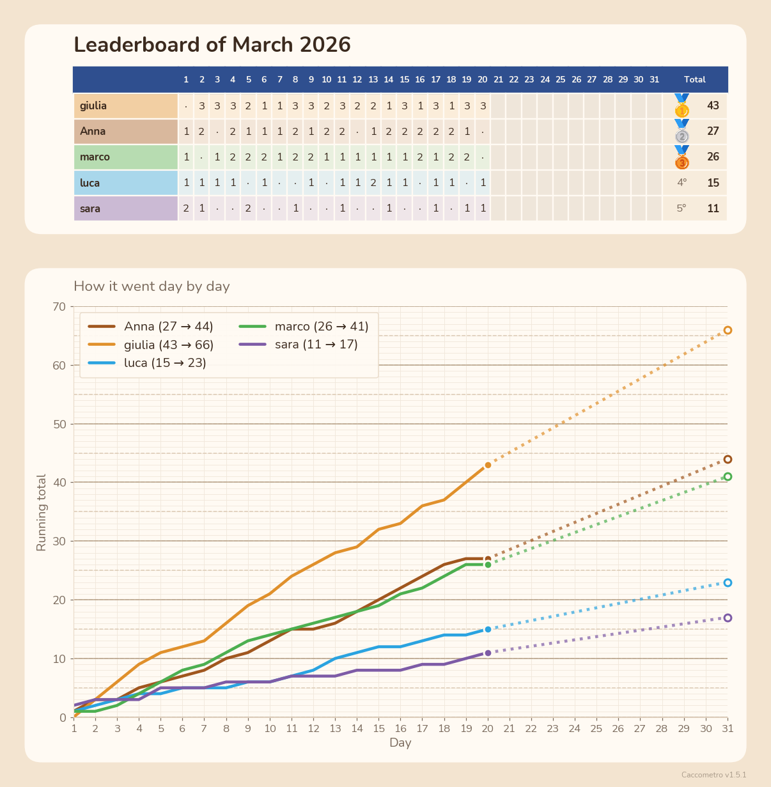
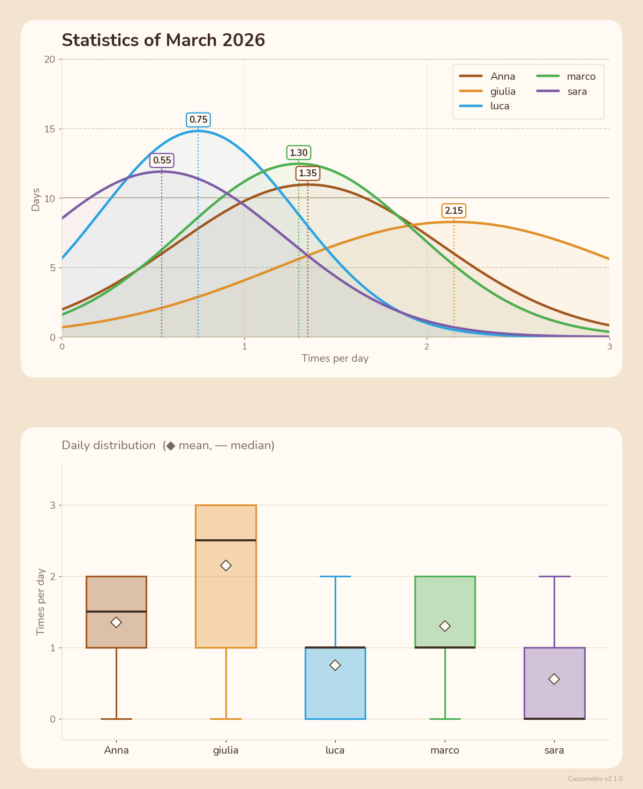
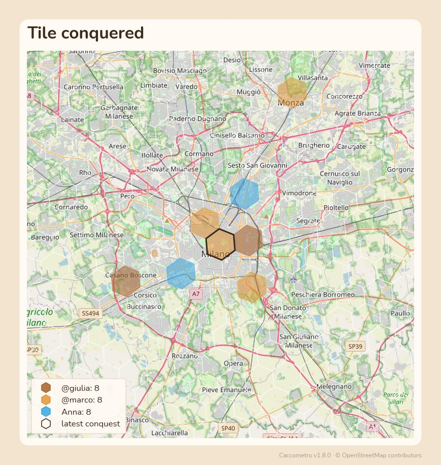
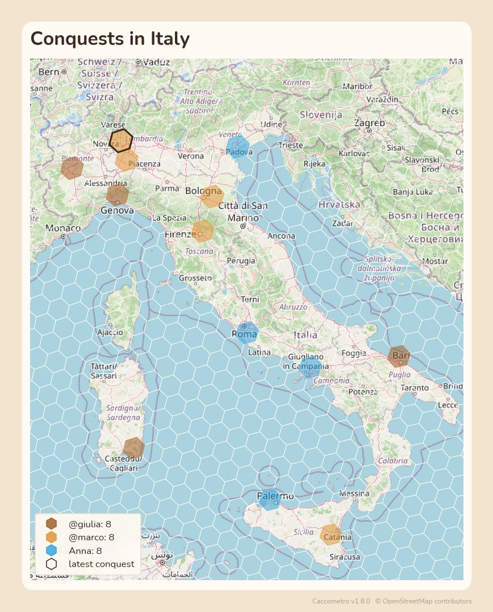

# 💩 Caccometro Telegram Bot

**English** · [Italiano](README.it.md)

  
  

Caccometro is an open source Telegram bot that counts the 💩 of every person in a group (or in a private chat) and challenges friends to see who does the most: monthly and yearly rankings, statistics with charts, personal and group records, trophies, days of "constipation", and a conquest game on the map. It speaks Italian and English.

- [How to use it](#-how-to-use-it)
- [Commands](#-commands)
- [Charts](#-charts)
- [Records and trophies](#-records-and-trophies)
- [Conquest game](#-conquest-game)
- [Old history and supergroups](#-old-history-and-supergroups)
- [Privacy](#-privacy)
- [Documentation](#-documentation)

---

## 💬 How to use it

1. Add the bot to the group and send `/start`.
2. When you have done your duty, send a message with 💩 or 🚽 (also as a sticker): the bot replies with a funny sentence (it changes with the time of day and with the count of the day), today's count and a reminder to send your location.
3. Within 15 minutes of the 💩, send a location (📎 → Location) to conquer its tile: see [Conquest game](#-conquest-game).
4. Use the commands below for rankings, statistics and records.
5. The bot speaks Italian; for English an admin sends `/language en` (in a private chat anybody can).

---

## 📚 Commands

| Command                                        | Description |
| :--------------------------------------------- | :---------- |
| `/start`                                       | Prepares the database of the chat and shows the version of the bot. |
| `/leaderboard_month [MM-YYYY]`                 | Leaderboard of the month (the current one if the date is missing; also `march 2026`), with a chart of the day-by-day trend. For the current month, next to each count, the forecast for the end of the month. |
| `/leaderboard_year [YYYY]`                     | Leaderboard of the year (the current one if missing; also `26`), with a chart and, for the current year, the forecast for the end of the year. |
| `/stats_month [MM-YYYY]`                       | Mean, median and variance of the 💩 per day of each person in the month, with a chart of the distributions. |
| `/stats_year [YYYY]`                           | The same statistics over the year. |
| `/records [me \| @username]`                   | Without arguments the **group records** (who holds each record and who leads right now). With `me` (or `io`) your own records, with `@username` (or replying to a message) those of another person, each with its **current state**. |
| `/trophies [me \| @username]`                  | Without arguments the **trophy board** of the group; with `me` (or `io`) your trophies, with `@username` (or replying to a message) those of another person, with how many days are left to the next streak trophy. |
| `/conquests [me \| @username]`                 | Without arguments the **tiles held** by each person, the king of the hill 👑 first; with `me` (or `io`), `@username` (or replying to a message) the tiles held and visited by one person, and maps of that person only: Lombardy, Italy and the world, lighter where tiles were lost, and a fourth map with the real tiles around the latest conquest (lost ones dashed). |
| `/app`                                         | A button that opens the **Mini App** on this chat. In the private chat with the bot, the menu button opens it on that chat; only members of a group see its data. |
| `/day_count [@username] [DD-MM-YYYY]`          | 💩 of a person on a day (today if the date is missing; also `yesterday`). |
| `/last_poop [@username]`                       | Days since the last 💩. |
| `/add_poop [@username] DD-MM-YYYY`             | Adds 1 💩 on a past day or today (also `today`, `yesterday`). On someone else's count: admins only. |
| `/remove_poop [@username] DD-MM-YYYY`          | Removes 1 💩 (down to 0) on a past day or today (also `today`, `yesterday`). On someone else's count: admins only. |
| `/link_history [auto \| historical username]`  | Admins only: links the old history recorded by username to the people (see below). Without arguments it shows what is left to link. |
| `/language [it \| en]`                         | Without arguments it shows the language of the chat; with `it` or `en` it changes it (in groups admins only). It applies to the replies, the charts, the midnight announcement and the command menu of the chat. |

Every command also has an Italian name (`/classifica_mese`, `/aggiungi_cacca`, ...), valid in every chat whatever its language: see the Italian menu in [docs/deployment.md](docs/deployment.md#command-menus).

In the commands with `[@username]` the person can also be chosen by **replying to one of their messages** (useful for people without a username). An `@username` works only for people who have already written at least one message in the group. In groups with topics, replying to the message that created the topic does not count as replying to a person.

**Dates and months** can be written in several ways: `-`, `/` and `.` are the same, leading zeros are optional and the year can have two digits (`26` = 2026, also for `/leaderboard_year` and `/stats_year`). So `5/3/26`, `05.03.2026` and `5-3-2026` are the same day (day first, then month), and `3/26`, `03.2026` and `03-2026` the same month. You can also use `today` and `yesterday` (or `oggi` and `ieri`), a day without a year (`5/3`, the current year) and the name of the month in English or Italian (`march 2026`, `marzo 26`, `march` for the current year), whatever the language of the chat. The replies always show `DD-MM-YYYY` and `MM-YYYY`. Only real dates between 1970 and today are valid (months and years up to 2100).

Dates follow Italian time (`Europe/Rome`). A 💩 counts on the day the message was **sent**, even if the bot handles it later.

---

## 📈 Charts

The leaderboards and the statistics come with a chart. These are drawn by the bot's own code from sample data, and are drawn again whenever the code changes (`tools/sample_charts.py`).

| Leaderboard of the month, with the forecast | Statistics of the month |
| :---: | :---: |
|  |  |

The same charts in an Italian chat: [leaderboard](assets/screenshots/leaderboard_month_it.png), [statistics](assets/screenshots/stats_month_it.png).

---

## 🏅 Records and trophies

- **Day / streak / breaks:** the day with the most 💩, the longest streak of consecutive days with at least one 💩, the streak with the most 💩 in total and the longest break between two days with 💩. On a tie, all the periods are listed.
- **Best month:** complete months only (the current month does not count yet).
- **Worst month:** complete months only, excluding the first month with data (you may have started halfway) and those after the last month with data (you may have left the group); the months in between without any 💩 count as 0. So at least a second month of data is needed.
- **Group records:** for each metric the best value among all the people (also those who left the group) and who holds it; on a tie, all of them are listed. The "Now" block only considers people who had a 💩 in the last 90 days.
- **Current state:** a streak is "in progress" if the last 💩 is from today or yesterday; the current break is the days since the last 💩. The 🔥 appears when you reach a record (from 2 up) or go past the record break.
- **Forecast:** for the current month or year, the total so far plus, for each day left, the mean 💩 per day of the last 30 days.
- **Trophies:** 🔥 one every 15 consecutive days with at least one 💩 (15, 30, 45, ...; a 47-day streak is worth 3 trophies), announced in the reply to the first 💩 of the day that completes them; 🏅 **💩 of the month** and 👑 **💩 of the year** to whoever did the most in a complete month or year (on a tie, to all of them). Trophies are computed from the counts, so `/add_poop` and `/remove_poop` update them. 🚩 **Season conqueror** (most conquests in a calendar quarter, stolen tiles included) and ⛰️ **season king** (most tiles held at the end of the quarter) come from the conquest history, with ties as above; the midnight announcement of the first day of a quarter names them, and `/conquests` shows the season in progress.
- **Midnight announcement:** on the first day of every month, at midnight, the bot writes the 💩 of the month just ended in every chat; on January 1st also the 💩 of the year, with happy new year wishes.

---

## 🚩 Conquest game

- The world is split into hexagonal tiles of about 5 km² ([H3](https://h3geo.org/) cells at resolution 7, about 2.6 km wide).
- Every 💩 sent as a message or sticker (not `/add_poop`) opens a **15 minute window**: the first location sent in it conquers the tile it falls in. One conquest per 💩. A location without an open window conquers nothing.
- 🚩 new tile, ⚔️ tile stolen from another person, 🏠 own tile defended. A tile belongs to whoever conquered it last.
- 👑 The **king of the hill** holds the most tiles; on a tie the current king keeps the crown.
- Every chat has its own map, never reset; removing a 💩 with `/remove_poop` does not remove a conquest.
- Every conquest comes with a **map** of the tiles around it; `/conquests` sends the tiles of the group around its latest conquest, then Lombardy, Italy and the whole world. On these last three a large hexagon stands for the tiles inside it and takes the colour of whoever holds most of them (on a tie, whoever conquered last). If the map cannot be drawn, the reply comes as text.

| Conquest | `/conquests`: Lombardy |
| :---: | :---: |
|  |  |
| **`/conquests`: Italy** | **`/conquests`: world** |
|  |  |

---

## 🔄 Old history and supergroups

The counts are tied to the **Telegram user ID**, not to the username: whoever changes username keeps their data, and people without a username are counted under their name.

- The databases of the first versions (counts by username) are **migrated automatically** on the first start. A copy is made first; the old data stays in an archive table until it is linked.
- The group **admins** link the old history to the people with `/link_history`:
  1. `/link_history` shows the history still to link;
  2. when everybody has written at least one message, `/link_history auto` links the identical usernames;
  3. for the others, reply to a message of the person with `/link_history <historical username>`.
- Old records without a username cannot be linked.
- When a group becomes a **supergroup**, Telegram gives it a new chat ID: the bot moves the history to the new chat by itself, and merges it if the supergroup already has counts.

---

## 🔒 Privacy

The bot reads the group messages to find the 💩: this is why its **Group Privacy** is disabled. The text of the messages is never stored or written to the log. The bot stores, for each chat, the Telegram user ID, username and name of whoever writes, and the 💩 per day. For the conquest game it stores the time of the last 💩 (until its window is used) and, for every conquest, the time, the tile and the latitude and longitude of the location; the log never records the coordinates. For every update the log writes only the command, the kind of chat (private or group), the time taken and the outcome, without names or text. The log records the changes made by hand: for every `/add_poop` and `/remove_poop`, who sent it, the person, the day and the count before and after; for `/link_history`, the old username, the person and the days moved.

---

## 📖 Documentation

| Document | For |
| :------- | :-- |
| [CONTRIBUTING.md](CONTRIBUTING.md) | Running the bot locally, tests, conventions and the workflow of a change |
| [docs/architecture.md](docs/architecture.md) | Modules, path of a message, database, translations |
| [docs/deployment.md](docs/deployment.md) | Telegram setup (menus, descriptions), production on a WSGI hosting, webhook, midnight announcement |
| [docs/operations.md](docs/operations.md) | Deploy, backups and restore, logs, releases |
| [docs/research/](docs/research/README.md) | The studies behind the choices: Mini App design, regularity index, hosting |
| [SECURITY.md](SECURITY.md) | Reporting a vulnerability |

## License

Caccometro is released under the [MIT](LICENSE) license.

The maps use tiles and data from [OpenStreetMap](https://www.openstreetmap.org/copyright), © OpenStreetMap contributors, available under the Open Database License.
