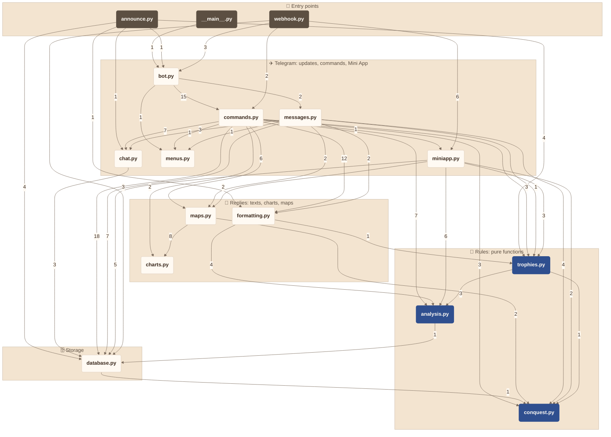
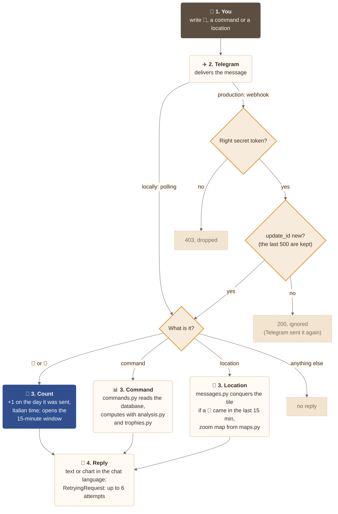
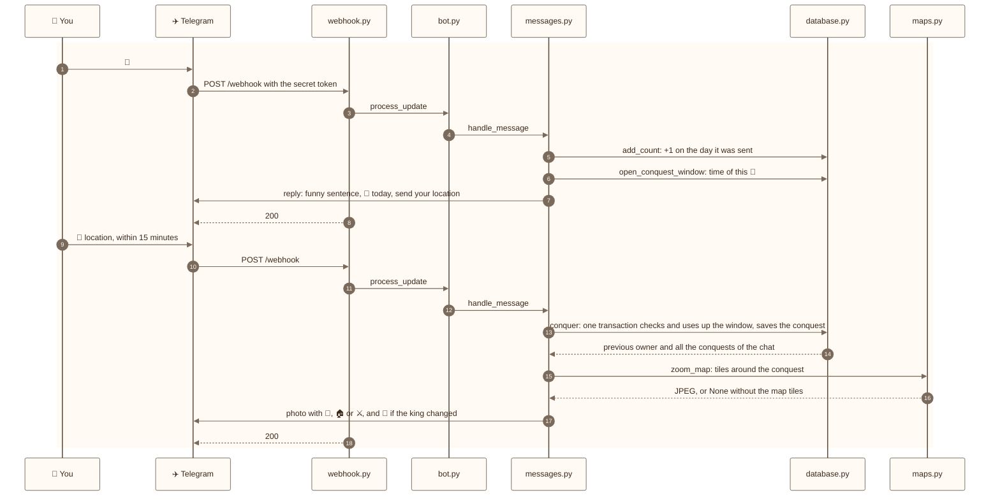
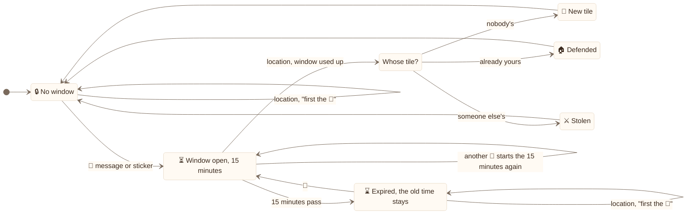
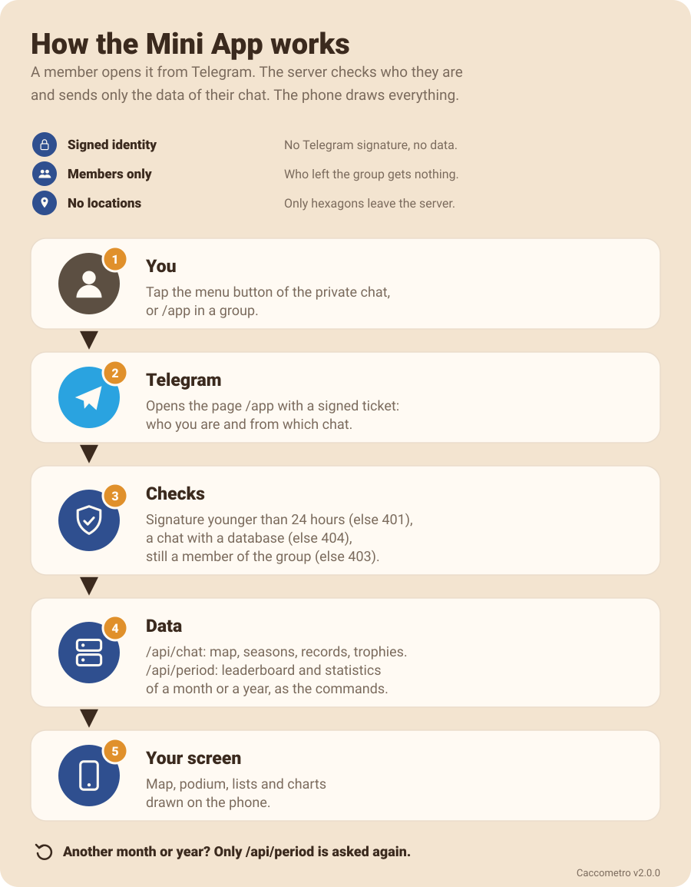
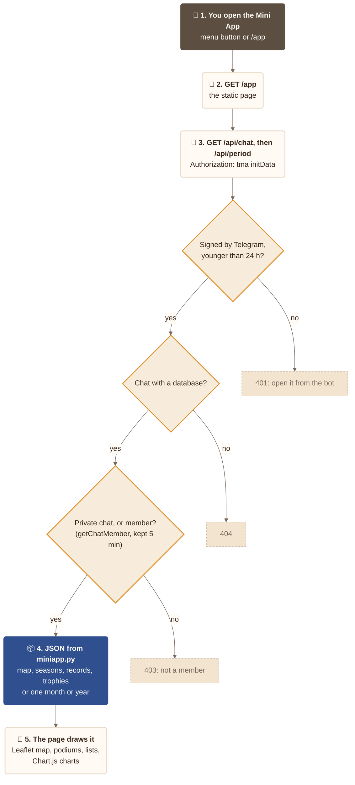
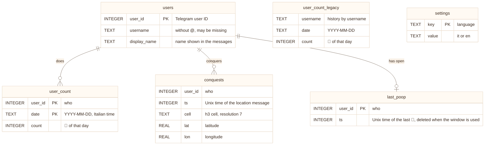

# Architecture

How the bot is built: the modules, the path of a message, the database and the translations. For running it, see [CONTRIBUTING.md](../CONTRIBUTING.md) and [deployment.md](deployment.md).

## Modules

```
caccometro/          the bot, as a Python package
  __init__.py        version (__version__)
  __main__.py        python -m caccometro: start in polling mode
  config.py          environment variables, date formats, Italian time
  bot.py             python-telegram-bot Application, logging, send retries, command registration
  webhook.py         Flask app that receives the updates from Telegram (production)
  commands.py        the commands (/leaderboard_month, /records, ...) and the permission checks
  messages.py        counting the 💩 in messages and stickers, conquests from locations
  chat.py            shared helpers on Telegram users and messages
  i18n.py            translations: the Italian sentences are the keys, one dictionary per language
  menus.py           command names and menu descriptions in both languages, menu of a chat
  database.py        SQLite database: schema, migration, queries
  analysis.py        records, streaks, statistics and forecasts (pure functions, no database)
  conquest.py        conquest game: h3 tiles, 15 minute window, ownership and king of the hill (pure functions)
  trophies.py        trophies: 15-day streaks, 💩 of the month and of the year, conquest seasons (pure functions)
  formatting.py      texts of /records, /trophies and the midnight announcement
  announce.py        midnight announcement of the 💩 of the month (scheduled task)
  charts.py          ranking and statistics charts (PNG in memory)
  maps.py            conquest maps over OpenStreetMap tiles (JPEG in memory, tile cache in tile_cache/)
  miniapp.py         Mini App: signed initData, membership checks, direct link, data of the map, seasons, records and periods
assets/webapp/       the Mini App page (static HTML and JavaScript, libraries from a CDN)
scripts/set_webhook.py   registers the webhook on Telegram (once)
tools/               service scripts: deploy, database backups, log download and summary, bot version, command menus, README charts and maps, page of the replies, module diagram, pages of the functions and of the use cases
.githooks/           git hooks (pre-commit, commit-msg), enabled with core.hooksPath
.gitattributes       line endings of the .py files (CRLF) and of the hooks (LF)
tests/               pytest tests
.github/workflows/tests.yml   CI: pytest on Python 3.10 on every pull request and every push to main
requirements.txt     bot dependencies (requirements-dev.txt: the test ones too)
wsgi.py              template of the WSGI file for the hosting
assets/              avatar, animation, fonts, medal images of the charts, README charts (screenshots/)
```

Every public function and class, with what it does and which modules use it, is in [functions.md](functions.md), written from the code by `tools/write_functions.py`; which of them each use case calls is in [use_cases.md](use_cases.md), written by `tools/write_use_cases.py`.

`analysis.py`, `trophies.py` and `conquest.py` do not touch the database or Telegram: they receive the counts and return records, statistics and trophies, which makes them the easiest parts to test.

`maps.py` draws the conquest maps: OpenStreetMap raster tiles fetched with `httpx` (User-Agent with the project name and repository, two attempts, 10 seconds for all the tiles of an image), kept 7 days in `tile_cache/` (at most 3000 files, the oldest dropped first), joined with Pillow and drawn with matplotlib in Web Mercator. The zoom around a conquest, the only map that follows the location, shows the real tiles (h3 resolution 6); `/conquests` shows fixed boxes: Lombardy at resolution 5, Italy at resolution 4 and the world at resolution 1, where a hexagon goes to the member holding most tiles inside it, on a tie the latest conqueror. When the tiles cannot be fetched, `maps.render` returns None and the reply goes out as text. `tools/sample_maps.py` draws the README maps (by hand: it needs the network).

## Dependencies between modules

Which module imports which, drawn from the code by `tools/draw_dependencies.py` (a test fails when it no longer matches). The arrows mostly go down: the Telegram code uses the replies, the replies use the rules, and the rules and the storage know nothing of Telegram. Two arrows cross between rules and storage: `analysis.py` takes only the `User` type from `database.py`, never a query, and `database.py` uses `conquest.cell_of` to recalculate the saved conquests when the schema changes (#174).

<!-- drawn by tools/draw_dependencies.py: start -->


An arrow goes from a module to the modules it imports; its number is how many names of the imported module it uses: functions, classes and constants (the functions and classes: [functions.md](functions.md), column Used by). Not drawn: `config.py`, `i18n.py`, imported by almost every module, and `__init__.py`, which holds only the version.

Import cycles: none.
<!-- drawn by tools/draw_dependencies.py: end -->

## Path of a message

From sending to reply. In production Telegram calls the webhook; locally the bot asks Telegram for the updates (polling). The bot asks only for messages (`allowed_updates`).



- When an update is done, `bot.py` (`LoggingApplication`) writes one line: `Update <id> done: command=<English command, or message, sticker, location> chat=<private|group> ms=<duration> attempts=<requests to Telegram, retries included> outcome=<ok|lost|error>`. `lost` means the network gave up after all the attempts, `error` any other exception. In webhook mode the line covers the whole request, also the start of the Application (its `getMe` after a reload, with the retries), and is written even when the start fails. No names, no text: the nightly summary is built on this line.
- An error inside a command or the counting goes to the error handler of `bot.py` (logged with the traceback and the command): the webhook still answers 200, so Telegram does not send the update again. A 💩 is counted before the reply is sent, so a lost reply never loses the count.
- An error outside the handlers (for example the bot cannot start) makes the webhook answer 500. Telegram sends the update again later. The `update_id` is remembered once the Application has started, so a 💩 is never counted twice, and an update refused because the start failed is processed when it comes again.
- `RetryingRequest` waits 1, 2, 4, 8 and 16 seconds between the attempts. It does not retry timeouts and read errors, because the message may have already arrived.
- The webhook starts and stops the Application at every request: each Flask request has its own event loop.

## A 💩 and its conquest

The same path in time order, for a 💩 in a group followed by a location (production, webhook mode). Each update is a separate request: the database is what links the two.



The window of each person is one row of `last_poop`. A location conquers only while that row is younger than 15 minutes, and the conquest deletes it, so one 💩 gives one conquest. The tile belongs to the latest conquest saved for it, and the history is never reset.



Seasons are not drawn: they are calendar quarters computed from the dates of the conquests, with no state of their own (`trophies.season_results`).

## Mini App

<p align="center"></p>

The Mini App (#79) is one static page, `assets/webapp/index.html`, served by Flask at `/app`, with its libraries from a CDN and no build step. It opens from the menu button of the private chat or from the button of `/app` in a chat (direct link `t.me/<bot>/app?startapp=<chat_id>`, already on that chat: groups accept only plain URL buttons). The page asks the JSON API of `webhook.py` for the data:

- every call carries the signed `initData` in `Authorization: tma <initData>`; `miniapp.user_of` checks the signature with the bot token and refuses it after 24 hours (401);
- `webhook.member_chat` checks the chat of every call: it must have a database (404 otherwise: the API never creates one) and the user must be a member: `getChatMember`, trusted for 5 minutes, refuses who left or was kicked (403); the private chat needs no check;
- `/api/chat?chat=<id>` sends what does not depend on a period: the bot version (shown at the bottom of every tab), the language and today's date of the chat; the conquest map (`miniapp.conquest_data`: for each h3 resolution from 7, the tiles, to 1, the world, the hexagons with their owner, the tiles each member holds and ever conquered inside and the outline computed with `h3`, plus names, ranking, king, current season and `seasons`, the conquests and the tiles held of every season from `miniapp.season_boards`); and the records and trophies of the group and of each person (`miniapp.records_data`, the same functions as `/records` and `/trophies`). The saved locations never leave the server;
- `/api/period?chat=<id>&year=<YYYY>[&month=<MM>]` sends a month or a year (`miniapp.period_data`): the leaderboard with the forecast like `/leaderboard_month`, the statistics like `/stats_month` with the regularity of each person (`analysis.regularity`, see [the study](research/regularity_index.md)), and the counts of every day for the charts drawn by the page.



The page follows Telegram's light or dark mode and its back button; how it is organised and why is in [Mini App design](research/mini_app_design.md).

Each call holds the single worker of the web app like an update, and its calls to Telegram go through `RetryingRequest`.

## Database

One SQLite file per chat, `db/<chat_id>_bot_data.db`:



- `conquests` keeps every conquest: the owner of a tile is its latest row (in the order the bot handled them); holdings and the king are replayed from the history (`conquest.holdings`). Latitude and longitude are kept so the resolution can change later.
- `settings` is created on the first choice made with `/language`: without the table the chat speaks Italian.
- `user_count_legacy` exists only in the chats migrated from the first version and empties as `/link_history` moves the history into `user_count`.
- The schema version is in `PRAGMA user_version` (4 today; 3 added `conquests` and `last_poop`, 4 recalculated every conquest at h3 resolution 7 from its latitude and longitude). The migration starts by itself when the database is opened, inside `BEGIN IMMEDIATE`, after a copy `db/<chat_id>_bot_data.db.v1.bak`.
- When a group becomes a supergroup, the database is renamed `db/<old>_bot_data.db` → `db/<new>_bot_data.db`. If the migration message arrives late and the new database already has counts, the two are merged (same user and same day are added up, conquests appended) and the old file stays as `<old>_bot_data.db.merged`. The migration also starts from the twin message in the old chat, so it gets two chances.

## Translations

`i18n.py` keeps the texts simple: the bot messages are written in Italian inside `tr("...")`, and each other language is a dictionary from the Italian sentence to its translation. The language of the chat is read once per update (`chat.register_sender`) and kept in a context variable, so every `tr()` of that update answers in it; the midnight announcement sets it for each chat. `tests/test_i18n.py` fails when a sentence has no translation.

A new language is one more dictionary in `i18n.py`, plus its name in `LANGUAGES` and its months in `MONTHS`.
