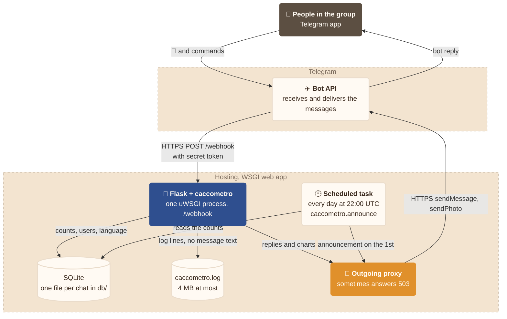
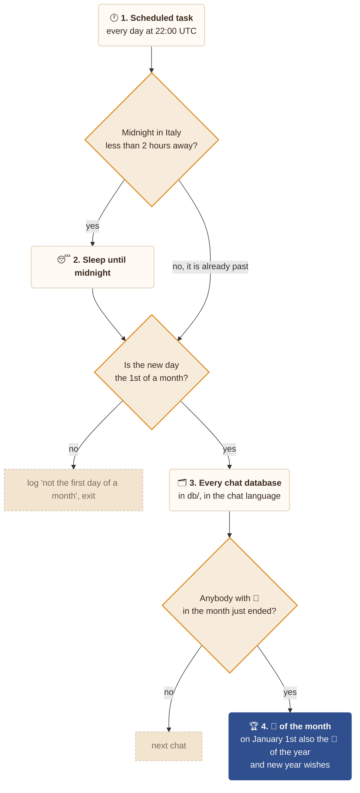

# Deployment

How to set up a bot on Telegram and run Caccometro in production. For the day-to-day work on a running bot (deploys, backups, logs, releases) see [operations.md](operations.md).

## Telegram setup

1. On **[@BotFather](https://t.me/botfather)** create a bot with `/newbot` and note its username and token. Keep a separate bot for development.
2. With `/setprivacy` choose **Disable**, otherwise the bot does not see the 💩 in groups.
3. Register the command menus and the descriptions below, on every bot. Telegram shows them in the app language of whoever opens them: the Italian ones are the default, the English ones are registered with `language_code=en`. When a chat chooses its language with `/language`, the bot sets the menu of that chat in that language for everybody (see below).

### Command menus

Italian menu (`/setcommands` on BotFather, or `setMyCommands`; the texts come from `caccometro/menus.py`):

```
start - Avvia il bot e spiega come contare le 💩.
classifica_mese - Classifica del mese, corrente o [MM-YYYY, anche marzo 2026].
classifica_anno - Classifica dell'anno, corrente o [YYYY o YY].
statistiche_mese - Media, mediana e varianza del mese, corrente o [MM-YYYY, anche marzo 2026].
statistiche_anno - Media, mediana e varianza dell'anno, corrente o [YYYY o YY].
record - Record del gruppo; con io o @username quelli di una persona.
trofei - Trofei del gruppo; con io o @username quelli di una persona.
conquiste - Zone conquistate con una posizione dopo la 💩; con io o @username quelle di una persona.
app - Apre la Mini App: classifiche, statistiche e mappa delle conquiste.
conto_giorno - 💩 di un giorno: [@username] [DD-MM-YYYY, oggi, ieri].
ultima_cacca - Giorni dall'ultima 💩: [@username].
aggiungi_cacca - Aggiunge 1 💩 in un giorno: [@username] DD-MM-YYYY, oggi o ieri (altri: solo admin).
togli_cacca - Toglie 1 💩 in un giorno: [@username] DD-MM-YYYY, oggi o ieri (altri: solo admin).
lingua - Lingua del bot in questa chat: it o en (nei gruppi solo admin).
```

English menu (`setMyCommands` with `language_code=en`):

```
start - Start the bot and explain how to count 💩.
leaderboard_month - Leaderboard of the month, current or [MM-YYYY, also march 2026].
leaderboard_year - Leaderboard of the year, current or [YYYY or YY].
stats_month - Mean, median and variance of the month, current or [MM-YYYY, also march 2026].
stats_year - Mean, median and variance of the year, current or [YYYY or YY].
records - Group records; with me or @username those of one person.
trophies - Group trophies; with me or @username those of one person.
conquests - Tiles conquered with a location after the 💩; with me or @username those of one person.
app - Open the Mini App: leaderboards, statistics and conquest map.
day_count - 💩 of a day: [@username] [DD-MM-YYYY, today, yesterday].
last_poop - Days since the last 💩: [@username].
add_poop - Add 1 💩 on a day: [@username] DD-MM-YYYY, today or yesterday (others: admins only).
remove_poop - Remove 1 💩 on a day: [@username] DD-MM-YYYY, today or yesterday (others: admins only).
language - Language of the bot in this chat: it or en (in groups admins only).
```

`/link_history` (`/collega_storico`) is for admins only: it goes in the administrators' list (`setMyCommands` with scope `all_chat_administrators`), together with the other commands, in both languages. The menus are set for four scopes: default, private chats, groups, group administrators. `python tools/register_menus.py dev|prod` registers them all from the code and reads them back with `getMyCommands`.

**Menu of a chat.** `/language it|en` also sets the menu of that chat in the chosen language, without `language_code`, so it wins over the menus above whatever the app language: scope `chat` in private chats; in groups scope `chat` and scope `chat_administrators` (with `/link_history`: for the admins Telegram looks at the chat scope before `all_chat_administrators`). A group that becomes a supergroup gets it again. Chats that never chose a language keep the menus above. If Telegram refuses the menu, the language is kept anyway and the log has a warning: sending `/language` again repairs it.

### Mini App

Once per bot (development and production):

1. On BotFather, by hand (there is no API for it): `/newapp`, choose the bot, short name `app` (the `/app` command builds the link `t.me/<bot>/app?startapp=<chat_id>` with it), URL `https://<web app domain>/app`.
2. The menu button, set by `python tools/register_menus.py prod` (dev: `python tools/register_menus.py dev <URL>`). In private chats the button next to the text field then opens the Mini App on the private chat with the bot (a group opens only from its `/app` button); typing `/` still shows the commands.

The page calls `/api/chat` with the signed `initData` in the `Authorization: tma <initData>` header: the server checks the signature with the bot token (at most 24 hours old) and, for a group, that the user is still a member (`getChatMember`, trusted for 5 minutes). For a test with the development bot, a temporary HTTPS tunnel to the local Flask app is enough; its URL goes to `/editapp` on BotFather and to `register_menus.py dev <URL>`.

### Descriptions

Italian (`/setdescription` and `/setabouttext`, or `setMyDescription` and `setMyShortDescription`):

- **Descrizione:** Manda 💩 o 🚽 quando hai fatto il tuo dovere: il bot tiene il conto per ogni persona del gruppo, con classifiche, statistiche, grafici e record personali e di gruppo.
- **Descrizione breve:** Conta le 💩 del gruppo: classifiche, statistiche, grafici e record.

English (`setMyDescription` and `setMyShortDescription` with `language_code=en`):

- **Description:** Send 💩 or 🚽 when you have done your duty: the bot keeps the count for every person in the group, with leaderboards, statistics, charts and personal and group records.
- **Short description:** Counts the 💩 of the group: leaderboards, statistics, charts and records.

After every release `tools/bot_version.py` adds a "Versione X.Y.Z" / "Version X.Y.Z" line at the end of both descriptions ([operations.md](operations.md#releases)).

## Production

In production the bot runs as a Flask web app on a WSGI hosting (we use [PythonAnywhere](https://www.pythonanywhere.com/), free plan, Python 3.10): Telegram calls `/webhook` on every message.



The replies go out through the hosting proxy, which sometimes answers 503 for a few seconds: `RetryingRequest` tries again ([architecture.md](architecture.md#path-of-a-message)).

### 1. Code and dependencies

Copy the `caccometro/`, `assets/` and `scripts/` folders to the server, then install the dependencies in `requirements.txt` (on the free plan, with `pip install --user`). Later updates go through `tools/deploy.py` ([operations.md](operations.md#deploy)).

### 2. The `.env` file

On the server, create `.env` from [`.env.example`](../.env.example) with the production token, a long random `WEBHOOK_SECRET` (letters, digits, `_` and `-`) and `RUN_MODE = 'WEBHOOK'`. Never commit it.

### 3. WSGI file

The hosting web app has its own WSGI file: replace its content with that of `wsgi.py`, setting `path` to the folder that contains the `caccometro` package.

```python
import sys

path = '/home/<your-username>'
if path not in sys.path:
    sys.path.insert(0, path)

from caccometro.webhook import app as application
```

Reload the web app: the home page answers with a greeting and the bot version.

### 4. Webhook

Once, from a console on the server:

```bash
python scripts/set_webhook.py
```

The script registers the `/webhook` URL on Telegram with the `WEBHOOK_SECRET`, asking for messages only: calls without the secret get 403.

### 5. Midnight announcement

Create a daily scheduled task at **22:00 UTC** that starts from the project folder:

```bash
cd /home/<your-username> && python3.10 -m caccometro.announce
```

At 22:00 UTC it is 23:00 in Italy (winter time) or midnight (summer time), so the script works out which day is starting:



To try it without sending anything: `python3.10 -m caccometro.announce --date 2027-01-01 --dry-run`.

### Web app expiry

On the free plan the web app **expires about every month**: in the Web tab choose "Run until 1 month from today". The scheduled task must be extended too, otherwise the midnight announcement is skipped. There is no API for it: `tools/deploy.py` and `tools/fetch_logs.py` print the days left and warn below 14.
