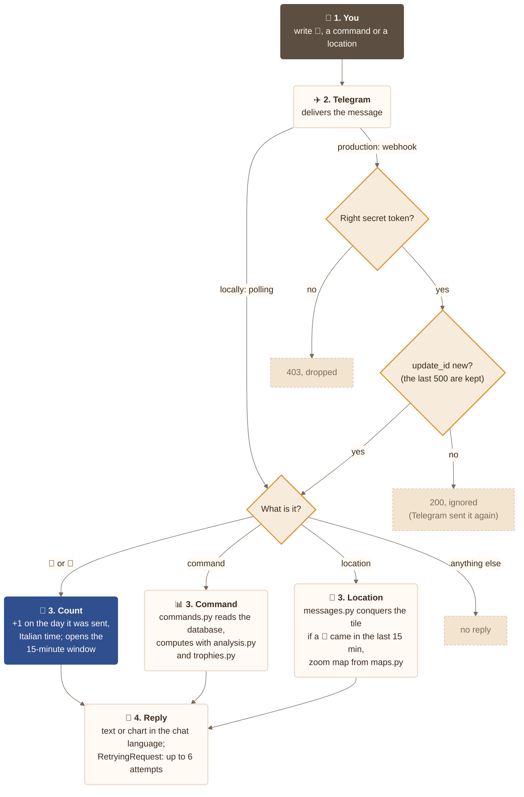
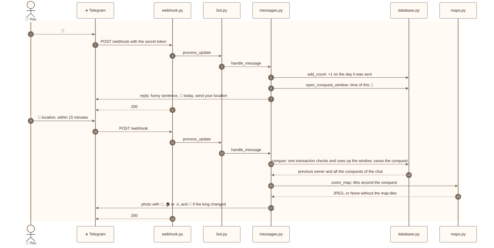

# Mermaid check (temporary)

Test page for the style proposed in [research/diagrams.md](research/diagrams.md): look at it on GitHub in light and dark mode. Deleted before the merge of #204.

## Mermaid version

```mermaid
info
```

## Flowchart with the style



## Sequence diagram with the style


