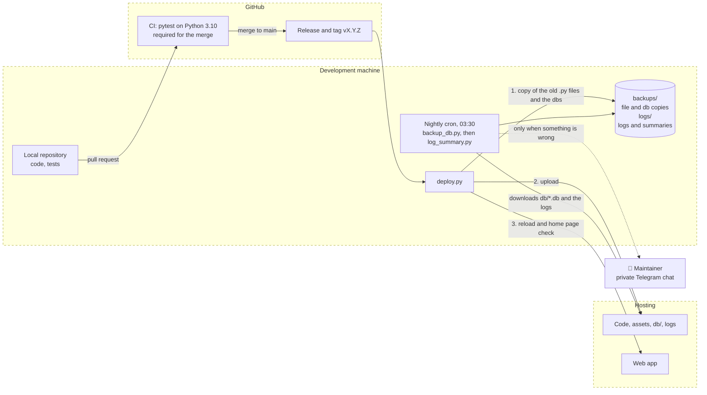
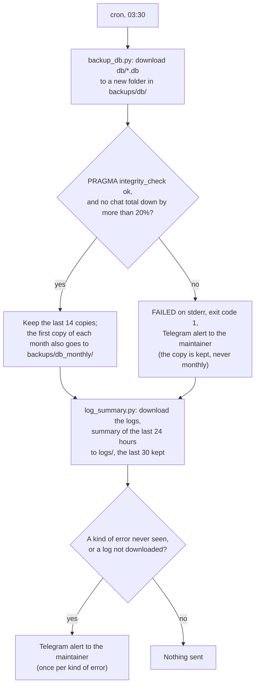

# Operations

The service scripts in `tools/` that keep the production bot running: deploy, backups, logs, releases. They run on the development machine and talk to the hosting through its HTTP API. For the first setup of the server see [deployment.md](deployment.md).

**Settings.** The scripts read `HOSTING_USERNAME` from the `.env` and the API token from the `HOSTING_API_TOKEN` environment variable (never in the `.env`, never printed). Run them from the repository root, with the virtual environment active. Backups and logs always end up in the project `backups/` and `logs/` folders, whatever folder the scripts start from, and only the owner can read them: they hold database copies and usernames.



## Deploy

`tools/deploy.py` runs only after the merge, by hand. Nothing runs on the server.

```bash
python tools/deploy.py caccometro/*.py           # dry run: shows what would change
python tools/deploy.py caccometro/*.py --yes     # real deploy
python tools/deploy.py --rollback backups/<stamp> --yes
```

With `--yes` it saves the old files and the databases in `backups/<stamp>/`, uploads the new files (fonts and emoji first, the WSGI file given with `--wsgi` last), reloads the web app, checks that the home page shows the new version and writes a line in `backups/deploys.log`. The rollback restores the saved `.py` files; it does not delete the files the deploy created.

## Nightly backup and log summary

A cron job on the development machine runs every night at 03:30 the backup and then the log summary, in the same line, so the summary runs even if the backup fails. Both write to `backups/db_backup.log`. The job runs only while the machine is on, and a skipped night is not caught up.



- **Backup** (`tools/backup_db.py [--keep N]`): the alerts are sent by the development bot (`BOT_TOKEN` of the local `.env`) to the `ALERT_CHAT_ID` chat; without that variable nothing is sent. When the backup works nothing arrives.
- **Log summary** (`tools/log_summary.py`): updates received, retries towards Telegram, lost replies, calls refused by the webhook (403), slowest update and errors grouped by kind. The expected kinds are listed in `KNOWN` in the script; the kinds already reported are in `logs/seen_kinds.txt`.
- **Logs** (`tools/fetch_logs.py`): downloads the bot log and the web server logs into `logs/`, to look for errors by hand. The logs contain usernames: never publish them.

## Restoring a database

1. Run `tools/backup_db.py` to save the current state.
2. Pick the copy in `backups/db/` or `backups/db_monthly/` and check it with `sqlite3 <file> "PRAGMA integrity_check"`.
3. In the hosting Files tab, `db/` folder, upload the file with the same name `<chat_id>_bot_data.db`, overwriting the current one (no reload or journal files needed).
4. Try `/record` in the chat. The 💩 counted after the copy must be added back with `/aggiungi`.

Tested on a copy: the restored file is sound and the totals are those of the copy.

## Releases

The version is in `caccometro/__init__.py` (`__version__`, [Semantic Versioning](https://semver.org/)): `/start`, the home page and the charts show it. A release:

1. A bump issue raises `__version__`; its pull request is merged like any other.
2. Signed tag `vX.Y.Z` and GitHub release titled `vX.Y.Z <Short name>`.
3. Deploy with `tools/deploy.py`, including `caccometro/__init__.py`.
4. `tools/bot_version.py` writes "Versione X.Y.Z" / "Version X.Y.Z" at the end of the descriptions of the production and development bots, in Italian and English (the description of each language must already be there).
5. If the commands changed, register the menus again on both bots ([deployment.md](deployment.md#command-menus)) and read them back with `getMyCommands`.

The charts in the README carry the version too: the commit of the bump redraws them (`tools/sample_charts.py`, see [CONTRIBUTING.md](../CONTRIBUTING.md#git-hooks)).

## Web app expiry

The free plan web app and the scheduled task expire every 3 months and must be extended by hand ([deployment.md](deployment.md#web-app-expiry)). `tools/deploy.py` and `tools/fetch_logs.py` print the days left and warn below 14.
