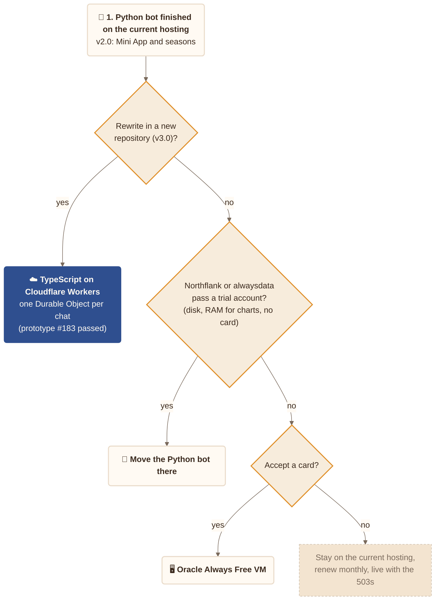

# Hosting

Where the bot should run: free, no card, maintenance close to zero, a disk that keeps the SQLite files (or an equivalent store), a scheduled job for the midnight announcement, and a reliable connection to Telegram. Comparison made for #89 in November 2026; prototype in #183.

## The current hosting

- Free, no card; a webhook web app with one worker, 512 MB of disk, no always-on process.
- Every outgoing request goes through a proxy that returns bursts of 503 errors: on 16 November 2026, 43 retries on 49 updates and 4 replies lost even after 6 attempts in 31 seconds (#70, #75, #125).
- The web app and the scheduled task expire and must be renewed by hand every month.
- The Python version of the current system image is 3.10 (end of life); a newer image exists but the switch is one way and the packages must be reinstalled.

## The options

| Option | Cost and card | Always on | Disk for SQLite | Scheduled job | Main limit | Verdict |
| --- | --- | --- | --- | --- | --- | --- |
| Current hosting | Free, no card | Webhook only | Yes, 512 MB | One daily task, renewed monthly | Proxy 503s, monthly renewals | Works today |
| Northflank Sandbox | Free, "no card" (disputed by third parties) | Yes | Volumes, size unknown | 2 jobs | RAM "limited", region unknown | To try |
| alwaysdata Free | Free | To verify | Yes, 1 GB | Cron | 256 MB of RAM may not fit charts and maps | To try |
| Oracle Always Free | Free, **card required** | Yes | Yes, 200 GB | Cron | Idle instances reclaimed; account closures reported | Fallback if a card is accepted |
| Google `e2-micro` | About 3.65 $/month for IPv4 | Yes | Yes, 30 GB | Cron | Not free | Out |
| Vercel Hobby + Turso | Free, no card | Serverless | External database | Cron off by up to an hour | Rewrite of the storage | Partial |
| Render, Koyeb, Hugging Face | Free | Sleep after 15 min to 48 h | Ephemeral or none | Paid or none | Files lost, Telegram blocked on HF | Out |
| Fly.io, Heroku, Glitch, Deta, Replit | No free plan | | | | | Out |
| Cloudflare Workers (rewrite in TypeScript) | Free, no card | Yes, no cold start for the bot | One Durable Object with SQLite per chat | Free cron | 10 ms CPU per request: charts must come from an external service, the map becomes a web page | Candidate of #183 |

Sources: the pricing and documentation pages of each provider, read in November 2026; the full list of links is in #89.

## Prototype results (#183)

A throwaway Worker on the free plan passed the five criteria: a 💩 counted and answered with 1-2 ms of CPU (under 1 s, 828 ms on a cold start); one Durable Object with its own SQLite per chat; a leaderboard photo from an external chart service in 729 ms; the interactive map with Telegram-signed identity; and the cron at Italian midnight (forced run on 23 November, real midnight message received on 24 November).

## Decision pending

- Plan of 23 November 2026 (#185): first finish the Python bot on the current hosting (milestone v2.0: Mini App and seasons), then rewrite in a new repository (milestone v3.0: #183, #89, #15, #125).
- Leading candidate: TypeScript on Cloudflare Workers with one Durable Object per chat, because it passed the prototype and removes the proxy and the monthly renewals.
- If the rewrite does not happen: stay in Python and move to Northflank or alwaysdata after a trial account, Oracle as fallback.
- Every free plan shrank somewhere between 2024 and 2026: whatever the choice, the nightly backup outside the hosting and the scripted deploy stay.
