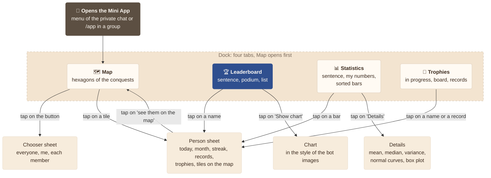
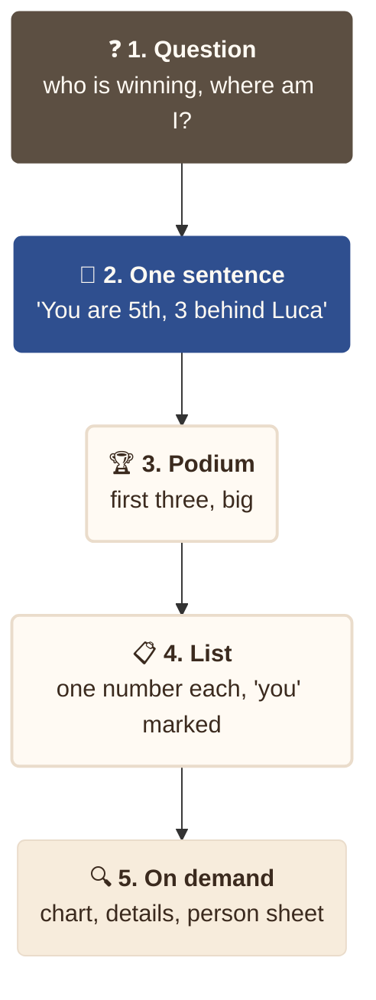

# Mini App design

How the Mini App (#79, #189, #190) shows a group's leaderboards, statistics, records, trophies and conquest map on a phone. People open it for a few seconds to see who is winning; the design must answer that first.

## What the evidence says

**Answer first, details on demand.** Show the few most important things first and keep at most two levels: a summary, then one layer of detail ([NN/g, progressive disclosure](https://www.nngroup.com/articles/progressive-disclosure/)). Short contextual detail goes in a bottom sheet that keeps the page visible; long content gets its own screen ([NN/g, bottom sheets](https://www.nngroup.com/articles/bottom-sheet/); [Apple HIG, sheets](https://developer.apple.com/design/human-interface-guidelines/sheets)).

**One dominant element per screen.** About three text sizes, one big number, no light weights; body text 16-17 px; spacing on an 8 px grid; touch targets of 44-48 px ([Apple HIG, typography](https://developer.apple.com/design/human-interface-guidelines/typography); [Android, touch targets](https://support.google.com/accessibility/android/answer/7101858)). Lists, not cards, when people rank or compare items ([NN/g, cards](https://www.nngroup.com/articles/cards-component/)).

**Navigation.** A bottom bar with 3-5 labelled destinations, always visible and never disabled ([Apple HIG, tab bars](https://developer.apple.com/design/human-interface-guidelines/tab-bars)). A segmented control for 2-5 views inside a section; dropdowns are a poor fit for a few options ([NN/g, dropdowns](https://www.nngroup.com/articles/drop-down-menus/)). Removing text labels made Google's expressive designs harder to use ([Material 3 Expressive research](https://design.google/library/expressive-material-design-google-research)).

**Numbers before charts, "me" in colour.** A big number with a one-line comparison; a chart only when the shape matters. Sorted bars or one line, never pies or gauges; the reader's own series in colour, the others grey; names written on the chart instead of a legend ([NN/g, dashboards](https://www.nngroup.com/articles/dashboards-preattentive/); [Datawrapper](https://www.datawrapper.de/blog/emphasize-with-color-in-data-visualizations)).

**Leaderboards among friends.** Leaderboards raise short-term effort but can hurt those at the bottom; relative boards (your neighbours, the gap to the person above) work better than a bare ranking ([Na & Han 2023](https://www.emerald.com/insight/content/doi/10.1108/intr-12-2021-0897/full/html); [Jia 2018](https://scholarworks.iupui.edu/bitstream/1805/17645/1/Jia_2018_designing.pdf); [HKU study](https://hub.hku.hk/bitstream/10722/368255/1/content.pdf)). Frequent resets and more than one way to win keep everyone in the game (Duolingo leagues; Strava Local Legend, [BikeRadar](https://www.bikeradar.com/news/strava-local-legend/)). Show trophies in progress with how much is left, above the ones already won (Apple Fitness awards).

**Glass only on controls.** Apple's Liquid Glass belongs to the navigation and control layer, never to the content layer, and must stay legible ([Apple, adopting Liquid Glass](https://developer.apple.com/documentation/technologyoverviews/adopting-liquid-glass.md)); critics measured contrast as low as 1.5:1 on glass ([NN/g, Liquid Glass](https://nngroup.com/articles/liquid-glass); [Infinum](https://infinum.com/blog/apples-ios-26-liquid-glass-sleek-shiny-and-questionably-accessible/)). On the web: a solid fallback without `backdrop-filter` and with reduced transparency.

**Telegram.** Behave like Telegram: follow light or dark mode, use the native back button, respect safe areas, light haptics only on selection changes, disable vertical swipes while dragging a map ([Telegram Web Apps](https://core.telegram.org/bots/webapps)).

**Accessibility.** Text contrast 4.5:1, graphics 3:1, colour never the only cue, names for icon-only buttons, alternatives to dragging, reduced motion respected ([WCAG 2.2, contrast](https://www.w3.org/WAI/WCAG22/Understanding/contrast-minimum.html); [dragging](https://www.w3.org/WAI/WCAG22/Understanding/dragging-movements.html); [motion](https://www.w3.org/WAI/WCAG22/Understanding/animation-from-interactions.html)).

**Generated look.** The same rounded card with the same shadow everywhere, decorative gradients, arrows and middle dots as separators, and stock stat tiles read as templated. These come from practitioner opinion pieces, not from studies.

## What we chose and why

### Structure at a glance

What each tab shows first, and what opens with one tap. Two levels at most: the tab, then a sheet or a closed section.

### Reading order of one tab

Every tab answers the main question before showing anything else.

### The choices

| Choice | Why | Alternative left out |
| --- | --- | --- |
| Four tabs: Map, Leaderboard, Statistics, Trophies; Map opens first | 3-5 labelled tabs; the map is the newest part of the game | Five tabs with Records alone: one tab too many for the content |
| Each tab opens with a sentence ("You are 5th, 3 behind Luca"), then a podium, then a compact list with one number | Answer first; relative position motivates more than rank alone | Full tables first: too much at once (owner feedback, NN/g) |
| The reader's row is marked with "you"; ties share the position and say "tie" | Von Restorff effect; colour is never the only cue | Colour only |
| Forecast as words ("by month end ~44", "at this pace you finish 3rd") | Plain language; no symbols to decode | An arrow "→ 44" |
| Charts and technical numbers (mean, median, variance, normal curves, box plot in the style of the bot images) under "Details" | Details on demand; same look as the command images for whoever opens them | Charts always visible: crowded with many members |
| Statistics in plain words: per day on average, place, a typical day, "how you go" ([regularity index](regularity_index.md)); sorted bars with the reader in colour and the others grey | Non-experts; "me" against the group | Podium of the mean: a second leaderboard that looks like the first |
| A tap on a name opens the person in a bottom sheet (today, this month, streak, records, trophies, tiles on the map); Telegram's back button closes it | Two levels at most; one place for a person | A menu that changed every tab at once (confusing) |
| One chooser button with a list that slides up, for the map and the records | Fixed space whatever the group size; with 12 people chips took five rows | Chips on every tab (the study's advice) and a native dropdown (anonymous) |
| Records stay with Trophies (two sections: Trophies and Records) | Records and trophies are achievements; Statistics shows the chosen period only | Records in Statistics: they do not change with the period above them |
| Trophies: "In progress" first (streak with a bar and the days left, the race of the month, the season), then the board with a small legend | Goals within reach first (Apple Fitness) | Board only |
| Conquests by season with arrows to the past seasons, or in total (tiles held now, as on the map) | The game titles are per season; two different numbers kept apart | One all-time list |
| Glass only on the dock, switches, chooser, map buttons and sheets; content on solid surfaces | Apple's rule and legibility | Glass everywhere (tried, harder to read) |
| The bot's palette (avatar colours, Nunito, denim) with a dark variant when Telegram is dark | Brand of the chart images; no bright page in a dark app | Telegram theme colours only |
| Flat background, radius by rank (podium 24, lists 18, small parts 12), the four personal numbers in one block with hairlines | Avoid the generated look | Decorative gradients and identical cards |

Checked in a headless browser at 360 and 390 px, light and dark, Italian and English, with a fake group of 12 people. Still to check on real phones: glass and scrolling on a low-end Android, haptics, and the header colours.

## How a design change is made

The workflow followed for every choice above, and to follow for the next ones.

```mermaid
flowchart TD
    ask("👤 <b>1. The owner asks for a change</b>")
    critique("🔍 <b>2. Critique the request first</b><br/>what is weak, what an expert would do")
    evidence{"Is there evidence<br/>to decide?"}
    research("📚 Research<br/>guidelines, studies, apps<br/>(notes kept locally, summary in docs/research)")
    options("⚖️ <b>3. Two options at most</b><br/>with a recommendation")
    compare{"Hard to judge<br/>in words?"}
    ab("🖼️ Both built,<br/>screenshots side by side")
    choose("👤 The owner chooses")
    build("🔨 <b>4. Build it</b>")
    headless("🧪 <b>5. Headless browser check</b><br/>360 and 390 px, light and dark,<br/>Italian and English, fake group of 12")
    edge{"Errors or content<br/>past the edge?"}
    phone("👤 <b>6. The owner tries it on the phone</b><br/>development bot")
    doc("📝 <b>7. The choice and the why</b><br/>in docs/research")
    ask --> critique --> evidence
    evidence -->|"no"| research --> options
    evidence -->|"yes"| options
    options --> compare
    compare -->|"yes"| ab --> choose --> build
    compare -->|"no"| build
    build --> headless --> edge
    edge -->|"yes"| build
    edge -->|"no"| phone --> doc
    classDef step fill:#fffaf3,stroke:#eadccb,stroke-width:2px,color:#3b2a1e
    classDef main fill:#2f4f8f,stroke:#2f4f8f,color:#fffaf3
    classDef person fill:#5c4f42,stroke:#5c4f42,color:#fffaf3
    classDef check fill:#f7ecdc,stroke:#e0902b,stroke-width:2px,color:#3b2a1e
    classDef detail fill:#f7ecdc,stroke:#eadccb,color:#3b2a1e
    classDef alert fill:#e0902b,stroke:#e0902b,color:#fffaf3
    classDef stop fill:#f3e4d0,stroke:#cbbca9,stroke-dasharray:4 3,color:#7a6a5c
    class ask,choose,phone person
    class options,build,headless,doc step
    class critique main
    class research,ab detail
    class evidence,compare,edge check
```

