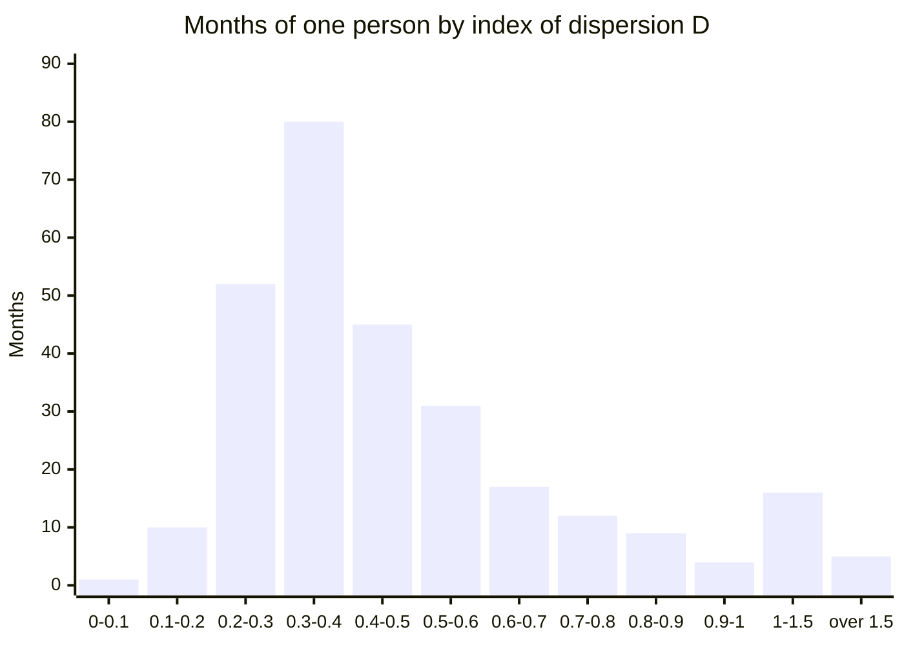
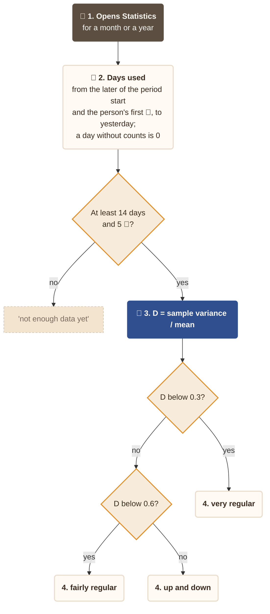

# Regularity index

How the Mini App says "how you go" (`analysis.regularity`): very regular, fairly regular or up and down, from a person's daily 💩 counts. Caccometro is a game among friends: this label is for fun, **not medical advice**.

## What the evidence says

**Medicine has no regularity index.** "Normal" frequency goes from three a week to three a day: 95.9% of US adults ([Mitsuhashi 2018](https://pubmed.ncbi.nlm.nih.gov/28762379/)), confirmed in Sweden with no sex or age differences ([Walter 2010](https://pubmed.ncbi.nlm.nih.gov/20205503/)). One to two a day matched the healthiest profile in an observational study ([Johnson-Martínez 2024](https://sciencedaily.com/releases/2024/07/240716122711.htm)). Only about 40% of men and 33% of women have a fixed daily rhythm ([Heaton 1992](https://pmc.ncbi.nlm.nih.gov/articles/PMC1379343)): being irregular is normal. Clinical definitions (Rome IV) need much more than counts ([MDCalc](https://www.mdcalc.com/calc/10003/rome-iv-diagnostic-criteria-functional-constipation)); validated tools measure stool form, not regularity ([PMC4716915](https://pmc.ncbi.nlm.nih.gov/articles/PMC4716915)).

**Statistics: the index of dispersion.** D = variance / mean of the daily counts. D = 1 is a Poisson process ("as random as dice"), below 1 steadier than chance, above 1 in waves ([index of dispersion](https://en.wikipedia.org/wiki/Index_of_dispersion)). For random data D does not change with the mean, which matters because most people stay between 0.3 and 2 a day. Alternatives were dropped:

| Measure | Problem here |
| --- | --- |
| Coefficient of variation of the counts | Grows by itself when the mean is low |
| Share of days with 💩 | Measures frequency, not regularity |
| Longest pause | Grows with the length of the period |
| Sleep regularity indices | Need times within the day, which the bot does not store |

Known limit: for someone who never has more than one a day, D is about 1 minus the share of active days, whatever their rhythm.

**How apps word it.** Three to five gentle bands, a sentence on what is measured, and a minimum of data before any verdict: Oura (two weeks, four bands), Apple (OK / Low / Very low), Fitbit (14 nights a month) ([Oura](https://support.ouraring.com/hc/en-us/articles/360057791533); [Google Fitbit](https://support.google.com/fitbit/answer/14236407)). No poop-tracking app publishes its formula.

## Measures compared

| Measure | Sees "same amount every day" | Independent of the mean | Stable over 28 days | One-sentence explanation |
| --- | --- | --- | --- | --- |
| **D = variance / mean** | yes | yes, for random data | random people fall between 0.6 and 1.5 | "1 = as random as dice" |
| Coefficient of variation | yes | **no** | yes | "variation against the mean" |
| Share of days with 💩 | no | no, it is the frequency | yes | "N days out of M" |
| Longest pause | no | no, grows with the period | no | "the longest pause" |
| Spread of the pauses | rhythm, not amount | partly | noisy, needs 3+ active days | "how equal the pauses are" |

## Calibration on the real groups

The study proposed D < 0.5 and D > 1.5 from simulations. On the November 2026 backups (282 months of one person, at least 14 days and 5 💩 each) the median D was 0.40 and the quartiles 0.31 and 0.56: with the proposed bands two people out of three were "very regular" and only 2% "up and down". The bands were moved to the real quartiles.

Months of one person by D (November 2026 backups, 282 months); the bars left of 0.3 are "very regular", those from 0.6 on "up and down":

| Bands | Very regular | Fairly regular | Up and down |
| --- | --- | --- | --- |
| Proposed by the study (0.5 / 1.5) | 67% | 32% | 2% |
| **Chosen, from the real quartiles (0.3 / 0.6)** | **22%** | **55%** | **22%** |

## What we chose and why

- **Formula**: D = sample variance / mean of the daily counts (`analysis.regularity`).
- **Days used**: from the later of the period start and the person's first 💩 in the chat, to yesterday (today is not over); days without counts are 0.
- **Minimum**: 14 days and 5 💩, otherwise "not enough data yet".
- **Bands**: D < 0.3 very regular, 0.3 to 0.6 fairly regular, above 0.6 up and down. About a quarter of the months read very regular and a fifth up and down, so the label compares friends instead of giving everyone the same word.
- **Words**: kind labels; "up and down" is a funny trait, not a fault.

Left out for now: the extra rule on the regularity of the pauses for people who go less than once a day, and any measure based on the time of the messages (more privacy at stake). The bands should be checked again when the groups have a year more of data.
