# Use cases

What the code does in each use case, read from the code by `tools/write_use_cases.py`: do not edit by hand. Each use case has three views, in UML notation drawn with Mermaid:

1. **Communication diagram**: the modules involved, one arrow for the calls from a module to another (the functions it uses, numbered) and a dashed arrow back with what they return.
2. **Sequence diagram**: the same steps in time order, with the arguments of every call and the variable that receives the result. `alt`, `opt` and `loop` boxes are the `if`, `else` and `for` of the code; a note marks a branch that ends the function, or a function of the same module already drawn above.
3. **Call tree**, folded: every function of the package the entry point may call, private functions replaced by the public ones they call.

The views come from the code, not from a run: every branch appears, whether or not it is taken. Calls inside one module have no arrow; calls to `config.py`, `i18n.py`, classes and other libraries are left out, except the Telegram methods that send something. Arguments and conditions are cut at 40 characters. What each function does is in [functions.md](functions.md); the path of a message through Telegram and the webhook is in [architecture.md](architecture.md#path-of-a-message).

## `/start`

Entry point: `commands.start_command`

```mermaid
---
config:
  theme: base
  themeVariables:
    fontFamily: "Nunito, Segoe UI, Roboto, sans-serif"
    primaryColor: "#fffaf3"
    primaryTextColor: "#3b2a1e"
    primaryBorderColor: "#eadccb"
    secondaryColor: "#f7ecdc"
    tertiaryColor: "#f3e4d0"
    lineColor: "#7a6a5c"
    textColor: "#3b2a1e"
    edgeLabelBackground: "#fffaf3"
    clusterBkg: "#f3e4d0"
    clusterBorder: "#cbbca9"
    titleColor: "#5c4f42"
    noteBkgColor: "#f7ecdc"
    noteTextColor: "#3b2a1e"
    actorBkg: "#fffaf3"
    actorBorder: "#5c4f42"
    actorTextColor: "#3b2a1e"
    signalColor: "#7a6a5c"
    signalTextColor: "#3b2a1e"
    labelBoxBkgColor: "#f3e4d0"
    loopTextColor: "#3b2a1e"
    sequenceNumberColor: "#fffaf3"
    xyChart:
      plotColorPalette: "#2f4f8f"
  flowchart:
    nodeSpacing: 50
    rankSpacing: 160
---
flowchart LR
    accTitle: Communication diagram, /start
    accDescr: The modules involved, the functions each one calls in another and what comes back, numbered as in the sequence
    telegram("<b>✈️ Telegram</b>")
    commands("<b>commands.py</b>")
    chat("<b>chat.py</b>")
    database("<b>database.py</b>")
    telegram -->|"1.#nbsp;start_command"| commands
    commands -->|"2.#nbsp;register_sender"| chat
    chat -->|"3.#nbsp;get_language<br/>4.#nbsp;upsert_user"| database
    chat -.->|"5.#nbsp;sender"| commands
    commands -->|"6.#nbsp;init_database"| database
    commands -->|"7.#nbsp;reply_text"| telegram
    classDef step fill:#fffaf3,stroke:#eadccb,stroke-width:2px,color:#3b2a1e
    classDef person fill:#5c4f42,stroke:#5c4f42,color:#fffaf3
    class commands,chat,database step
    class telegram person
```

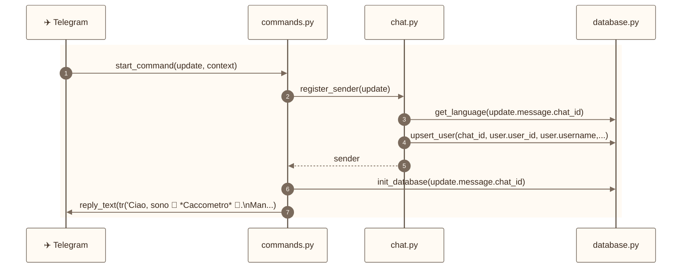

<details>
<summary>Call tree</summary>

- `chat.register_sender`
  - `database.get_language`
  - `chat.register_user`
    - `chat.display_name_of`
    - `database.upsert_user`
- `database.init_database`

</details>

## `/leaderboard_month` (`/classifica_mese`)

Entry point: `commands.leaderboard_month_command`


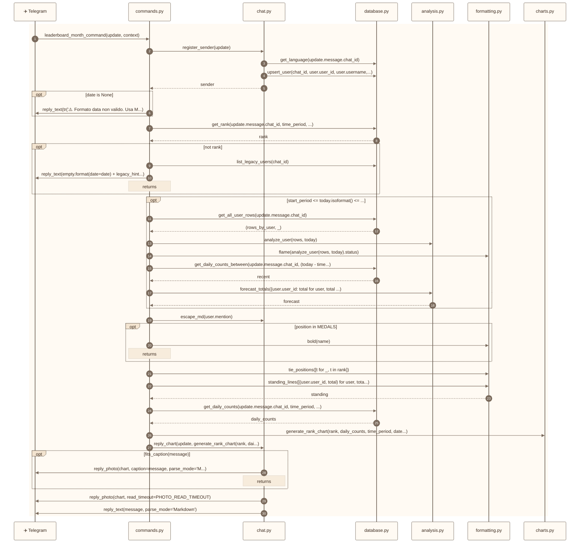

<details>
<summary>Call tree</summary>

- `commands.leaderboard_command`
  - `chat.register_sender`
    - `database.get_language`
    - `chat.register_user`
      - `chat.display_name_of`
      - `database.upsert_user`
  - `commands.period_from_args`
  - `database.get_rank`
  - `commands.legacy_hint`
    - `database.list_legacy_users`
  - `database.get_all_user_rows`
  - `formatting.flame`
  - `analysis.analyze_user`
    - `analysis.parse_counts`
    - `analysis.consecutive_runs`
  - `database.get_daily_counts_between`
  - `analysis.forecast_totals`
  - `chat.escape_md`
  - `commands.ranked_line`
    - `formatting.bold`
  - `formatting.tie_positions`
  - `formatting.standing_lines`
  - `database.get_daily_counts`
    - `database.get_daily_counts_between` (see above)
  - `chat.reply_chart`
    - `chat.fits_caption`
  - `charts.generate_rank_chart`
    - `charts.period_info`
    - `charts.last_day_shown`
    - `charts.chart_label`
    - `charts.sorted_by_name`
    - `charts.short_name`
    - `charts.user_style`
    - `charts.positions`
    - `charts.emoji`
    - `charts.fine_vlines`
    - `charts.layered_grid`
    - `charts.add_cards`
    - `charts.png_bytes`
      - `charts.add_watermark`

</details>

## `/leaderboard_year` (`/classifica_anno`)

Entry point: `commands.leaderboard_year_command`

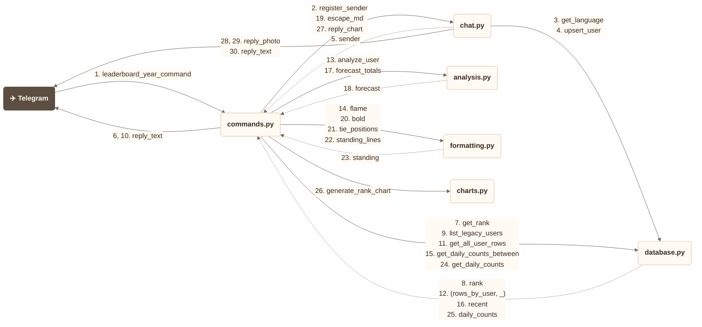


<details>
<summary>Call tree</summary>

- `commands.leaderboard_command`
  - `chat.register_sender`
    - `database.get_language`
    - `chat.register_user`
      - `chat.display_name_of`
      - `database.upsert_user`
  - `commands.period_from_args`
  - `database.get_rank`
  - `commands.legacy_hint`
    - `database.list_legacy_users`
  - `database.get_all_user_rows`
  - `formatting.flame`
  - `analysis.analyze_user`
    - `analysis.parse_counts`
    - `analysis.consecutive_runs`
  - `database.get_daily_counts_between`
  - `analysis.forecast_totals`
  - `chat.escape_md`
  - `commands.ranked_line`
    - `formatting.bold`
  - `formatting.tie_positions`
  - `formatting.standing_lines`
  - `database.get_daily_counts`
    - `database.get_daily_counts_between` (see above)
  - `chat.reply_chart`
    - `chat.fits_caption`
  - `charts.generate_rank_chart`
    - `charts.period_info`
    - `charts.last_day_shown`
    - `charts.chart_label`
    - `charts.sorted_by_name`
    - `charts.short_name`
    - `charts.user_style`
    - `charts.positions`
    - `charts.emoji`
    - `charts.fine_vlines`
    - `charts.layered_grid`
    - `charts.add_cards`
    - `charts.png_bytes`
      - `charts.add_watermark`

</details>

## `/stats_month` (`/statistiche_mese`)

Entry point: `commands.stats_month_command`

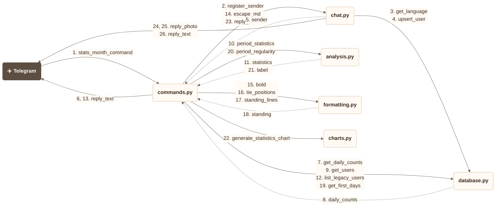


<details>
<summary>Call tree</summary>

- `commands.stats_command`
  - `chat.register_sender`
    - `database.get_language`
    - `chat.register_user`
      - `chat.display_name_of`
      - `database.upsert_user`
  - `commands.period_from_args`
  - `database.get_daily_counts`
    - `database.get_daily_counts_between`
  - `analysis.period_statistics`
  - `database.get_users`
  - `commands.legacy_hint`
    - `database.list_legacy_users`
  - `chat.escape_md`
  - `commands.ranked_line`
    - `formatting.bold`
  - `formatting.tie_positions`
  - `formatting.standing_lines`
  - `analysis.period_regularity`
    - `analysis.regularity`
  - `database.get_first_days`
  - `chat.reply_chart`
    - `chat.fits_caption`
  - `charts.generate_statistics_chart`
    - `charts.period_info`
    - `charts.chart_label`
    - `charts.sorted_by_name`
    - `charts.last_day_shown`
    - `charts.user_style`
    - `charts.normal_pdf`
    - `charts.short_name`
    - `charts.decimal`
    - `charts.fine_vlines`
    - `charts.layered_grid`
    - `charts.add_cards`
    - `charts.png_bytes`
      - `charts.add_watermark`

</details>

## `/stats_year` (`/statistiche_anno`)

Entry point: `commands.stats_year_command`


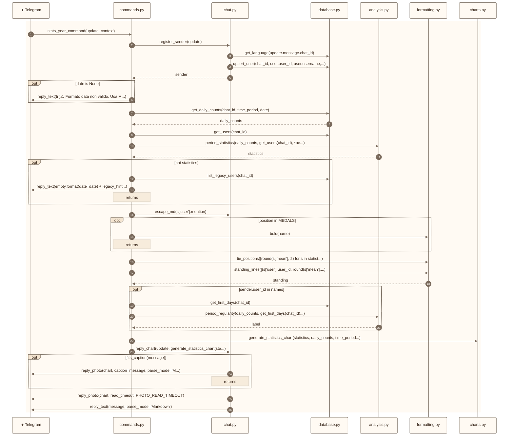

<details>
<summary>Call tree</summary>

- `commands.stats_command`
  - `chat.register_sender`
    - `database.get_language`
    - `chat.register_user`
      - `chat.display_name_of`
      - `database.upsert_user`
  - `commands.period_from_args`
  - `database.get_daily_counts`
    - `database.get_daily_counts_between`
  - `analysis.period_statistics`
  - `database.get_users`
  - `commands.legacy_hint`
    - `database.list_legacy_users`
  - `chat.escape_md`
  - `commands.ranked_line`
    - `formatting.bold`
  - `formatting.tie_positions`
  - `formatting.standing_lines`
  - `analysis.period_regularity`
    - `analysis.regularity`
  - `database.get_first_days`
  - `chat.reply_chart`
    - `chat.fits_caption`
  - `charts.generate_statistics_chart`
    - `charts.period_info`
    - `charts.chart_label`
    - `charts.sorted_by_name`
    - `charts.last_day_shown`
    - `charts.user_style`
    - `charts.normal_pdf`
    - `charts.short_name`
    - `charts.decimal`
    - `charts.fine_vlines`
    - `charts.layered_grid`
    - `charts.add_cards`
    - `charts.png_bytes`
      - `charts.add_watermark`

</details>

## `/records` (`/record`)

Entry point: `commands.records_command`

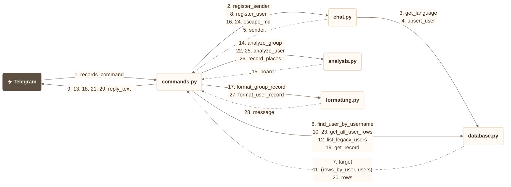

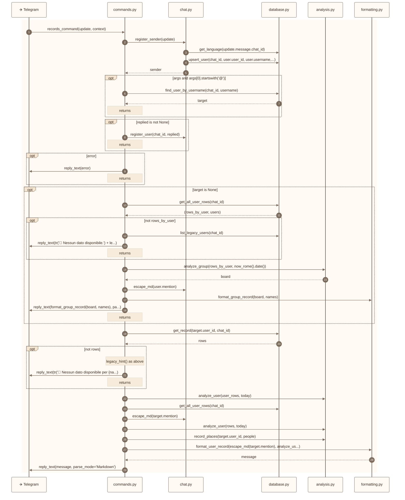

<details>
<summary>Call tree</summary>

- `chat.register_sender`
  - `database.get_language`
  - `chat.register_user`
    - `chat.display_name_of`
    - `database.upsert_user`
- `commands.resolve_optional_target`
  - `commands.replied_person`
  - `commands.resolve_target`
    - `commands.parse_username_arg`
    - `commands.invalid_format`
    - `database.find_user_by_username`
    - `commands.replied_person` (see above)
    - `chat.register_user` (see above)
  - `commands.invalid_format` (see above)
- `database.get_all_user_rows`
- `commands.legacy_hint`
  - `database.list_legacy_users`
- `analysis.analyze_group`
  - `analysis.analyze_user`
    - `analysis.parse_counts`
    - `analysis.consecutive_runs`
- `chat.escape_md`
- `formatting.format_group_record`
  - `formatting.bold`
- `database.get_record`
- `analysis.analyze_user` (see above)
- `formatting.format_user_record`
  - `formatting.bold` (see above)
- `analysis.record_places`

</details>

## `/trophies` (`/trofei`)

Entry point: `commands.trophies_command`

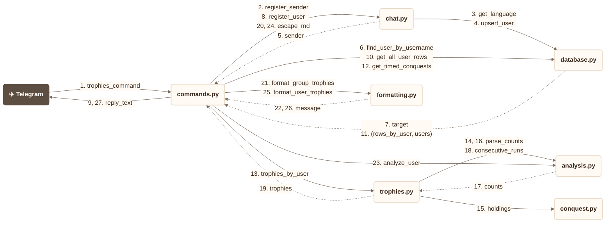

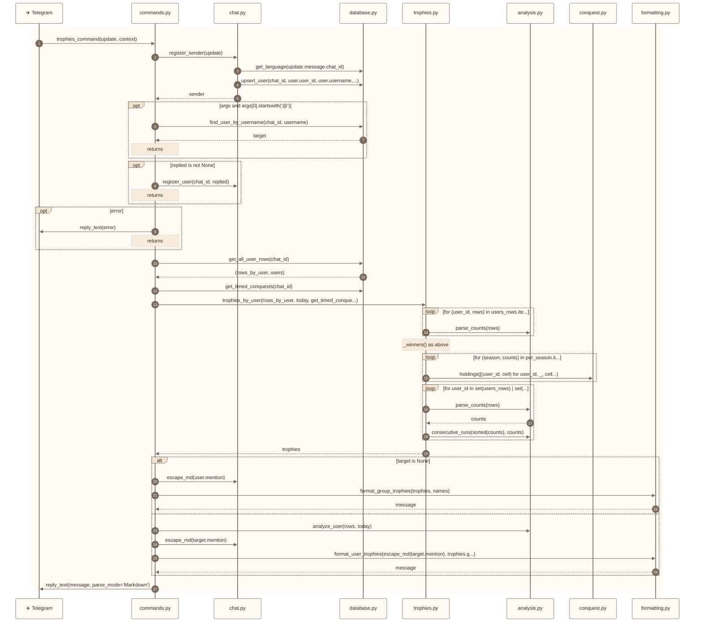

<details>
<summary>Call tree</summary>

- `chat.register_sender`
  - `database.get_language`
  - `chat.register_user`
    - `chat.display_name_of`
    - `database.upsert_user`
- `commands.resolve_optional_target`
  - `commands.replied_person`
  - `commands.resolve_target`
    - `commands.parse_username_arg`
    - `commands.invalid_format`
    - `database.find_user_by_username`
    - `commands.replied_person` (see above)
    - `chat.register_user` (see above)
  - `commands.invalid_format` (see above)
- `database.get_all_user_rows`
- `trophies.trophies_by_user`
  - `trophies.monthly_winners`
    - `analysis.parse_counts`
  - `trophies.yearly_winners`
    - `analysis.parse_counts` (see above)
  - `trophies.season_results`
    - `trophies.season_of`
    - `conquest.holdings`
  - `trophies.season_of` (see above)
  - `trophies.streak_runs`
    - `analysis.parse_counts` (see above)
    - `analysis.consecutive_runs`
- `database.get_timed_conquests`
- `chat.escape_md`
- `formatting.format_group_trophies`
  - `formatting.bold`
- `analysis.analyze_user`
  - `analysis.parse_counts` (see above)
  - `analysis.consecutive_runs` (see above)
- `formatting.format_user_trophies`
  - `formatting.bold` (see above)

</details>

## `/conquests` (`/conquiste`)

Entry point: `commands.conquests_command`

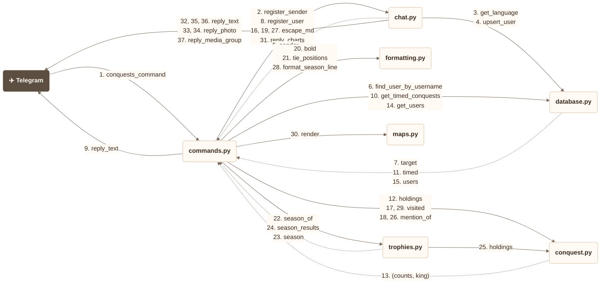

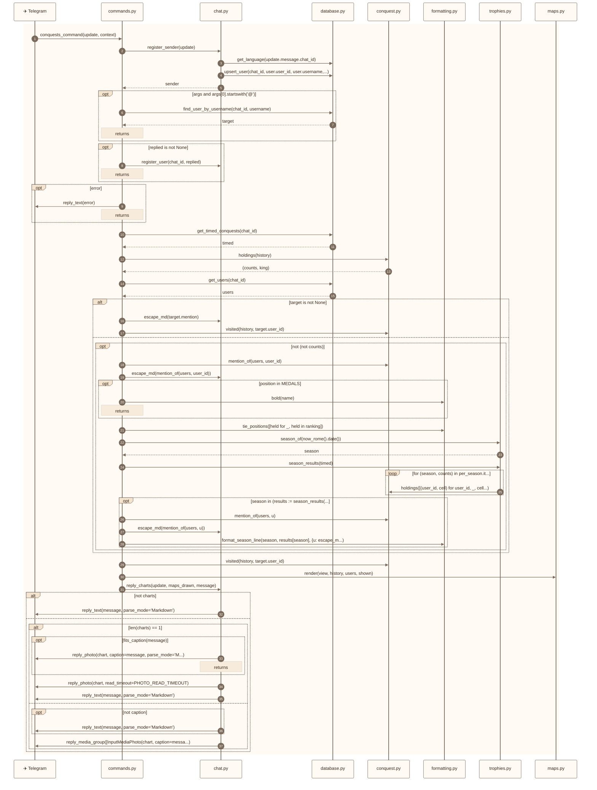

<details>
<summary>Call tree</summary>

- `chat.register_sender`
  - `database.get_language`
  - `chat.register_user`
    - `chat.display_name_of`
    - `database.upsert_user`
- `commands.resolve_optional_target`
  - `commands.replied_person`
  - `commands.resolve_target`
    - `commands.parse_username_arg`
    - `commands.invalid_format`
    - `database.find_user_by_username`
    - `commands.replied_person` (see above)
    - `chat.register_user` (see above)
  - `commands.invalid_format` (see above)
- `database.get_timed_conquests`
- `conquest.holdings`
- `database.get_users`
- `chat.escape_md`
- `conquest.visited`
- `commands.ranked_line`
  - `formatting.bold`
- `conquest.mention_of`
- `formatting.tie_positions`
- `trophies.season_of`
- `trophies.season_results`
  - `trophies.season_of` (see above)
  - `conquest.holdings` (see above)
- `formatting.format_season_line`
  - `formatting.bold` (see above)
- `maps.render`
- `chat.reply_charts`
  - `chat.reply_chart`
    - `chat.fits_caption`
  - `chat.fits_caption` (see above)

</details>

## `/app`

Entry point: `commands.app_command`

```mermaid
---
config:
  theme: base
  themeVariables:
    fontFamily: "Nunito, Segoe UI, Roboto, sans-serif"
    primaryColor: "#fffaf3"
    primaryTextColor: "#3b2a1e"
    primaryBorderColor: "#eadccb"
    secondaryColor: "#f7ecdc"
    tertiaryColor: "#f3e4d0"
    lineColor: "#7a6a5c"
    textColor: "#3b2a1e"
    edgeLabelBackground: "#fffaf3"
    clusterBkg: "#f3e4d0"
    clusterBorder: "#cbbca9"
    titleColor: "#5c4f42"
    noteBkgColor: "#f7ecdc"
    noteTextColor: "#3b2a1e"
    actorBkg: "#fffaf3"
    actorBorder: "#5c4f42"
    actorTextColor: "#3b2a1e"
    signalColor: "#7a6a5c"
    signalTextColor: "#3b2a1e"
    labelBoxBkgColor: "#f3e4d0"
    loopTextColor: "#3b2a1e"
    sequenceNumberColor: "#fffaf3"
    xyChart:
      plotColorPalette: "#2f4f8f"
  flowchart:
    nodeSpacing: 50
    rankSpacing: 160
---
flowchart LR
    accTitle: Communication diagram, /app
    accDescr: The modules involved, the functions each one calls in another and what comes back, numbered as in the sequence
    telegram("<b>✈️ Telegram</b>")
    commands("<b>commands.py</b>")
    chat("<b>chat.py</b>")
    database("<b>database.py</b>")
    miniapp("<b>miniapp.py</b>")
    telegram -->|"1.#nbsp;app_command"| commands
    commands -->|"2.#nbsp;register_sender"| chat
    chat -->|"3.#nbsp;get_language<br/>4.#nbsp;upsert_user"| database
    chat -.->|"5.#nbsp;sender"| commands
    commands -->|"6.#nbsp;direct_link"| miniapp
    miniapp -.->|"7.#nbsp;link"| commands
    commands -->|"8.#nbsp;reply_text"| telegram
    classDef step fill:#fffaf3,stroke:#eadccb,stroke-width:2px,color:#3b2a1e
    classDef person fill:#5c4f42,stroke:#5c4f42,color:#fffaf3
    class commands,chat,database,miniapp step
    class telegram person
```

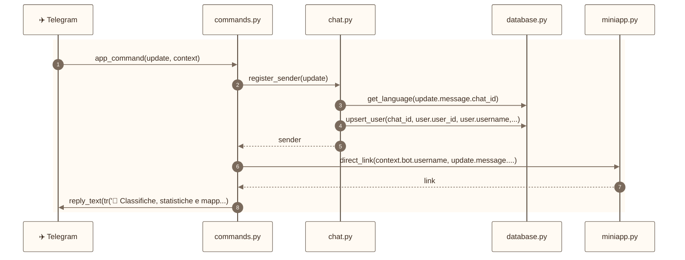

<details>
<summary>Call tree</summary>

- `chat.register_sender`
  - `database.get_language`
  - `chat.register_user`
    - `chat.display_name_of`
    - `database.upsert_user`
- `miniapp.direct_link`

</details>

## `/day_count` (`/conto_giorno`)

Entry point: `commands.day_count_command`

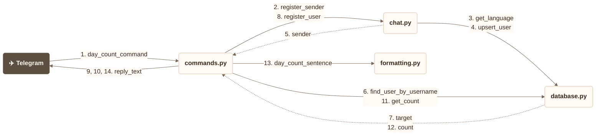

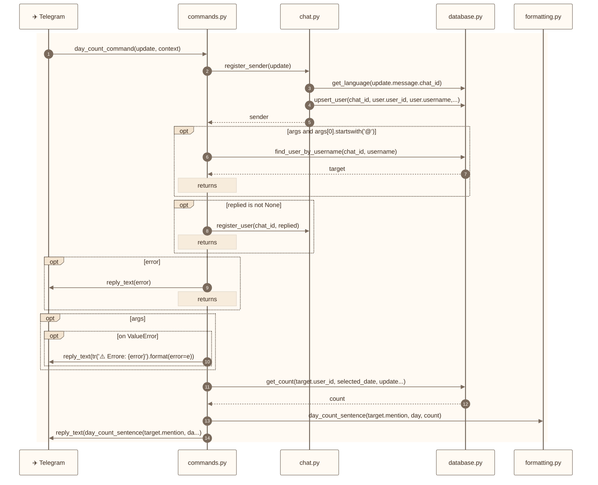

<details>
<summary>Call tree</summary>

- `chat.register_sender`
  - `database.get_language`
  - `chat.register_user`
    - `chat.display_name_of`
    - `database.upsert_user`
- `commands.resolve_target`
  - `commands.parse_username_arg`
  - `commands.invalid_format`
  - `database.find_user_by_username`
  - `commands.replied_person`
  - `chat.register_user` (see above)
- `commands.invalid_format` (see above)
- `commands.parse_date_arg`
- `database.get_count`
- `formatting.day_count_sentence`

</details>

## `/last_poop` (`/ultima_cacca`)

Entry point: `commands.last_poop_command`

```mermaid
---
config:
  theme: base
  themeVariables:
    fontFamily: "Nunito, Segoe UI, Roboto, sans-serif"
    primaryColor: "#fffaf3"
    primaryTextColor: "#3b2a1e"
    primaryBorderColor: "#eadccb"
    secondaryColor: "#f7ecdc"
    tertiaryColor: "#f3e4d0"
    lineColor: "#7a6a5c"
    textColor: "#3b2a1e"
    edgeLabelBackground: "#fffaf3"
    clusterBkg: "#f3e4d0"
    clusterBorder: "#cbbca9"
    titleColor: "#5c4f42"
    noteBkgColor: "#f7ecdc"
    noteTextColor: "#3b2a1e"
    actorBkg: "#fffaf3"
    actorBorder: "#5c4f42"
    actorTextColor: "#3b2a1e"
    signalColor: "#7a6a5c"
    signalTextColor: "#3b2a1e"
    labelBoxBkgColor: "#f3e4d0"
    loopTextColor: "#3b2a1e"
    sequenceNumberColor: "#fffaf3"
    xyChart:
      plotColorPalette: "#2f4f8f"
  flowchart:
    nodeSpacing: 50
    rankSpacing: 160
---
flowchart LR
    accTitle: Communication diagram, /last_poop (/ultima_cacca)
    accDescr: The modules involved, the functions each one calls in another and what comes back, numbered as in the sequence
    telegram("<b>✈️ Telegram</b>")
    commands("<b>commands.py</b>")
    chat("<b>chat.py</b>")
    database("<b>database.py</b>")
    formatting("<b>formatting.py</b>")
    telegram -->|"1.#nbsp;last_poop_command"| commands
    commands -->|"2.#nbsp;register_sender<br/>8.#nbsp;register_user"| chat
    chat -->|"3.#nbsp;get_language<br/>4.#nbsp;upsert_user"| database
    chat -.->|"5.#nbsp;sender"| commands
    commands -->|"6.#nbsp;find_user_by_username<br/>10.#nbsp;get_days_since_last_poop"| database
    database -.->|"7.#nbsp;target<br/>11.#nbsp;days"| commands
    commands -->|"9, 13.#nbsp;reply_text"| telegram
    commands -->|"12.#nbsp;last_poop_sentence"| formatting
    classDef step fill:#fffaf3,stroke:#eadccb,stroke-width:2px,color:#3b2a1e
    classDef person fill:#5c4f42,stroke:#5c4f42,color:#fffaf3
    class commands,chat,database,formatting step
    class telegram person
```

```mermaid
---
config:
  theme: base
  themeVariables:
    fontFamily: "Nunito, Segoe UI, Roboto, sans-serif"
    primaryColor: "#fffaf3"
    primaryTextColor: "#3b2a1e"
    primaryBorderColor: "#eadccb"
    secondaryColor: "#f7ecdc"
    tertiaryColor: "#f3e4d0"
    lineColor: "#7a6a5c"
    textColor: "#3b2a1e"
    edgeLabelBackground: "#fffaf3"
    clusterBkg: "#f3e4d0"
    clusterBorder: "#cbbca9"
    titleColor: "#5c4f42"
    noteBkgColor: "#f7ecdc"
    noteTextColor: "#3b2a1e"
    actorBkg: "#fffaf3"
    actorBorder: "#5c4f42"
    actorTextColor: "#3b2a1e"
    signalColor: "#7a6a5c"
    signalTextColor: "#3b2a1e"
    labelBoxBkgColor: "#f3e4d0"
    loopTextColor: "#3b2a1e"
    sequenceNumberColor: "#fffaf3"
    xyChart:
      plotColorPalette: "#2f4f8f"
---
sequenceDiagram
    accTitle: Sequence diagram, /last_poop (/ultima_cacca)
    accDescr: The calls between the modules in time order, starting from commands.last_poop_command
    autonumber
    participant telegram as ✈️ Telegram
    participant commands as commands.py
    participant chat as chat.py
    participant database as database.py
    participant formatting as formatting.py
    rect rgb(255, 250, 243)
        telegram->>commands: last_poop_command(update, context)
        commands->>chat: register_sender(update)
        chat->>database: get_language(update.message.chat_id)
        chat->>database: upsert_user(chat_id, user.user_id, user.username,...)
        chat-->>commands: sender
        opt args and args[0].startswith('@')
            commands->>database: find_user_by_username(chat_id, username)
            database-->>commands: target
            Note over commands: returns
        end
        opt replied is not None
            commands->>chat: register_user(chat_id, replied)
            Note over commands: returns
        end
        opt error
            commands->>telegram: reply_text(error)
            Note over commands: returns
        end
        commands->>database: get_days_since_last_poop(target.user_id, update.message.chat_id)
        database-->>commands: days
        commands->>formatting: last_poop_sentence(target.mention, days)
        commands->>telegram: reply_text(last_poop_sentence(target.mention, days))
    end
```

<details>
<summary>Call tree</summary>

- `chat.register_sender`
  - `database.get_language`
  - `chat.register_user`
    - `chat.display_name_of`
    - `database.upsert_user`
- `commands.resolve_target`
  - `commands.parse_username_arg`
  - `commands.invalid_format`
  - `database.find_user_by_username`
  - `commands.replied_person`
  - `chat.register_user` (see above)
- `commands.invalid_format` (see above)
- `database.get_days_since_last_poop`
- `formatting.last_poop_sentence`

</details>

## `/add_poop` (`/aggiungi_cacca`)

Entry point: `commands.add_poop_command`

```mermaid
---
config:
  theme: base
  themeVariables:
    fontFamily: "Nunito, Segoe UI, Roboto, sans-serif"
    primaryColor: "#fffaf3"
    primaryTextColor: "#3b2a1e"
    primaryBorderColor: "#eadccb"
    secondaryColor: "#f7ecdc"
    tertiaryColor: "#f3e4d0"
    lineColor: "#7a6a5c"
    textColor: "#3b2a1e"
    edgeLabelBackground: "#fffaf3"
    clusterBkg: "#f3e4d0"
    clusterBorder: "#cbbca9"
    titleColor: "#5c4f42"
    noteBkgColor: "#f7ecdc"
    noteTextColor: "#3b2a1e"
    actorBkg: "#fffaf3"
    actorBorder: "#5c4f42"
    actorTextColor: "#3b2a1e"
    signalColor: "#7a6a5c"
    signalTextColor: "#3b2a1e"
    labelBoxBkgColor: "#f3e4d0"
    loopTextColor: "#3b2a1e"
    sequenceNumberColor: "#fffaf3"
    xyChart:
      plotColorPalette: "#2f4f8f"
  flowchart:
    nodeSpacing: 50
    rankSpacing: 160
---
flowchart LR
    accTitle: Communication diagram, /add_poop (/aggiungi_cacca)
    accDescr: The modules involved, the functions each one calls in another and what comes back, numbered as in the sequence
    telegram("<b>✈️ Telegram</b>")
    commands("<b>commands.py</b>")
    chat("<b>chat.py</b>")
    database("<b>database.py</b>")
    formatting("<b>formatting.py</b>")
    telegram -->|"1.#nbsp;add_poop_command"| commands
    commands -->|"2.#nbsp;register_sender<br/>8.#nbsp;register_user<br/>10.#nbsp;is_chat_admin<br/>16.#nbsp;where"| chat
    chat -->|"3.#nbsp;get_language<br/>4.#nbsp;upsert_user"| database
    chat -.->|"5.#nbsp;sender"| commands
    commands -->|"6.#nbsp;find_user_by_username<br/>14.#nbsp;add_count"| database
    database -.->|"7.#nbsp;target<br/>15.#nbsp;(old_count, new_count)"| commands
    commands -->|"9, 12, 13, 17, 19.#nbsp;reply_text"| telegram
    chat -->|"11.#nbsp;get_chat_member"| telegram
    commands -->|"18.#nbsp;change_count_sentence"| formatting
    classDef step fill:#fffaf3,stroke:#eadccb,stroke-width:2px,color:#3b2a1e
    classDef person fill:#5c4f42,stroke:#5c4f42,color:#fffaf3
    class commands,chat,database,formatting step
    class telegram person
```

```mermaid
---
config:
  theme: base
  themeVariables:
    fontFamily: "Nunito, Segoe UI, Roboto, sans-serif"
    primaryColor: "#fffaf3"
    primaryTextColor: "#3b2a1e"
    primaryBorderColor: "#eadccb"
    secondaryColor: "#f7ecdc"
    tertiaryColor: "#f3e4d0"
    lineColor: "#7a6a5c"
    textColor: "#3b2a1e"
    edgeLabelBackground: "#fffaf3"
    clusterBkg: "#f3e4d0"
    clusterBorder: "#cbbca9"
    titleColor: "#5c4f42"
    noteBkgColor: "#f7ecdc"
    noteTextColor: "#3b2a1e"
    actorBkg: "#fffaf3"
    actorBorder: "#5c4f42"
    actorTextColor: "#3b2a1e"
    signalColor: "#7a6a5c"
    signalTextColor: "#3b2a1e"
    labelBoxBkgColor: "#f3e4d0"
    loopTextColor: "#3b2a1e"
    sequenceNumberColor: "#fffaf3"
    xyChart:
      plotColorPalette: "#2f4f8f"
---
sequenceDiagram
    accTitle: Sequence diagram, /add_poop (/aggiungi_cacca)
    accDescr: The calls between the modules in time order, starting from commands.add_poop_command
    autonumber
    participant telegram as ✈️ Telegram
    participant commands as commands.py
    participant chat as chat.py
    participant database as database.py
    participant formatting as formatting.py
    rect rgb(255, 250, 243)
        telegram->>commands: add_poop_command(update, context)
        commands->>chat: register_sender(update)
        chat->>database: get_language(update.message.chat_id)
        chat->>database: upsert_user(chat_id, user.user_id, user.username,...)
        chat-->>commands: sender
        opt args and args[0].startswith('@')
            commands->>database: find_user_by_username(chat_id, username)
            database-->>commands: target
            Note over commands: returns
        end
        opt replied is not None
            commands->>chat: register_user(chat_id, replied)
            Note over commands: returns
        end
        opt error
            commands->>telegram: reply_text(error)
            Note over commands: returns
        end
        commands->>chat: is_chat_admin(update, context)
        chat->>telegram: get_chat_member(update.message.chat_id, update.messag...)
        commands->>telegram: reply_text(tr('🔒 Solo gli admin del gruppo posso...)
        opt on ValueError
            commands->>telegram: reply_text(tr('⚠️ Errore: {error}').format(error=e))
        end
        commands->>database: add_count(target.user_id, selected_date, delta,...)
        database-->>commands: (old_count, new_count)
        commands->>chat: where(update)
        alt delta < 0 and old_count == 0
            commands->>telegram: reply_text(tr('⚠️ Il conteggio di {name} nel gio...)
        else
            commands->>formatting: change_count_sentence(target.mention, date, new_count, delta)
            commands->>telegram: reply_text(change_count_sentence(target.mention,...)
        end
    end
```

<details>
<summary>Call tree</summary>

- `commands.change_count_command`
  - `chat.register_sender`
    - `database.get_language`
    - `chat.register_user`
      - `chat.display_name_of`
      - `database.upsert_user`
  - `commands.resolve_target`
    - `commands.parse_username_arg`
    - `commands.invalid_format`
    - `database.find_user_by_username`
    - `commands.replied_person`
    - `chat.register_user` (see above)
  - `commands.invalid_format` (see above)
  - `commands.may_change_counts_of`
    - `chat.is_chat_admin`
  - `commands.parse_date_arg`
  - `database.add_count`
  - `chat.where`
  - `formatting.change_count_sentence`

</details>

## `/remove_poop` (`/togli_cacca`)

Entry point: `commands.remove_poop_command`

```mermaid
---
config:
  theme: base
  themeVariables:
    fontFamily: "Nunito, Segoe UI, Roboto, sans-serif"
    primaryColor: "#fffaf3"
    primaryTextColor: "#3b2a1e"
    primaryBorderColor: "#eadccb"
    secondaryColor: "#f7ecdc"
    tertiaryColor: "#f3e4d0"
    lineColor: "#7a6a5c"
    textColor: "#3b2a1e"
    edgeLabelBackground: "#fffaf3"
    clusterBkg: "#f3e4d0"
    clusterBorder: "#cbbca9"
    titleColor: "#5c4f42"
    noteBkgColor: "#f7ecdc"
    noteTextColor: "#3b2a1e"
    actorBkg: "#fffaf3"
    actorBorder: "#5c4f42"
    actorTextColor: "#3b2a1e"
    signalColor: "#7a6a5c"
    signalTextColor: "#3b2a1e"
    labelBoxBkgColor: "#f3e4d0"
    loopTextColor: "#3b2a1e"
    sequenceNumberColor: "#fffaf3"
    xyChart:
      plotColorPalette: "#2f4f8f"
  flowchart:
    nodeSpacing: 50
    rankSpacing: 160
---
flowchart LR
    accTitle: Communication diagram, /remove_poop (/togli_cacca)
    accDescr: The modules involved, the functions each one calls in another and what comes back, numbered as in the sequence
    telegram("<b>✈️ Telegram</b>")
    commands("<b>commands.py</b>")
    chat("<b>chat.py</b>")
    database("<b>database.py</b>")
    formatting("<b>formatting.py</b>")
    telegram -->|"1.#nbsp;remove_poop_command"| commands
    commands -->|"2.#nbsp;register_sender<br/>8.#nbsp;register_user<br/>10.#nbsp;is_chat_admin<br/>16.#nbsp;where"| chat
    chat -->|"3.#nbsp;get_language<br/>4.#nbsp;upsert_user"| database
    chat -.->|"5.#nbsp;sender"| commands
    commands -->|"6.#nbsp;find_user_by_username<br/>14.#nbsp;add_count"| database
    database -.->|"7.#nbsp;target<br/>15.#nbsp;(old_count, new_count)"| commands
    commands -->|"9, 12, 13, 17, 19.#nbsp;reply_text"| telegram
    chat -->|"11.#nbsp;get_chat_member"| telegram
    commands -->|"18.#nbsp;change_count_sentence"| formatting
    classDef step fill:#fffaf3,stroke:#eadccb,stroke-width:2px,color:#3b2a1e
    classDef person fill:#5c4f42,stroke:#5c4f42,color:#fffaf3
    class commands,chat,database,formatting step
    class telegram person
```

```mermaid
---
config:
  theme: base
  themeVariables:
    fontFamily: "Nunito, Segoe UI, Roboto, sans-serif"
    primaryColor: "#fffaf3"
    primaryTextColor: "#3b2a1e"
    primaryBorderColor: "#eadccb"
    secondaryColor: "#f7ecdc"
    tertiaryColor: "#f3e4d0"
    lineColor: "#7a6a5c"
    textColor: "#3b2a1e"
    edgeLabelBackground: "#fffaf3"
    clusterBkg: "#f3e4d0"
    clusterBorder: "#cbbca9"
    titleColor: "#5c4f42"
    noteBkgColor: "#f7ecdc"
    noteTextColor: "#3b2a1e"
    actorBkg: "#fffaf3"
    actorBorder: "#5c4f42"
    actorTextColor: "#3b2a1e"
    signalColor: "#7a6a5c"
    signalTextColor: "#3b2a1e"
    labelBoxBkgColor: "#f3e4d0"
    loopTextColor: "#3b2a1e"
    sequenceNumberColor: "#fffaf3"
    xyChart:
      plotColorPalette: "#2f4f8f"
---
sequenceDiagram
    accTitle: Sequence diagram, /remove_poop (/togli_cacca)
    accDescr: The calls between the modules in time order, starting from commands.remove_poop_command
    autonumber
    participant telegram as ✈️ Telegram
    participant commands as commands.py
    participant chat as chat.py
    participant database as database.py
    participant formatting as formatting.py
    rect rgb(255, 250, 243)
        telegram->>commands: remove_poop_command(update, context)
        commands->>chat: register_sender(update)
        chat->>database: get_language(update.message.chat_id)
        chat->>database: upsert_user(chat_id, user.user_id, user.username,...)
        chat-->>commands: sender
        opt args and args[0].startswith('@')
            commands->>database: find_user_by_username(chat_id, username)
            database-->>commands: target
            Note over commands: returns
        end
        opt replied is not None
            commands->>chat: register_user(chat_id, replied)
            Note over commands: returns
        end
        opt error
            commands->>telegram: reply_text(error)
            Note over commands: returns
        end
        commands->>chat: is_chat_admin(update, context)
        chat->>telegram: get_chat_member(update.message.chat_id, update.messag...)
        commands->>telegram: reply_text(tr('🔒 Solo gli admin del gruppo posso...)
        opt on ValueError
            commands->>telegram: reply_text(tr('⚠️ Errore: {error}').format(error=e))
        end
        commands->>database: add_count(target.user_id, selected_date, delta,...)
        database-->>commands: (old_count, new_count)
        commands->>chat: where(update)
        alt delta < 0 and old_count == 0
            commands->>telegram: reply_text(tr('⚠️ Il conteggio di {name} nel gio...)
        else
            commands->>formatting: change_count_sentence(target.mention, date, new_count, delta)
            commands->>telegram: reply_text(change_count_sentence(target.mention,...)
        end
    end
```

<details>
<summary>Call tree</summary>

- `commands.change_count_command`
  - `chat.register_sender`
    - `database.get_language`
    - `chat.register_user`
      - `chat.display_name_of`
      - `database.upsert_user`
  - `commands.resolve_target`
    - `commands.parse_username_arg`
    - `commands.invalid_format`
    - `database.find_user_by_username`
    - `commands.replied_person`
    - `chat.register_user` (see above)
  - `commands.invalid_format` (see above)
  - `commands.may_change_counts_of`
    - `chat.is_chat_admin`
  - `commands.parse_date_arg`
  - `database.add_count`
  - `chat.where`
  - `formatting.change_count_sentence`

</details>

## `/language` (`/lingua`)

Entry point: `commands.language_command`

```mermaid
---
config:
  theme: base
  themeVariables:
    fontFamily: "Nunito, Segoe UI, Roboto, sans-serif"
    primaryColor: "#fffaf3"
    primaryTextColor: "#3b2a1e"
    primaryBorderColor: "#eadccb"
    secondaryColor: "#f7ecdc"
    tertiaryColor: "#f3e4d0"
    lineColor: "#7a6a5c"
    textColor: "#3b2a1e"
    edgeLabelBackground: "#fffaf3"
    clusterBkg: "#f3e4d0"
    clusterBorder: "#cbbca9"
    titleColor: "#5c4f42"
    noteBkgColor: "#f7ecdc"
    noteTextColor: "#3b2a1e"
    actorBkg: "#fffaf3"
    actorBorder: "#5c4f42"
    actorTextColor: "#3b2a1e"
    signalColor: "#7a6a5c"
    signalTextColor: "#3b2a1e"
    labelBoxBkgColor: "#f3e4d0"
    loopTextColor: "#3b2a1e"
    sequenceNumberColor: "#fffaf3"
    xyChart:
      plotColorPalette: "#2f4f8f"
  flowchart:
    nodeSpacing: 50
    rankSpacing: 160
---
flowchart LR
    accTitle: Communication diagram, /language (/lingua)
    accDescr: The modules involved, the functions each one calls in another and what comes back, numbered as in the sequence
    telegram("<b>✈️ Telegram</b>")
    commands("<b>commands.py</b>")
    chat("<b>chat.py</b>")
    database("<b>database.py</b>")
    menus("<b>menus.py</b>")
    telegram -->|"1.#nbsp;language_command"| commands
    commands -->|"2.#nbsp;register_sender<br/>7.#nbsp;is_chat_admin<br/>11.#nbsp;where"| chat
    chat -->|"3.#nbsp;get_language<br/>4.#nbsp;upsert_user"| database
    chat -.->|"5.#nbsp;sender"| commands
    commands -->|"6, 9, 12.#nbsp;reply_text"| telegram
    chat -->|"8.#nbsp;get_chat_member"| telegram
    commands -->|"10.#nbsp;set_language"| database
    commands -->|"13.#nbsp;set_chat_menu"| menus
    menus -->|"14, 15.#nbsp;set_my_commands"| telegram
    classDef step fill:#fffaf3,stroke:#eadccb,stroke-width:2px,color:#3b2a1e
    classDef person fill:#5c4f42,stroke:#5c4f42,color:#fffaf3
    class commands,chat,database,menus step
    class telegram person
```

```mermaid
---
config:
  theme: base
  themeVariables:
    fontFamily: "Nunito, Segoe UI, Roboto, sans-serif"
    primaryColor: "#fffaf3"
    primaryTextColor: "#3b2a1e"
    primaryBorderColor: "#eadccb"
    secondaryColor: "#f7ecdc"
    tertiaryColor: "#f3e4d0"
    lineColor: "#7a6a5c"
    textColor: "#3b2a1e"
    edgeLabelBackground: "#fffaf3"
    clusterBkg: "#f3e4d0"
    clusterBorder: "#cbbca9"
    titleColor: "#5c4f42"
    noteBkgColor: "#f7ecdc"
    noteTextColor: "#3b2a1e"
    actorBkg: "#fffaf3"
    actorBorder: "#5c4f42"
    actorTextColor: "#3b2a1e"
    signalColor: "#7a6a5c"
    signalTextColor: "#3b2a1e"
    labelBoxBkgColor: "#f3e4d0"
    loopTextColor: "#3b2a1e"
    sequenceNumberColor: "#fffaf3"
    xyChart:
      plotColorPalette: "#2f4f8f"
---
sequenceDiagram
    accTitle: Sequence diagram, /language (/lingua)
    accDescr: The calls between the modules in time order, starting from commands.language_command
    autonumber
    participant telegram as ✈️ Telegram
    participant commands as commands.py
    participant chat as chat.py
    participant database as database.py
    participant menus as menus.py
    rect rgb(255, 250, 243)
        telegram->>commands: language_command(update, context)
        commands->>chat: register_sender(update)
        chat->>database: get_language(update.message.chat_id)
        chat->>database: upsert_user(chat_id, user.user_id, user.username,...)
        chat-->>commands: sender
        opt language not in i18n.LANGUAGES
            commands->>telegram: reply_text(tr('🌐 La lingua di questa chat è {nam...)
            Note over commands: returns
        end
        commands->>chat: is_chat_admin(update, context)
        chat->>telegram: get_chat_member(update.message.chat_id, update.messag...)
        opt not await is_chat_admin(update, context)
            commands->>telegram: reply_text(tr('🔒 Solo gli admin del gruppo posso...)
            Note over commands: returns
        end
        commands->>database: set_language(update.message.chat_id, language)
        commands->>chat: where(update)
        commands->>telegram: reply_text(tr('Da ora parlo italiano 🇮🇹'))
        commands->>menus: set_chat_menu(context.bot, update.message.chat_id, ...)
        menus->>telegram: set_my_commands(menu(language), scope=BotCommandScope...)
        opt group
            menus->>telegram: set_my_commands(menu(language, admins=True), scope=Bo...)
        end
    end
```

<details>
<summary>Call tree</summary>

- `chat.register_sender`
  - `database.get_language`
  - `chat.register_user`
    - `chat.display_name_of`
    - `database.upsert_user`
- `chat.is_chat_admin`
- `database.set_language`
- `chat.where`
- `menus.set_chat_menu`
  - `menus.menu`

</details>

## `/link_history` (`/collega_storico`)

Entry point: `commands.link_history_command`

```mermaid
---
config:
  theme: base
  themeVariables:
    fontFamily: "Nunito, Segoe UI, Roboto, sans-serif"
    primaryColor: "#fffaf3"
    primaryTextColor: "#3b2a1e"
    primaryBorderColor: "#eadccb"
    secondaryColor: "#f7ecdc"
    tertiaryColor: "#f3e4d0"
    lineColor: "#7a6a5c"
    textColor: "#3b2a1e"
    edgeLabelBackground: "#fffaf3"
    clusterBkg: "#f3e4d0"
    clusterBorder: "#cbbca9"
    titleColor: "#5c4f42"
    noteBkgColor: "#f7ecdc"
    noteTextColor: "#3b2a1e"
    actorBkg: "#fffaf3"
    actorBorder: "#5c4f42"
    actorTextColor: "#3b2a1e"
    signalColor: "#7a6a5c"
    signalTextColor: "#3b2a1e"
    labelBoxBkgColor: "#f3e4d0"
    loopTextColor: "#3b2a1e"
    sequenceNumberColor: "#fffaf3"
    xyChart:
      plotColorPalette: "#2f4f8f"
  flowchart:
    nodeSpacing: 50
    rankSpacing: 160
---
flowchart LR
    accTitle: Communication diagram, /link_history (/collega_storico)
    accDescr: The modules involved, the functions each one calls in another and what comes back, numbered as in the sequence
    telegram("<b>✈️ Telegram</b>")
    commands("<b>commands.py</b>")
    chat("<b>chat.py</b>")
    database("<b>database.py</b>")
    telegram -->|"1.#nbsp;link_history_command"| commands
    commands -->|"2.#nbsp;register_sender<br/>14.#nbsp;is_chat_admin<br/>19, 29.#nbsp;where<br/>25.#nbsp;register_user"| chat
    chat -->|"3.#nbsp;get_language<br/>4.#nbsp;upsert_user"| database
    chat -.->|"5.#nbsp;sender<br/>26.#nbsp;target"| commands
    commands -->|"6, 20.#nbsp;list_legacy_users<br/>9.#nbsp;find_user_by_username<br/>11.#nbsp;count_legacy_orphans<br/>17.#nbsp;link_legacy_by_username<br/>27.#nbsp;link_legacy_username"| database
    database -.->|"7.#nbsp;legacy<br/>10.#nbsp;match<br/>12.#nbsp;orphans<br/>18.#nbsp;linked<br/>21.#nbsp;remaining<br/>28.#nbsp;days"| commands
    commands -->|"8, 13, 16, 22, 23, 24, 30, 31.#nbsp;reply_text"| telegram
    chat -->|"15.#nbsp;get_chat_member"| telegram
    classDef step fill:#fffaf3,stroke:#eadccb,stroke-width:2px,color:#3b2a1e
    classDef person fill:#5c4f42,stroke:#5c4f42,color:#fffaf3
    class commands,chat,database step
    class telegram person
```

```mermaid
---
config:
  theme: base
  themeVariables:
    fontFamily: "Nunito, Segoe UI, Roboto, sans-serif"
    primaryColor: "#fffaf3"
    primaryTextColor: "#3b2a1e"
    primaryBorderColor: "#eadccb"
    secondaryColor: "#f7ecdc"
    tertiaryColor: "#f3e4d0"
    lineColor: "#7a6a5c"
    textColor: "#3b2a1e"
    edgeLabelBackground: "#fffaf3"
    clusterBkg: "#f3e4d0"
    clusterBorder: "#cbbca9"
    titleColor: "#5c4f42"
    noteBkgColor: "#f7ecdc"
    noteTextColor: "#3b2a1e"
    actorBkg: "#fffaf3"
    actorBorder: "#5c4f42"
    actorTextColor: "#3b2a1e"
    signalColor: "#7a6a5c"
    signalTextColor: "#3b2a1e"
    labelBoxBkgColor: "#f3e4d0"
    loopTextColor: "#3b2a1e"
    sequenceNumberColor: "#fffaf3"
    xyChart:
      plotColorPalette: "#2f4f8f"
---
sequenceDiagram
    accTitle: Sequence diagram, /link_history (/collega_storico)
    accDescr: The calls between the modules in time order, starting from commands.link_history_command
    autonumber
    participant telegram as ✈️ Telegram
    participant commands as commands.py
    participant chat as chat.py
    participant database as database.py
    rect rgb(255, 250, 243)
        telegram->>commands: link_history_command(update, context)
        commands->>chat: register_sender(update)
        chat->>database: get_language(update.message.chat_id)
        chat->>database: upsert_user(chat_id, user.user_id, user.username,...)
        chat-->>commands: sender
        opt not args
            commands->>database: list_legacy_users(chat_id)
            database-->>commands: legacy
            opt not legacy
                commands->>telegram: reply_text(tr('🤷 Non ci sono dati storici da col...)
                Note over commands: returns
            end
            loop for (legacy_username, total) in legacy
                commands->>database: find_user_by_username(chat_id, legacy_username)
                database-->>commands: match
            end
            commands->>database: count_legacy_orphans(chat_id)
            database-->>commands: orphans
            commands->>telegram: reply_text('\n'.join(lines))
            Note over commands: returns
        end
        commands->>chat: is_chat_admin(update, context)
        chat->>telegram: get_chat_member(update.message.chat_id, update.messag...)
        opt not await is_chat_admin(update, context)
            commands->>telegram: reply_text(tr('🔒 Solo gli admin del gruppo posso...)
            Note over commands: returns
        end
        opt len(args) == 1 and args[0] == 'auto'
            commands->>database: link_legacy_by_username(chat_id)
            database-->>commands: linked
            loop for (legacy_username, user, days) in ...
                commands->>chat: where(update)
            end
            commands->>database: list_legacy_users(chat_id)
            database-->>commands: remaining
            commands->>telegram: reply_text('\n'.join(lines))
            Note over commands: returns
        end
        opt len(args) != 1
            commands->>telegram: reply_text(invalid_format(usage))
            Note over commands: returns
        end
        opt replied is None
            commands->>telegram: reply_text(tr('⚠️ Rispondi a un messaggio della ...)
            Note over commands: returns
        end
        commands->>chat: register_user(chat_id, replied)
        chat-->>commands: target
        commands->>database: link_legacy_username(chat_id, legacy_username, target.user_id)
        database-->>commands: days
        commands->>chat: where(update)
        alt days == 0
            commands->>telegram: reply_text(tr('🤷 Nessun dato storico trovato per...)
        else
            commands->>telegram: reply_text(tr('🔗 Collegati {days} giorni di dati...)
        end
    end
```

<details>
<summary>Call tree</summary>

- `chat.register_sender`
  - `database.get_language`
  - `chat.register_user`
    - `chat.display_name_of`
    - `database.upsert_user`
- `database.list_legacy_users`
- `database.find_user_by_username`
- `database.count_legacy_orphans`
- `chat.is_chat_admin`
- `database.link_legacy_by_username`
  - `database.list_legacy_users` (see above)
  - `database.find_user_by_username` (see above)
  - `database.link_legacy_username`
- `chat.where`
- `commands.invalid_format`
- `commands.replied_person`
- `chat.register_user` (see above)
- `database.link_legacy_username` (see above)

</details>

## A message in the chat: 💩 or 🚽 (text or sticker), a location, a mention of the bot, "run"

Entry point: `messages.handle_message`

```mermaid
---
config:
  theme: base
  themeVariables:
    fontFamily: "Nunito, Segoe UI, Roboto, sans-serif"
    primaryColor: "#fffaf3"
    primaryTextColor: "#3b2a1e"
    primaryBorderColor: "#eadccb"
    secondaryColor: "#f7ecdc"
    tertiaryColor: "#f3e4d0"
    lineColor: "#7a6a5c"
    textColor: "#3b2a1e"
    edgeLabelBackground: "#fffaf3"
    clusterBkg: "#f3e4d0"
    clusterBorder: "#cbbca9"
    titleColor: "#5c4f42"
    noteBkgColor: "#f7ecdc"
    noteTextColor: "#3b2a1e"
    actorBkg: "#fffaf3"
    actorBorder: "#5c4f42"
    actorTextColor: "#3b2a1e"
    signalColor: "#7a6a5c"
    signalTextColor: "#3b2a1e"
    labelBoxBkgColor: "#f3e4d0"
    loopTextColor: "#3b2a1e"
    sequenceNumberColor: "#fffaf3"
    xyChart:
      plotColorPalette: "#2f4f8f"
  flowchart:
    nodeSpacing: 50
    rankSpacing: 160
---
flowchart LR
    accTitle: Communication diagram, A message in the chat, 💩 or 🚽 (text or sticker), a location, a mention of the bot, "run"
    accDescr: The modules involved, the functions each one calls in another and what comes back, numbered as in the sequence
    telegram("<b>✈️ Telegram</b>")
    messages("<b>messages.py</b>")
    chat("<b>chat.py</b>")
    database("<b>database.py</b>")
    formatting("<b>formatting.py</b>")
    trophies("<b>trophies.py</b>")
    analysis("<b>analysis.py</b>")
    conquest("<b>conquest.py</b>")
    maps("<b>maps.py</b>")
    telegram -->|"1.#nbsp;handle_message"| messages
    messages -->|"2.#nbsp;register_sender<br/>9, 18, 29, 31, 33.#nbsp;escape_md<br/>35.#nbsp;reply_charts"| chat
    chat -->|"3.#nbsp;get_language<br/>4.#nbsp;upsert_user"| database
    chat -.->|"5.#nbsp;sender"| messages
    messages -->|"6.#nbsp;add_count<br/>8.#nbsp;open_conquest_window<br/>11.#nbsp;get_record<br/>22.#nbsp;conquer<br/>27.#nbsp;get_users"| database
    database -.->|"7.#nbsp;(_, count)<br/>23.#nbsp;result<br/>28.#nbsp;users"| messages
    messages -->|"10.#nbsp;poop_sentence<br/>17.#nbsp;format_streak_trophy"| formatting
    messages -->|"12.#nbsp;new_streak_trophy"| trophies
    trophies -->|"13.#nbsp;parse_counts<br/>15.#nbsp;consecutive_runs"| analysis
    analysis -.->|"14.#nbsp;counts"| trophies
    trophies -.->|"16.#nbsp;streak"| messages
    messages -->|"19, 20.#nbsp;reply_text"| telegram
    messages -->|"21.#nbsp;cell_of<br/>24, 25.#nbsp;holdings<br/>30, 32.#nbsp;mention_of"| conquest
    conquest -.->|"26.#nbsp;(counts, king)"| messages
    messages -->|"34.#nbsp;render"| maps
    chat -->|"36, 39, 40.#nbsp;reply_text<br/>37, 38.#nbsp;reply_photo<br/>41.#nbsp;reply_media_group"| telegram
    classDef step fill:#fffaf3,stroke:#eadccb,stroke-width:2px,color:#3b2a1e
    classDef person fill:#5c4f42,stroke:#5c4f42,color:#fffaf3
    class messages,chat,database,formatting,trophies,analysis,conquest,maps step
    class telegram person
```

```mermaid
---
config:
  theme: base
  themeVariables:
    fontFamily: "Nunito, Segoe UI, Roboto, sans-serif"
    primaryColor: "#fffaf3"
    primaryTextColor: "#3b2a1e"
    primaryBorderColor: "#eadccb"
    secondaryColor: "#f7ecdc"
    tertiaryColor: "#f3e4d0"
    lineColor: "#7a6a5c"
    textColor: "#3b2a1e"
    edgeLabelBackground: "#fffaf3"
    clusterBkg: "#f3e4d0"
    clusterBorder: "#cbbca9"
    titleColor: "#5c4f42"
    noteBkgColor: "#f7ecdc"
    noteTextColor: "#3b2a1e"
    actorBkg: "#fffaf3"
    actorBorder: "#5c4f42"
    actorTextColor: "#3b2a1e"
    signalColor: "#7a6a5c"
    signalTextColor: "#3b2a1e"
    labelBoxBkgColor: "#f3e4d0"
    loopTextColor: "#3b2a1e"
    sequenceNumberColor: "#fffaf3"
    xyChart:
      plotColorPalette: "#2f4f8f"
---
sequenceDiagram
    accTitle: Sequence diagram, A message in the chat, 💩 or 🚽 (text or sticker), a location, a mention of the bot, "run"
    accDescr: The calls between the modules in time order, starting from messages.handle_message
    autonumber
    participant telegram as ✈️ Telegram
    participant messages as messages.py
    participant chat as chat.py
    participant database as database.py
    participant formatting as formatting.py
    participant trophies as trophies.py
    participant analysis as analysis.py
    participant conquest as conquest.py
    participant maps as maps.py
    rect rgb(255, 250, 243)
        telegram->>messages: handle_message(update, context)
        messages->>chat: register_sender(update)
        chat->>database: get_language(update.message.chat_id)
        chat->>database: upsert_user(chat_id, user.user_id, user.username,...)
        chat-->>messages: sender
        alt update.message.text
            opt not (config.BOT_USERNAME and config.B...
                alt '💩' in text or '🚽' in text
                    messages->>database: add_count(sender.user_id, today.strftime(STORIN...)
                    database-->>messages: (_, count)
                    messages->>database: open_conquest_window(sender.user_id, int(time.time() if se...)
                    messages->>chat: escape_md(sender.mention)
                    messages->>formatting: poop_sentence(escape_md(sender.mention), sent.hour,...)
                    opt count == 1
                        messages->>database: get_record(sender.user_id, chat_id)
                        messages->>trophies: new_streak_trophy(get_record(sender.user_id, chat_id), ...)
                        trophies->>analysis: parse_counts(rows)
                        analysis-->>trophies: counts
                        trophies->>analysis: consecutive_runs(sorted((day for day in counts if day ...)
                        trophies-->>messages: streak
                        opt streak is not None
                            messages->>formatting: format_streak_trophy(streak)
                        end
                    end
                else
                    opt re.search('\\brun\\b', text)
                        messages->>chat: escape_md(sender.mention)
                    end
                end
            end
            opt response
                messages->>telegram: reply_text(response, parse_mode='Markdown')
            end
        else
            alt update.message.sticker
                opt emoji == '💩' or emoji == '🚽'
                    Note over messages: record_poop() as above
                    messages->>telegram: reply_text(response, parse_mode='Markdown')
                end
            else
                opt update.message.location
                    messages->>conquest: cell_of(location.latitude, location.longitude)
                    messages->>database: conquer(chat_id, sender.user_id, int(sent_at....)
                    database-->>messages: result
                    messages->>conquest: holdings(history[:-1])
                    messages->>conquest: holdings(history)
                    conquest-->>messages: (counts, king)
                    messages->>database: get_users(chat_id)
                    database-->>messages: users
                    messages->>chat: escape_md(sender.mention)
                    opt not (previous is None)
                        opt not (previous == sender.user_id)
                            messages->>conquest: mention_of(users, previous)
                            messages->>chat: escape_md(mention_of(users, previous))
                        end
                    end
                    opt king != king_before
                        messages->>conquest: mention_of(users, king)
                        messages->>chat: escape_md(mention_of(users, king))
                    end
                    messages->>maps: render(maps.zoom_map, history, users)
                    messages->>chat: reply_charts(update, [history and maps.render(maps...)
                    alt not charts
                        chat->>telegram: reply_text(message, parse_mode='Markdown')
                    else
                        alt len(charts) == 1
                            opt fits_caption(message)
                                chat->>telegram: reply_photo(chart, caption=message, parse_mode='M...)
                                Note over chat: returns
                            end
                            chat->>telegram: reply_photo(chart, read_timeout=PHOTO_READ_TIMEOUT)
                            chat->>telegram: reply_text(message, parse_mode='Markdown')
                        else
                            opt not caption
                                chat->>telegram: reply_text(message, parse_mode='Markdown')
                            end
                            chat->>telegram: reply_media_group([InputMediaPhoto(chart, caption=messa...)
                        end
                    end
                end
            end
        end
    end
```

<details>
<summary>Call tree</summary>

- `chat.register_sender`
  - `database.get_language`
  - `chat.register_user`
    - `chat.display_name_of`
    - `database.upsert_user`
- `messages.record_poop`
  - `database.add_count`
  - `database.open_conquest_window`
  - `formatting.poop_sentence`
    - `formatting.poop_pool`
  - `chat.escape_md`
  - `trophies.new_streak_trophy`
    - `analysis.parse_counts`
    - `analysis.consecutive_runs`
  - `database.get_record`
  - `formatting.format_streak_trophy`
- `chat.escape_md` (see above)
- `messages.record_conquest`
  - `database.conquer`
  - `conquest.cell_of`
  - `conquest.holdings`
  - `database.get_users`
  - `chat.escape_md` (see above)
  - `conquest.mention_of`
- `chat.reply_charts`
  - `chat.reply_chart`
    - `chat.fits_caption`
  - `chat.fits_caption` (see above)
- `maps.render`
- `maps.zoom_map`
  - `maps.owners`
  - `maps.tile_xy`
  - `maps.legend_and_colors`
    - `conquest.holdings` (see above)
    - `charts.chart_label`
    - `charts.short_name`
    - `conquest.mention_of` (see above)
    - `charts.sorted_by_name`
  - `maps.draw`
    - `maps.basemap`
      - `maps.cached_tile`
      - `maps.trim_cache`
    - `maps.outline`
      - `maps.tile_xy` (see above)
    - `charts.add_cards`
    - `maps.jpeg`
    - `charts.png_bytes`
      - `charts.add_watermark`

</details>

## A group becomes a supergroup

Entry point: `messages.handle_migration`

```mermaid
---
config:
  theme: base
  themeVariables:
    fontFamily: "Nunito, Segoe UI, Roboto, sans-serif"
    primaryColor: "#fffaf3"
    primaryTextColor: "#3b2a1e"
    primaryBorderColor: "#eadccb"
    secondaryColor: "#f7ecdc"
    tertiaryColor: "#f3e4d0"
    lineColor: "#7a6a5c"
    textColor: "#3b2a1e"
    edgeLabelBackground: "#fffaf3"
    clusterBkg: "#f3e4d0"
    clusterBorder: "#cbbca9"
    titleColor: "#5c4f42"
    noteBkgColor: "#f7ecdc"
    noteTextColor: "#3b2a1e"
    actorBkg: "#fffaf3"
    actorBorder: "#5c4f42"
    actorTextColor: "#3b2a1e"
    signalColor: "#7a6a5c"
    signalTextColor: "#3b2a1e"
    labelBoxBkgColor: "#f3e4d0"
    loopTextColor: "#3b2a1e"
    sequenceNumberColor: "#fffaf3"
    xyChart:
      plotColorPalette: "#2f4f8f"
  flowchart:
    nodeSpacing: 50
    rankSpacing: 160
---
flowchart LR
    accTitle: Communication diagram, A group becomes a supergroup
    accDescr: The modules involved, the functions each one calls in another and what comes back, numbered as in the sequence
    telegram("<b>✈️ Telegram</b>")
    messages("<b>messages.py</b>")
    database("<b>database.py</b>")
    menus("<b>menus.py</b>")
    telegram -->|"1.#nbsp;handle_migration"| messages
    messages -->|"2.#nbsp;migrate_chat<br/>4.#nbsp;get_language"| database
    database -.->|"3.#nbsp;result<br/>5.#nbsp;language"| messages
    messages -->|"6.#nbsp;set_chat_menu"| menus
    menus -->|"7, 8.#nbsp;set_my_commands"| telegram
    classDef step fill:#fffaf3,stroke:#eadccb,stroke-width:2px,color:#3b2a1e
    classDef person fill:#5c4f42,stroke:#5c4f42,color:#fffaf3
    class messages,database,menus step
    class telegram person
```

```mermaid
---
config:
  theme: base
  themeVariables:
    fontFamily: "Nunito, Segoe UI, Roboto, sans-serif"
    primaryColor: "#fffaf3"
    primaryTextColor: "#3b2a1e"
    primaryBorderColor: "#eadccb"
    secondaryColor: "#f7ecdc"
    tertiaryColor: "#f3e4d0"
    lineColor: "#7a6a5c"
    textColor: "#3b2a1e"
    edgeLabelBackground: "#fffaf3"
    clusterBkg: "#f3e4d0"
    clusterBorder: "#cbbca9"
    titleColor: "#5c4f42"
    noteBkgColor: "#f7ecdc"
    noteTextColor: "#3b2a1e"
    actorBkg: "#fffaf3"
    actorBorder: "#5c4f42"
    actorTextColor: "#3b2a1e"
    signalColor: "#7a6a5c"
    signalTextColor: "#3b2a1e"
    labelBoxBkgColor: "#f3e4d0"
    loopTextColor: "#3b2a1e"
    sequenceNumberColor: "#fffaf3"
    xyChart:
      plotColorPalette: "#2f4f8f"
---
sequenceDiagram
    accTitle: Sequence diagram, A group becomes a supergroup
    accDescr: The calls between the modules in time order, starting from messages.handle_migration
    autonumber
    participant telegram as ✈️ Telegram
    participant messages as messages.py
    participant database as database.py
    participant menus as menus.py
    rect rgb(255, 250, 243)
        telegram->>messages: handle_migration(update, context)
        messages->>database: migrate_chat(old_chat_id, new_chat_id)
        database-->>messages: result
        messages->>database: get_language(new_chat_id)
        database-->>messages: language
        opt language
            messages->>menus: set_chat_menu(context.bot, new_chat_id, language, g...)
            menus->>telegram: set_my_commands(menu(language), scope=BotCommandScope...)
            opt group
                menus->>telegram: set_my_commands(menu(language, admins=True), scope=Bo...)
            end
        end
    end
```

<details>
<summary>Call tree</summary>

- `database.migrate_chat`
- `database.get_language`
- `menus.set_chat_menu`
  - `menus.menu`

</details>

## Open the Mini App: the page

Entry point: `webhook.mini_app`

```mermaid
---
config:
  theme: base
  themeVariables:
    fontFamily: "Nunito, Segoe UI, Roboto, sans-serif"
    primaryColor: "#fffaf3"
    primaryTextColor: "#3b2a1e"
    primaryBorderColor: "#eadccb"
    secondaryColor: "#f7ecdc"
    tertiaryColor: "#f3e4d0"
    lineColor: "#7a6a5c"
    textColor: "#3b2a1e"
    edgeLabelBackground: "#fffaf3"
    clusterBkg: "#f3e4d0"
    clusterBorder: "#cbbca9"
    titleColor: "#5c4f42"
    noteBkgColor: "#f7ecdc"
    noteTextColor: "#3b2a1e"
    actorBkg: "#fffaf3"
    actorBorder: "#5c4f42"
    actorTextColor: "#3b2a1e"
    signalColor: "#7a6a5c"
    signalTextColor: "#3b2a1e"
    labelBoxBkgColor: "#f3e4d0"
    loopTextColor: "#3b2a1e"
    sequenceNumberColor: "#fffaf3"
    xyChart:
      plotColorPalette: "#2f4f8f"
  flowchart:
    nodeSpacing: 50
    rankSpacing: 160
---
flowchart LR
    accTitle: Communication diagram, Open the Mini App, the page
    accDescr: The modules involved, the functions each one calls in another and what comes back, numbered as in the sequence
    miniapp_page("<b>📱 Mini App page</b>")
    webhook("<b>webhook.py</b>")
    miniapp_page -->|"1.#nbsp;mini_app"| webhook
    webhook -.->|"2.#nbsp;HTTP response"| miniapp_page
    classDef step fill:#fffaf3,stroke:#eadccb,stroke-width:2px,color:#3b2a1e
    classDef person fill:#5c4f42,stroke:#5c4f42,color:#fffaf3
    class webhook step
    class miniapp_page person
```

```mermaid
---
config:
  theme: base
  themeVariables:
    fontFamily: "Nunito, Segoe UI, Roboto, sans-serif"
    primaryColor: "#fffaf3"
    primaryTextColor: "#3b2a1e"
    primaryBorderColor: "#eadccb"
    secondaryColor: "#f7ecdc"
    tertiaryColor: "#f3e4d0"
    lineColor: "#7a6a5c"
    textColor: "#3b2a1e"
    edgeLabelBackground: "#fffaf3"
    clusterBkg: "#f3e4d0"
    clusterBorder: "#cbbca9"
    titleColor: "#5c4f42"
    noteBkgColor: "#f7ecdc"
    noteTextColor: "#3b2a1e"
    actorBkg: "#fffaf3"
    actorBorder: "#5c4f42"
    actorTextColor: "#3b2a1e"
    signalColor: "#7a6a5c"
    signalTextColor: "#3b2a1e"
    labelBoxBkgColor: "#f3e4d0"
    loopTextColor: "#3b2a1e"
    sequenceNumberColor: "#fffaf3"
    xyChart:
      plotColorPalette: "#2f4f8f"
---
sequenceDiagram
    accTitle: Sequence diagram, Open the Mini App, the page
    accDescr: The calls between the modules in time order, starting from webhook.mini_app
    autonumber
    participant miniapp_page as 📱 Mini App page
    participant webhook as webhook.py
    rect rgb(255, 250, 243)
        miniapp_page->>webhook: mini_app()
        webhook-->>miniapp_page: HTTP response
    end
```

<details>
<summary>Call tree</summary>

No other function of the package.

</details>

## Mini App: data of the chat (map, seasons, records, trophies)

Entry point: `webhook.api_chat`

```mermaid
---
config:
  theme: base
  themeVariables:
    fontFamily: "Nunito, Segoe UI, Roboto, sans-serif"
    primaryColor: "#fffaf3"
    primaryTextColor: "#3b2a1e"
    primaryBorderColor: "#eadccb"
    secondaryColor: "#f7ecdc"
    tertiaryColor: "#f3e4d0"
    lineColor: "#7a6a5c"
    textColor: "#3b2a1e"
    edgeLabelBackground: "#fffaf3"
    clusterBkg: "#f3e4d0"
    clusterBorder: "#cbbca9"
    titleColor: "#5c4f42"
    noteBkgColor: "#f7ecdc"
    noteTextColor: "#3b2a1e"
    actorBkg: "#fffaf3"
    actorBorder: "#5c4f42"
    actorTextColor: "#3b2a1e"
    signalColor: "#7a6a5c"
    signalTextColor: "#3b2a1e"
    labelBoxBkgColor: "#f3e4d0"
    loopTextColor: "#3b2a1e"
    sequenceNumberColor: "#fffaf3"
    xyChart:
      plotColorPalette: "#2f4f8f"
  flowchart:
    nodeSpacing: 50
    rankSpacing: 160
---
flowchart LR
    accTitle: Communication diagram, Mini App, data of the chat (map, seasons, records, trophies)
    accDescr: The modules involved, the functions each one calls in another and what comes back, numbered as in the sequence
    miniapp_page("<b>📱 Mini App page</b>")
    telegram("<b>✈️ Telegram</b>")
    webhook("<b>webhook.py</b>")
    miniapp("<b>miniapp.py</b>")
    database("<b>database.py</b>")
    conquest("<b>conquest.py</b>")
    maps("<b>maps.py</b>")
    trophies("<b>trophies.py</b>")
    analysis("<b>analysis.py</b>")
    miniapp_page -->|"1.#nbsp;api_chat"| webhook
    webhook -->|"2.#nbsp;user_of<br/>3.#nbsp;known_chats<br/>4.#nbsp;is_member<br/>12.#nbsp;conquest_data<br/>28.#nbsp;records_data<br/>36.#nbsp;recaps"| miniapp
    miniapp -->|"5.#nbsp;get_chat_member"| telegram
    miniapp -.->|"6.#nbsp;member"| webhook
    webhook -->|"7.#nbsp;get_all_user_rows<br/>9.#nbsp;get_timed_conquests<br/>11.#nbsp;get_language"| database
    database -.->|"8.#nbsp;(rows_by_user, users)<br/>10.#nbsp;timed"| webhook
    miniapp -->|"13, 26.#nbsp;holdings<br/>19.#nbsp;mention_of"| conquest
    conquest -.->|"14.#nbsp;(counts, king)<br/>27.#nbsp;(held, king)"| miniapp
    miniapp -->|"15.#nbsp;owners<br/>17.#nbsp;grouped"| maps
    maps -.->|"16.#nbsp;tiles<br/>18.#nbsp;owner_of"| miniapp
    miniapp -->|"20, 24.#nbsp;season_of<br/>22.#nbsp;season_results<br/>31.#nbsp;trophies_by_user"| trophies
    trophies -.->|"21, 25.#nbsp;season"| miniapp
    trophies -->|"23.#nbsp;holdings"| conquest
    miniapp -->|"29.#nbsp;analyze_user<br/>30.#nbsp;analyze_group<br/>40.#nbsp;recap"| analysis
    trophies -->|"32, 33.#nbsp;parse_counts<br/>35.#nbsp;consecutive_runs"| analysis
    analysis -.->|"34.#nbsp;counts"| trophies
    miniapp -->|"37.#nbsp;get_daily_counts_between<br/>39.#nbsp;get_first_days"| database
    database -.->|"38.#nbsp;daily"| miniapp
    webhook -.->|"41.#nbsp;HTTP response"| miniapp_page
    classDef step fill:#fffaf3,stroke:#eadccb,stroke-width:2px,color:#3b2a1e
    classDef person fill:#5c4f42,stroke:#5c4f42,color:#fffaf3
    class webhook,miniapp,database,conquest,maps,trophies,analysis step
    class miniapp_page,telegram person
```

```mermaid
---
config:
  theme: base
  themeVariables:
    fontFamily: "Nunito, Segoe UI, Roboto, sans-serif"
    primaryColor: "#fffaf3"
    primaryTextColor: "#3b2a1e"
    primaryBorderColor: "#eadccb"
    secondaryColor: "#f7ecdc"
    tertiaryColor: "#f3e4d0"
    lineColor: "#7a6a5c"
    textColor: "#3b2a1e"
    edgeLabelBackground: "#fffaf3"
    clusterBkg: "#f3e4d0"
    clusterBorder: "#cbbca9"
    titleColor: "#5c4f42"
    noteBkgColor: "#f7ecdc"
    noteTextColor: "#3b2a1e"
    actorBkg: "#fffaf3"
    actorBorder: "#5c4f42"
    actorTextColor: "#3b2a1e"
    signalColor: "#7a6a5c"
    signalTextColor: "#3b2a1e"
    labelBoxBkgColor: "#f3e4d0"
    loopTextColor: "#3b2a1e"
    sequenceNumberColor: "#fffaf3"
    xyChart:
      plotColorPalette: "#2f4f8f"
---
sequenceDiagram
    accTitle: Sequence diagram, Mini App, data of the chat (map, seasons, records, trophies)
    accDescr: The calls between the modules in time order, starting from webhook.api_chat
    autonumber
    participant miniapp_page as 📱 Mini App page
    participant telegram as ✈️ Telegram
    participant webhook as webhook.py
    participant miniapp as miniapp.py
    participant database as database.py
    participant conquest as conquest.py
    participant maps as maps.py
    participant trophies as trophies.py
    participant analysis as analysis.py
    rect rgb(255, 250, 243)
        miniapp_page->>webhook: api_chat()
        webhook->>miniapp: user_of(request.headers.get('Authorization', ...)
        webhook->>miniapp: known_chats()
        webhook->>miniapp: is_member(application.bot, chat_id, user['id'])
        miniapp->>telegram: get_chat_member(chat_id, user_id)
        miniapp-->>webhook: member
        webhook->>database: get_all_user_rows(chat_id)
        database-->>webhook: (rows_by_user, users)
        webhook->>database: get_timed_conquests(chat_id)
        database-->>webhook: timed
        webhook->>database: get_language(chat_id)
        webhook->>miniapp: conquest_data(timed, users)
        miniapp->>conquest: holdings(history)
        conquest-->>miniapp: (counts, king)
        miniapp->>maps: owners(history)
        maps-->>miniapp: tiles
        loop for res in LEVELS
            miniapp->>maps: grouped(tiles, res)
            maps-->>miniapp: owner_of
        end
        miniapp->>conquest: mention_of(users, user_id)
        miniapp->>trophies: season_of(now_rome().date())
        trophies-->>miniapp: season
        miniapp->>trophies: season_results(timed)
        loop for (season, counts) in per_season.it...
            trophies->>conquest: holdings([(user_id, cell) for user_id, _, cell...)
        end
        loop for (i, (user_id, ts, cell)) in enume...
            miniapp->>trophies: season_of(datetime.fromtimestamp(ts, ROME_TZ).d...)
            trophies-->>miniapp: season
        end
        loop for season in sorted(last)
            miniapp->>conquest: holdings([(user_id, cell) for user_id, _, cell...)
            conquest-->>miniapp: (held, king)
        end
        webhook->>miniapp: records_data(rows_by_user, today, timed)
        miniapp->>analysis: analyze_user(rows, today)
        miniapp->>analysis: analyze_group(rows_by_user, today)
        miniapp->>trophies: trophies_by_user(rows_by_user, today, timed)
        loop for (user_id, rows) in users_rows.ite...
            trophies->>analysis: parse_counts(rows)
        end
        Note over trophies: _winners() as above
        loop for user_id in set(users_rows) | set(...
            trophies->>analysis: parse_counts(rows)
            analysis-->>trophies: counts
            trophies->>analysis: consecutive_runs(sorted(counts), counts)
        end
        webhook->>miniapp: recaps(chat_id, user_id, today)
        miniapp->>database: get_daily_counts_between(chat_id, start.isoformat(), end.isofo...)
        database-->>miniapp: daily
        miniapp->>database: get_first_days(chat_id)
        miniapp->>analysis: recap(daily, user_id, year, month, database...)
        Note over miniapp: recap_data() as above
        webhook-->>miniapp_page: HTTP response
    end
```

<details>
<summary>Call tree</summary>

- `webhook.member_chat`
  - `webhook.mini_app_user`
    - `miniapp.user_of`
  - `miniapp.known_chats`
  - `miniapp.is_member`
- `database.get_all_user_rows`
- `database.get_timed_conquests`
- `database.get_language`
- `miniapp.conquest_data`
  - `conquest.holdings`
  - `maps.owners`
  - `maps.grouped`
  - `conquest.mention_of`
  - `trophies.season_of`
  - `trophies.season_results`
    - `trophies.season_of` (see above)
    - `conquest.holdings` (see above)
  - `miniapp.season_boards`
    - `trophies.season_of` (see above)
    - `conquest.holdings` (see above)
- `miniapp.records_data`
  - `analysis.analyze_user`
    - `analysis.parse_counts`
    - `analysis.consecutive_runs`
  - `miniapp.plain`
  - `analysis.analyze_group`
    - `analysis.analyze_user` (see above)
  - `trophies.trophies_by_user`
    - `trophies.monthly_winners`
      - `analysis.parse_counts` (see above)
    - `trophies.yearly_winners`
      - `analysis.parse_counts` (see above)
    - `trophies.season_results` (see above)
    - `trophies.season_of` (see above)
    - `trophies.streak_runs`
      - `analysis.parse_counts` (see above)
      - `analysis.consecutive_runs` (see above)
- `miniapp.recaps`
  - `miniapp.plain` (see above)
  - `miniapp.recap_data`
    - `database.get_daily_counts_between`
    - `analysis.recap`
      - `analysis.consecutive_runs` (see above)
      - `analysis.period_regularity`
        - `analysis.regularity`
    - `database.get_first_days`

</details>

## Mini App: a month or a year (leaderboard, statistics)

Entry point: `webhook.api_period`

```mermaid
---
config:
  theme: base
  themeVariables:
    fontFamily: "Nunito, Segoe UI, Roboto, sans-serif"
    primaryColor: "#fffaf3"
    primaryTextColor: "#3b2a1e"
    primaryBorderColor: "#eadccb"
    secondaryColor: "#f7ecdc"
    tertiaryColor: "#f3e4d0"
    lineColor: "#7a6a5c"
    textColor: "#3b2a1e"
    edgeLabelBackground: "#fffaf3"
    clusterBkg: "#f3e4d0"
    clusterBorder: "#cbbca9"
    titleColor: "#5c4f42"
    noteBkgColor: "#f7ecdc"
    noteTextColor: "#3b2a1e"
    actorBkg: "#fffaf3"
    actorBorder: "#5c4f42"
    actorTextColor: "#3b2a1e"
    signalColor: "#7a6a5c"
    signalTextColor: "#3b2a1e"
    labelBoxBkgColor: "#f3e4d0"
    loopTextColor: "#3b2a1e"
    sequenceNumberColor: "#fffaf3"
    xyChart:
      plotColorPalette: "#2f4f8f"
  flowchart:
    nodeSpacing: 50
    rankSpacing: 160
---
flowchart LR
    accTitle: Communication diagram, Mini App, a month or a year (leaderboard, statistics)
    accDescr: The modules involved, the functions each one calls in another and what comes back, numbered as in the sequence
    miniapp_page("<b>📱 Mini App page</b>")
    telegram("<b>✈️ Telegram</b>")
    webhook("<b>webhook.py</b>")
    miniapp("<b>miniapp.py</b>")
    database("<b>database.py</b>")
    analysis("<b>analysis.py</b>")
    miniapp_page -->|"1.#nbsp;api_period"| webhook
    webhook -->|"2.#nbsp;user_of<br/>3.#nbsp;known_chats<br/>4.#nbsp;is_member<br/>7.#nbsp;period_data"| miniapp
    miniapp -->|"5.#nbsp;get_chat_member"| telegram
    miniapp -.->|"6.#nbsp;member"| webhook
    miniapp -->|"8.#nbsp;get_rank<br/>10, 12.#nbsp;get_daily_counts_between<br/>16.#nbsp;get_users<br/>19.#nbsp;get_first_days"| database
    database -.->|"9.#nbsp;rank<br/>11.#nbsp;daily<br/>13.#nbsp;recent<br/>20.#nbsp;first_days"| miniapp
    miniapp -->|"14.#nbsp;forecast_totals<br/>17.#nbsp;period_statistics<br/>21.#nbsp;period_regularity"| analysis
    analysis -.->|"15.#nbsp;forecast<br/>18.#nbsp;statistics"| miniapp
    webhook -.->|"22.#nbsp;HTTP response"| miniapp_page
    classDef step fill:#fffaf3,stroke:#eadccb,stroke-width:2px,color:#3b2a1e
    classDef person fill:#5c4f42,stroke:#5c4f42,color:#fffaf3
    class webhook,miniapp,database,analysis step
    class miniapp_page,telegram person
```

```mermaid
---
config:
  theme: base
  themeVariables:
    fontFamily: "Nunito, Segoe UI, Roboto, sans-serif"
    primaryColor: "#fffaf3"
    primaryTextColor: "#3b2a1e"
    primaryBorderColor: "#eadccb"
    secondaryColor: "#f7ecdc"
    tertiaryColor: "#f3e4d0"
    lineColor: "#7a6a5c"
    textColor: "#3b2a1e"
    edgeLabelBackground: "#fffaf3"
    clusterBkg: "#f3e4d0"
    clusterBorder: "#cbbca9"
    titleColor: "#5c4f42"
    noteBkgColor: "#f7ecdc"
    noteTextColor: "#3b2a1e"
    actorBkg: "#fffaf3"
    actorBorder: "#5c4f42"
    actorTextColor: "#3b2a1e"
    signalColor: "#7a6a5c"
    signalTextColor: "#3b2a1e"
    labelBoxBkgColor: "#f3e4d0"
    loopTextColor: "#3b2a1e"
    sequenceNumberColor: "#fffaf3"
    xyChart:
      plotColorPalette: "#2f4f8f"
---
sequenceDiagram
    accTitle: Sequence diagram, Mini App, a month or a year (leaderboard, statistics)
    accDescr: The calls between the modules in time order, starting from webhook.api_period
    autonumber
    participant miniapp_page as 📱 Mini App page
    participant telegram as ✈️ Telegram
    participant webhook as webhook.py
    participant miniapp as miniapp.py
    participant database as database.py
    participant analysis as analysis.py
    rect rgb(255, 250, 243)
        miniapp_page->>webhook: api_period()
        webhook->>miniapp: user_of(request.headers.get('Authorization', ...)
        webhook->>miniapp: known_chats()
        webhook->>miniapp: is_member(application.bot, chat_id, user['id'])
        miniapp->>telegram: get_chat_member(chat_id, user_id)
        miniapp-->>webhook: member
        webhook->>miniapp: period_data(chat_id, time_period, period, now_rom...)
        miniapp->>database: get_rank(chat_id, time_period, period)
        database-->>miniapp: rank
        miniapp->>database: get_daily_counts_between(chat_id, start, end)
        database-->>miniapp: daily
        opt rank and start <= today.isoformat() <...
            miniapp->>database: get_daily_counts_between(chat_id, (today - timedelta(days=FORE...)
            database-->>miniapp: recent
            miniapp->>analysis: forecast_totals({user.user_id: total for user, total ...)
            analysis-->>miniapp: forecast
        end
        miniapp->>database: get_users(chat_id)
        miniapp->>analysis: period_statistics(daily, database.get_users(chat_id), s...)
        analysis-->>miniapp: statistics
        miniapp->>database: get_first_days(chat_id)
        database-->>miniapp: first_days
        miniapp->>analysis: period_regularity(daily, first_days, s['user'].user_id,...)
        webhook-->>miniapp_page: HTTP response
    end
```

<details>
<summary>Call tree</summary>

- `webhook.member_chat`
  - `webhook.mini_app_user`
    - `miniapp.user_of`
  - `miniapp.known_chats`
  - `miniapp.is_member`
- `miniapp.period_data`
  - `database.get_rank`
  - `database.get_daily_counts_between`
  - `analysis.forecast_totals`
  - `analysis.period_statistics`
  - `database.get_users`
  - `database.get_first_days`
  - `analysis.period_regularity`
    - `analysis.regularity`

</details>

## Midnight announcement (scheduled task)

Entry point: `announce.main`

```mermaid
---
config:
  theme: base
  themeVariables:
    fontFamily: "Nunito, Segoe UI, Roboto, sans-serif"
    primaryColor: "#fffaf3"
    primaryTextColor: "#3b2a1e"
    primaryBorderColor: "#eadccb"
    secondaryColor: "#f7ecdc"
    tertiaryColor: "#f3e4d0"
    lineColor: "#7a6a5c"
    textColor: "#3b2a1e"
    edgeLabelBackground: "#fffaf3"
    clusterBkg: "#f3e4d0"
    clusterBorder: "#cbbca9"
    titleColor: "#5c4f42"
    noteBkgColor: "#f7ecdc"
    noteTextColor: "#3b2a1e"
    actorBkg: "#fffaf3"
    actorBorder: "#5c4f42"
    actorTextColor: "#3b2a1e"
    signalColor: "#7a6a5c"
    signalTextColor: "#3b2a1e"
    labelBoxBkgColor: "#f3e4d0"
    loopTextColor: "#3b2a1e"
    sequenceNumberColor: "#fffaf3"
    xyChart:
      plotColorPalette: "#2f4f8f"
  flowchart:
    nodeSpacing: 50
    rankSpacing: 160
---
flowchart LR
    accTitle: Communication diagram, Midnight announcement (scheduled task)
    accDescr: The modules involved, the functions each one calls in another and what comes back, numbered as in the sequence
    task("<b>🕛 Scheduled task</b>")
    telegram("<b>✈️ Telegram</b>")
    announce("<b>announce.py</b>")
    database("<b>database.py</b>")
    trophies("<b>trophies.py</b>")
    analysis("<b>analysis.py</b>")
    chat("<b>chat.py</b>")
    conquest("<b>conquest.py</b>")
    formatting("<b>formatting.py</b>")
    miniapp("<b>miniapp.py</b>")
    task -->|"1.#nbsp;main"| announce
    announce -->|"2.#nbsp;get_language<br/>3.#nbsp;get_all_user_rows<br/>11.#nbsp;get_timed_conquests"| database
    database -.->|"4.#nbsp;(rows_by_user, users)"| announce
    announce -->|"5.#nbsp;monthly_winners<br/>7.#nbsp;yearly_winners<br/>9.#nbsp;season_of<br/>12.#nbsp;season_results"| trophies
    trophies -->|"6.#nbsp;parse_counts"| analysis
    announce -->|"8.#nbsp;escape_md"| chat
    trophies -.->|"10.#nbsp;key"| announce
    trophies -->|"13.#nbsp;holdings"| conquest
    announce -->|"14.#nbsp;format_new_period"| formatting
    announce -->|"15, 16.#nbsp;direct_link"| miniapp
    announce -->|"17.#nbsp;send_message"| telegram
    classDef step fill:#fffaf3,stroke:#eadccb,stroke-width:2px,color:#3b2a1e
    classDef person fill:#5c4f42,stroke:#5c4f42,color:#fffaf3
    class announce,database,trophies,analysis,chat,conquest,formatting,miniapp step
    class task,telegram person
```

```mermaid
---
config:
  theme: base
  themeVariables:
    fontFamily: "Nunito, Segoe UI, Roboto, sans-serif"
    primaryColor: "#fffaf3"
    primaryTextColor: "#3b2a1e"
    primaryBorderColor: "#eadccb"
    secondaryColor: "#f7ecdc"
    tertiaryColor: "#f3e4d0"
    lineColor: "#7a6a5c"
    textColor: "#3b2a1e"
    edgeLabelBackground: "#fffaf3"
    clusterBkg: "#f3e4d0"
    clusterBorder: "#cbbca9"
    titleColor: "#5c4f42"
    noteBkgColor: "#f7ecdc"
    noteTextColor: "#3b2a1e"
    actorBkg: "#fffaf3"
    actorBorder: "#5c4f42"
    actorTextColor: "#3b2a1e"
    signalColor: "#7a6a5c"
    signalTextColor: "#3b2a1e"
    labelBoxBkgColor: "#f3e4d0"
    loopTextColor: "#3b2a1e"
    sequenceNumberColor: "#fffaf3"
    xyChart:
      plotColorPalette: "#2f4f8f"
---
sequenceDiagram
    accTitle: Sequence diagram, Midnight announcement (scheduled task)
    accDescr: The calls between the modules in time order, starting from announce.main
    autonumber
    participant task as 🕛 Scheduled task
    participant telegram as ✈️ Telegram
    participant announce as announce.py
    participant database as database.py
    participant trophies as trophies.py
    participant analysis as analysis.py
    participant chat as chat.py
    participant conquest as conquest.py
    participant formatting as formatting.py
    participant miniapp as miniapp.py
    rect rgb(255, 250, 243)
        task->>announce: main(argv)
        loop for chat_id in chat_ids()
            announce->>database: get_language(chat_id)
            announce->>database: get_all_user_rows(chat_id)
            database-->>announce: (rows_by_user, users)
            announce->>trophies: monthly_winners(rows_by_user, today)
            loop for (user_id, rows) in users_rows.ite...
                trophies->>analysis: parse_counts(rows)
            end
            announce->>trophies: yearly_winners(rows_by_user, today)
            Note over trophies: _winners() as above
            announce->>chat: escape_md(user.mention)
            opt today.month % 3 == 1
                announce->>trophies: season_of(ended)
                trophies-->>announce: key
                announce->>database: get_timed_conquests(chat_id)
                announce->>trophies: season_results(database.get_timed_conquests(chat_id))
                loop for (season, counts) in per_season.it...
                    trophies->>conquest: holdings([(user_id, cell) for user_id, _, cell...)
                end
            end
            announce->>formatting: format_new_period(today, month, year, names, season)
            opt text is not None
                announce->>miniapp: direct_link(BOT_USERNAME, chat_id, 'recap')
                opt today.month == 1
                    announce->>miniapp: direct_link(BOT_USERNAME, chat_id, 'year')
                end
            end
        end
        loop for (chat_id, text, button) in messages
            announce->>telegram: send_message(chat_id, text, parse_mode='Markdown',...)
        end
    end
```

<details>
<summary>Call tree</summary>

- `announce.wait_for_midnight`
- `announce.announce`
  - `announce.chat_ids`
  - `announce.announcement`
    - `database.get_language`
    - `database.get_all_user_rows`
    - `trophies.monthly_winners`
      - `analysis.parse_counts`
    - `trophies.yearly_winners`
      - `analysis.parse_counts` (see above)
    - `chat.escape_md`
    - `trophies.season_of`
    - `trophies.season_results`
      - `trophies.season_of` (see above)
      - `conquest.holdings`
    - `database.get_timed_conquests`
    - `formatting.format_new_period`
      - `formatting.bold`
  - `announce.recap_button`
    - `miniapp.direct_link`

</details>
